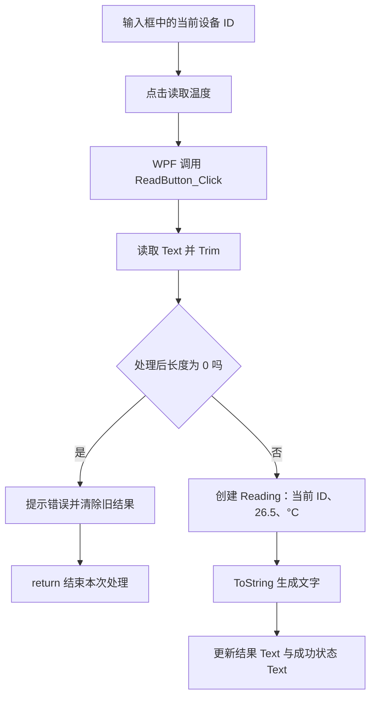

# TASK-009 知识笔记：WPF 窗口、布局与按钮事件

> 整理日期：2026-10-13。任务：用 WPF 窗口与按钮事件显示设备读数。状态：✅ 已通关（2026-10-09）。
>
> 根据任务卡、当前源码、学习进度与已有问答提取。“当前实现”来自学员作品；“说明示例”只用于解释，不表示写入项目或运行过。阅读笔记不新增掌握或验收证据。

## 阅读入口与来源

| 来源 | 用途 |
| :--- | :--- |
| [TASK-009 任务卡](../tasks/TASK-009.md) | 场景、实践要求、DoD、启动及审查历史 |
| [Task009Window.xaml](../../WpfBae/Exercises/TASK-009-window-events/Task009Window.xaml) | 当前窗口、控件、布局及事件关联 |
| [Task009Window.xaml.cs](../../WpfBae/Exercises/TASK-009-window-events/Task009Window.xaml.cs) | 当前 Reading 类型与点击处理逻辑 |
| [WpfBae.csproj](../../WpfBae/WpfBae.csproj) | 项目类型和构建配置 |
| [App.xaml](../../WpfBae/App.xaml) | 当前实际启动窗口 |
| [学习进度](../learning.md) | 已验证应用及待复习边界 |
| [布局问答](../questions/wpf-layout.md) | Window、控件、StackPanel/Grid 与间距基础 |
| [项目问答](../questions/dotnet-projects.md) | 项目、解决方案与创建历史 |
| [属性问答](../questions/csharp-properties.md) | get/init、完整 get/set 与 value |

建议按“项目入口 → XAML/控件 → 布局 → 事件连接 → 点击代码 → 验证边界”阅读。Java 后端背景可帮助理解类、对象和普通方法；C# 属性及桌面布局仍需单独说明。

## 1. 场景：从输入框到温度结果

操作员填写设备 ID，点击“读取温度”，在同一窗口看到该 ID 的一条模拟温度及操作状态。原来控制台中的“输入、执行、输出”，现在落到输入框、按钮事件和显示控件上。



本任务中的“读取”是创建固定样例 `26.5`，没有串口、TCP 或真实传感器访问。温度每次相同是模拟设计；设备 ID 必须来自本次点击时的输入。

界面采用直接方式：C# 事件处理方法读取输入控件、修改显示控件。Binding、Command、ViewModel 属于后续任务，理解本任务无需先引入那些机制。

## 2. 项目、解决方案与运行入口

### 2.1 文件分工

| 文件或目录 | 身份和用途 |
| :--- | :--- |
| `WpfBae/WpfBae.csproj` | 项目文件，定义目标框架、输出类型、WPF 支持 |
| `WpfBae/WpfBae.sln` | 解决方案文件，供 IDE 组织项目 |
| `WpfBae/App.xaml` | 应用配置，通过 StartupUri 指定启动窗口 |
| `WpfBae/App.xaml.cs` | 应用类的配套 C# 文件 |
| `WpfBae/Exercises/TASK-009-window-events/` | TASK-009 专属源码目录 |
| `WpfBae/MainWindow.xaml` | 最初的窗口模板；文件存在不代表运行时打开它 |

项目和解决方案不是同一层级。项目有自己的构建配置；一个解决方案可以组织多个项目。`dotnet run --project` 可直接指定项目，不要求先打开解决方案。

历史创建建议使用过名字 WpfPractice，但实际学员创建并复用的是 **WpfBae**。路径和命令以实际项目为准。

### 2.2 当前 .csproj

```xml
<Project Sdk="Microsoft.NET.Sdk">
    <PropertyGroup>
        <OutputType>WinExe</OutputType>
        <TargetFramework>net10.0-windows</TargetFramework>
        <Nullable>enable</Nullable>
        <ImplicitUsings>enable</ImplicitUsings>
        <UseWPF>true</UseWPF>
    </PropertyGroup>
</Project>
```

- `Sdk`：使用 .NET SDK 的构建规则。
- `OutputType=WinExe`：输出 Windows 窗口程序，通常不会自动打开控制台窗口。
- `TargetFramework=net10.0-windows`：使用 .NET 10，并面向 Windows。
- `UseWPF=true`：启用 WPF 构建支持，包括处理 WPF XAML。
- `Nullable=enable`：启用可空引用类型分析，帮助提示潜在空引用；它不替代设备 ID 的业务校验。
- `ImplicitUsings=enable`：SDK 自动引入一些常用命名空间，不表示所有类型都无需 using。

当前 SDK 风格项目默认包含项目中的 `.cs` 与相应 WPF XAML，所以新增任务子目录通常不用逐个登记。若项目显式排除文件，要按实际配置判断。[WPF 窗口与默认编译包含](https://learn.microsoft.com/en-us/dotnet/desktop/wpf/windows/)

### 2.3 StartupUri 与当前入口

TASK-009 开始时使用过：

```xml
StartupUri="Exercises/TASK-009-window-events/Task009Window.xaml"
```

`StartupUri` 是 WPF 的 Application 属性，此处指定应用中的窗口 XAML，启动时创建并显示该窗口。[StartupUri 官方说明](https://learn.microsoft.com/en-us/dotnet/api/system.windows.application.startupuri)

**2026-10-13 当前实际值是：**

```xml
StartupUri="Exercises/TASK-017-button-controltemplate/Task017Window.xaml"
```

因此在 `D:\host-computer-st` 执行：

```powershell
dotnet run --project .\WpfBae\WpfBae.csproj
```

会按当前配置打开 TASK-017。任务卡中“当前会启动 Task009Window”描述的是当时入口，不能原样当成今天的运行行为。

编辑 MainWindow 或 Task009Window 不会自动切换入口。本次整理没有修改 App.xaml。

## 3. 名称来源：语法、框架与自定义代码

| 名称 | 来源 | 当前作用 |
| :--- | :--- | :--- |
| class、partial、new、init、override、return | C# 语法或关键字 | 声明/组合类、创建对象、限制赋值、重写方法、结束方法 |
| string、double | C# 对 .NET 类型的关键字写法 | 保存文字和浮点数 |
| Window、TextBox、TextBlock、Button | WPF 类型 | 窗口、输入、文字显示和按钮 |
| StackPanel、Grid | WPF 布局容器 | 安排子元素位置和大小 |
| RoutedEventArgs、RoutedEventHandler | WPF 事件参数类、委托类型 | Click 处理器的参数与方法约定 |
| Text、Content、Margin、Padding、Click | 相应 WPF 类型提供的成员 | 文字、内容、间距与点击事件 |
| Task009Window | 骨架创建的类名 | 当前任务的具体窗口 |
| DeviceIdTextBox、ResultTextBlock、StatusTextBlock | 骨架在 XAML 中自行取的名称 | 标识三个具体控件对象 |
| ReadButton_Click | 骨架提供的方法名，学员实现方法体 | 处理按钮点击 |
| Reading | 学员新增的数据类 | 保存一条读数 |
| DeviceId、Value、Unit | 学员定义的 Reading 属性名 | 设备 ID、数值、单位 |
| idStr、reading | 方法内局部变量名 | 本次清理后的输入、本次读数对象引用 |
| InitializeComponent | WPF 构建工具生成的方法 | 加载窗口内容、连接控件和事件 |

`DeviceIdTextBox` 不是 WPF API，而是这个窗口里一个 TextBox 的名字。`Reading` 也不是设备通信库类型，它在当前 `.xaml.cs` 中有明确的类定义。

## 4. XAML 基础：标签描述对象，嵌套描述结构

### 4.1 标签和属性

最小说明示例：

```xml
<Button Content="读取温度" />
```

`Button` 指定对象类型；`Content` 是属性名；“读取温度”是属性值；`/>` 表示元素在此结束。

它的对象创建与设置内容可以用下面的 C# 说明示例理解，但这不是编译器逐字生成的代码：

```csharp
System.Windows.Controls.Button button = new System.Windows.Controls.Button();
button.Content = "读取温度";
```

`button` 是说明示例取的变量名，当前任务源码没有这个变量。

有子元素时用开始和结束标签：

```xml
<StackPanel>
    <TextBlock Text="设备温度监控" />
    <TextBox Text="TEMP-001" />
</StackPanel>
```

这表示一个 StackPanel 包含两个子元素。缩进帮助阅读，真正决定父子关系的是标签嵌套。

### 4.2 xmlns 与 xmlns:x

当前窗口声明：

```xml
xmlns="http://schemas.microsoft.com/winfx/2006/xaml/presentation"
xmlns:x="http://schemas.microsoft.com/winfx/2006/xaml"
```

默认 XML 命名空间使没有前缀的 Window、Button 等名称按 WPF 映射解释。第二项把 x 前缀关联到 XAML 语言命名空间，于是可以写 `x:Class`、`x:Name`。

这些 URL 是命名空间标识，不表示运行时联网下载控件；它们与 C# 的 namespace 也不是同一种声明。

### 4.3 当前窗口的对象树

```text
Task009Window（Window）
└─ StackPanel，Margin=20
   ├─ TextBlock：设备温度监控
   ├─ TextBox：DeviceIdTextBox，初值 TEMP-001
   ├─ Button：读取温度，Click → ReadButton_Click
   ├─ TextBlock：读取结果
   ├─ TextBlock：ResultTextBlock，初值 尚未读取
   └─ TextBlock：StatusTextBlock，初值 请完成 TODO 后尝试读取。
```

Window 的直接内容是一个 StackPanel，多项控件放在面板内。Window 的内容位置不能直接并列塞多个控件；通过容器把它们组合成一个内容对象。

## 5. XAML 与 C# 怎样组成同一个窗口

### 5.1 x:Class、namespace 与 partial

当前 XAML：

```xml
<Window x:Class="WpfBae.Exercises.Task009.Task009Window"
        ...>
```

当前配套 C# 的窗口部分：

```csharp
using System.Windows;

namespace WpfBae.Exercises.Task009;

public partial class Task009Window : Window
{
    public Task009Window()
    {
        InitializeComponent();
    }
}
```

`namespace ...;` 是文件作用域命名空间写法，此文件的类处于该命名空间。加上 Task009Window，得到与 x:Class 相同的完整类名。

`using System.Windows;` 让 Window、RoutedEventArgs 等类型可用短名，不会创建窗口或下载依赖。`: Window` 表示继承 WPF 的 Window，可类比 Java 的 extends。

`partial` 是 C# 允许把同一个类的定义分布在多个源码部分的语法。这里一部分是手写 `.xaml.cs`，另一部分是 WPF 根据 XAML 生成的 C#，编译后组成同一个窗口类。

文件名配对便于组织；实际连接还要求类名、命名空间、事件方法签名及构建配置正确。[XAML 与后台代码要求](https://learn.microsoft.com/en-us/dotnet/desktop/wpf/advanced/code-behind-and-xaml-in-wpf)

### 5.2 构造函数与 InitializeComponent

`public Task009Window()` 与类同名、没有返回类型，是构造函数。创建窗口实例时执行它。

InitializeComponent 来自 WPF 生成代码。当前生成方法加载此窗口 XAML 资源，连接过程中把具体控件交给具名字段，并登记 Click 处理方法。

所以通常在 InitializeComponent 之后访问 DeviceIdTextBox 等控件。字段已经在类中声明，不等于加载前已引用具体对象。

当前工作区已有生成文件：

```text
WpfBae/obj/Debug/net10.0-windows/Exercises/
TASK-009-window-events/Task009Window.g.cs
```

它是中间构建产物，清理或重建可能重新生成。需要修改的是任务 XAML 或 `.xaml.cs`，不要在 `.g.cs` 写业务实现。

### 5.3 x:Name 与对象引用

当前输入框：

```xml
<TextBox x:Name="DeviceIdTextBox" Text="TEMP-001" Margin="0,8,0,12" />
```

x:Name 给控件取名；当前窗口编译后生成同名 TextBox 字段，加载时连接到 XAML 创建的那个输入框。

因此 `DeviceIdTextBox.Text` 访问屏幕上的输入框，没有新建另一个输入框，也不是按文件名查找控件。ResultTextBlock、StatusTextBlock 同样是两个不同显示对象的引用。

当前按钮没有 x:Name，因为处理器不需要通过名字访问按钮；Click 关联照样能工作。

## 6. 基础控件与常用属性

### 6.1 Window：窗口标题和尺寸

当前设置：

```xml
Title="TASK-009：设备读数练习"
Height="360" Width="560"
MinHeight="300" MinWidth="360"
```

Title 设置系统标题栏；Width/Height 设置窗口尺寸；MinWidth/MinHeight 设置可以缩小到的下界。

内容中的 `TextBlock Text="设备温度监控"` 与系统标题栏不是同一个对象，修改它不会修改 Window.Title。

WPF 的这些长度通常用设备无关单位，每单位为 1/96 英寸，不必等于一个物理像素。系统缩放影响实际像素大小。Window 整体尺寸还包含边框、标题栏，内部可用内容区域更小。

最小尺寸只是限制缩小范围，不会自动让任意内容都排得下。[WPF 窗口说明](https://learn.microsoft.com/en-us/dotnet/desktop/wpf/windows/)

### 6.2 TextBox：接收输入

TextBox 用于可编辑输入，Text 保存当前文字。XAML 的 `Text="TEMP-001"` 是初值，不会禁止用户改输入。

用户改为 TEMP-002 后，处理器重新读 Text 就会取得新值。本任务直接访问控件，没有输入 Binding。

### 6.3 TextBlock：显示文字与换行

TextBlock 在此显示标题、结果和状态，不作为普通可编辑输入框。当前结果控件：

```xml
<TextBlock x:Name="ResultTextBlock"
           Text="尚未读取" TextWrapping="Wrap" />
```

初始显示“尚未读取”，后续 Text 赋值改变显示。`TextWrapping="Wrap"` 允许文字在可用宽度不足时换行；换行会增加所需高度，父容器空间不足时仍可能显示不全。

普通 ID 的最小窗口尺寸有历史审查记录；超长 ID 可选场景没有运行记录。

### 6.4 Button：内容和点击

当前声明：

```xml
<Button Content="读取温度" Click="ReadButton_Click"
        HorizontalAlignment="Left" Padding="12,6" />
```

Button 用 Content 设置显示内容，TextBox/TextBlock 用 Text。不能因为都能显示文字，就认为它们使用相同属性名。

Click 是事件名称，ReadButton_Click 是处理方法名称；HorizontalAlignment 和 Padding 控制摆放与内部留白。

## 7. StackPanel：沿一个方向依次排列

StackPanel 是布局容器，计算子元素位置与大小。当前未指定 Orientation，默认垂直排列，六个子元素按书写顺序从上到下出现。

`Orientation="Horizontal"` 才会改为从左到右。它不在横向空间不足时自动把下一个控件排到下一行，也不自动提供滚动条。[WPF 布局容器](https://learn.microsoft.com/en-us/dotnet/desktop/wpf/controls/panel)

当前“标题 → 输入 → 按钮 → 结果 → 状态”的窗口适合垂直 StackPanel。它避免逐个指定固定坐标，但不保证长内容总能容纳。

区分两件事：TextBlock.Wrap 是一个控件内部的文字换行；StackPanel 排列是多个子控件之间的位置安排。

## 8. Margin、Padding、对齐与 Grid

### 8.1 Margin：外部留白

面板 `Margin="20"` 表示四边均为 20，使整个内容组与窗口内容边缘保持距离。

输入框 `Margin="0,8,0,12"` 按 **左、上、右、下** 解读：左 0、上 8、右 0、下 12。改最后一项改变输入框下方外部留白，不是输入文字到边框的距离。

结果标题 `Margin="0,16,0,8"` 在上方留 16、下方留 8；状态 `Margin="0,12,0,0"` 在上方留 12。相邻控件都设间距时，要一起看布局效果。

### 8.2 Padding：内部留白

按钮 `Padding="12,6"` 表示左右各 12、上下各 6，是内容到按钮边缘的内部留白，通常让文字更宽松，也可能增加按钮所需大小。

| 写法 | 含义 |
| :--- | :--- |
| `Margin="20"` | 四边均为 20 |
| `Padding="12,6"` | 左右各 12，上下各 6 |
| `Margin="0,8,0,12"` | 左 0、上 8、右 0、下 12 |

可用“边框外侧空隙”和“边框内侧文字周围空隙”区分二者。不是所有布局容器都有 Padding，当前 StackPanel 用的是 Margin。[对齐、Margin 与 Padding](https://learn.microsoft.com/en-us/dotnet/desktop/wpf/advanced/alignment-margins-and-padding-overview)

### 8.3 HorizontalAlignment

当前按钮设为 Left，表示在父容器分配的横向空间中靠左。常用值有 Left、Center、Right、Stretch。

Stretch 请求填充可用空间，但显式 Width 和父容器约束等会影响最终结果。当前按钮靠左，通常按内容及 Padding 取得所需宽度，不铺满整行。

### 8.4 Grid：行列布局的补充

任务允许 StackPanel 或 Grid，当前实现用 **StackPanel**。Grid 曾在入门问答中讲过，没有本任务自主写 Grid 的证据。

Grid 将空间划为行列，可类比表格格子安排位置，但它不是显示业务表格数据的控件。最小说明示例，未写入项目：

```xml
<Grid>
    <Grid.RowDefinitions>
        <RowDefinition Height="Auto" />
        <RowDefinition Height="Auto" />
    </Grid.RowDefinitions>
    <TextBlock Grid.Row="0" Text="设备 ID" />
    <TextBox Grid.Row="1" Text="TEMP-001" />
</Grid>
```

Grid.RowDefinitions 设置行定义集合，不是可见控件；RowDefinition 描述一行。Grid.Row 指定子控件所在行，从 0 编号，这种由 Grid 提供、写在子元素上的布局属性叫附加属性。

列用 Grid.ColumnDefinitions、ColumnDefinition、Grid.Column。尺寸常见形式：

| 写法 | 分配规则 |
| :--- | :--- |
| `Auto` | 根据内容所需大小分配 |
| `40` | 固定设备无关长度 |
| `*` | 在 Auto 和固定部分之后，按权重分享可用剩余空间 |
| `2*` | 星号权重为 2；普通星号权重为 1 |

星号分配受可用空间与约束影响，不应在所有容器中都简单当成“窗口的一半”。本任务先理解行列和 Auto 即可。

没有指定不同格子时，多个 Grid 子元素默认都在第 0 行、第 0 列，可能重叠。Grid 不像 StackPanel 自动让下一个子元素排到下一行。[布局容器说明](https://learn.microsoft.com/en-us/dotnet/desktop/wpf/controls/panel)

## 9. Click 怎样连接到 C# 方法

### 9.1 声明关联与处理方法

XAML 写 `Click="ReadButton_Click"`，配套方法是：

```csharp
private void ReadButton_Click(object sender, RoutedEventArgs e)
```

方法名可以自行取；能连接是因为 XAML 引用了同一窗口类中存在、签名符合要求的方法。名称中的下划线只是习惯，不是自动关联机制。只有方法叫这个名字而没有事件关联，不会自动被按钮调用。

| 签名部分 | 意义 |
| :--- | :--- |
| private | 窗口类内部的处理方法 |
| void | 不向调用者返回业务结果 |
| object sender | 事件发送者；本任务直接挂在按钮上，对应这个按钮 |
| RoutedEventArgs e | WPF 提供的路由事件参数对象 |

sender/e 是普通参数名，可自行命名；参数类型及签名要符合事件约定。当前无需使用它们，因为具名字段已能取得输入、结果和状态对象。

WPF 路由事件可以按规定路线在元素间传递；本任务先理解按钮上的处理器收到通知。Source/OriginalSource、完整路由机制不属于已验证范围。[路由事件说明](https://learn.microsoft.com/en-us/dotnet/desktop/wpf/events/routed-events-overview)

### 9.2 本地生成代码中的实际订阅

当前已有 Task009Window.g.cs 中的连接语句：

```csharp
((System.Windows.Controls.Button)(target)).Click +=
    new System.Windows.RoutedEventHandler(this.ReadButton_Click);
```

按步骤解释：

1. 该连接分支的 target 是 XAML 创建的按钮；类型转换后作为 Button 访问。
2. this 是正在初始化的 Task009Window 实例。
3. this.ReadButton_Click 引用当前窗口的方法，没有调用括号，此时不执行方法体。
4. new RoutedEventHandler 创建符合 Click 参数约定的委托对象，保存处理方法引用。
5. Click += 把处理方法登记为事件接收方。
6. 后续 Click 触发时，WPF 调用已登记的方法。

这来自当前本地生成文件，用来展示框架完成的连接，学员无需再手写一次。既保留 XAML 关联又重复手动订阅，可能让一次点击执行两次逻辑。

可联系 Java 监听器的“先登记，事件发生后回调”理解用途；C# 委托和事件的类型、语法仍要分别学习，使用过 TASK-002 不代表已掌握全部机制。

## 10. 每次读取当前输入，Trim 只返回处理后的文字

当前实现：

```csharp
string idStr = DeviceIdTextBox.Text.Trim();
```

执行顺序是：通过 DeviceIdTextBox 引用取得输入框 → 读取当前 Text → Trim 去掉两端空白 → 将结果存入本次方法的局部变量 idStr。

当前没有给 DeviceIdTextBox.Text 再赋值，所以**结果 ID 被清理，不代表输入框中两端空格也已消失**。Trim 不删除中间空格，也不验证设备 ID 字符规则。

| 输入 | Trim 后 | 当前逻辑 |
| :--- | :--- | :--- |
| TEMP-001 | TEMP-001 | 成功路径 |
| 两侧带空格的 TEMP-003 | TEMP-003 | 成功路径 |
| 空字符串 | 空字符串 | 空白分支 |
| 三个空格 | 空字符串 | 空白分支 |
| TEMP 001 | TEMP 001 | 当前允许；源码推导，非历史实测 |

语句放在处理器中，每次点击都重新执行。若写死 ID，或只在构造窗口时读取一次，改输入后的新值就不能按本次要求使用。

## 11. 空白校验：提示、清旧结果、提前结束

当前分支：

```csharp
if (idStr.Length == 0)
{
    StatusTextBlock.Text = "ID 为空或全是空白，请输入正确的ID";
    ResultTextBlock.Text = "";
    return;
}
```

Length 是字符串长度，Trim 后为 0 表示没有剩余字符。三个动作分别解决三个问题：

- 状态提示解释本次失败原因。
- 清空结果避免上次读数被误认为本次成功结果。
- return 立即结束本次处理，阻止后面创建 Reading 和覆盖为成功提示。

提示本身不终止方法。if 花括号结束后通常仍顺序执行后续语句，所以 return 是让无效路径停止的关键。

return 结束当前方法调用，不关闭窗口，也不取消 Click 关联。有效 ID 再点击，处理器会重新执行并恢复成功。

当前成功路径末尾也有 return，在 void 方法末尾合法但可省略；它与空白分支中阻止后续代码的 return 位置作用不同，不应记成错误。

本任务单结果区约定为空白时清旧结果；后续历史列表任务可能要求保留有效历史，应以各自任务卡为准。

## 12. Reading：自定义读数类与属性基础

### 12.1 当前类定义

学员在 Task009Window.xaml.cs 新增：

```csharp
public class Reading
{
    public string DeviceId { get; init; } = "";
    public double Value { get; init; }
    public string Unit { get; init; } = "";

    public override string ToString()
    {
        return $"{DeviceId} {Unit} {Value}";
    }
}
```

Reading 把 ID、数值、单位组织成一条数据，既不是控件，也不负责真正通信。它与窗口处于同一命名空间，可以在同一个 .cs 文件声明；C# 不要求一个文件只能声明一个类。

### 12.2 从完整 get/set 理解属性

说明示例，用来解释属性读写；它使用 set，不是当前 init 属性的等价替换：

```csharp
private string _deviceId = "";

public string DeviceId
{
    get
    {
        return _deviceId;
    }
    set
    {
        _deviceId = value;
    }
}
```

字段 _deviceId 保存数据；属性 DeviceId 规定读取、赋值时的行为。读取 `对象.DeviceId` 进入 get；赋值进入 set，右侧的新字符串成为 value，然后保存到字段。

逻辑上可对照 Java 常见 Get/Set 方法：GetDeviceId 返回字段，SetDeviceId(newText) 保存新值。C# 属性使用读取与赋值语法表达相应操作。

当前 `get; init;` 是自动实现属性，访问器没有手写方法体，由编译器生成存储及访问代码。get 允许读，init 允许初始化阶段设置。[自动属性说明](https://learn.microsoft.com/en-us/dotnet/csharp/programming-guide/classes-and-structs/auto-implemented-properties)

### 12.3 init、默认值与初始化后限制

说明示例：

```csharp
Reading sample = new Reading
{
    DeviceId = "TEMP-001",
    Value = 26.5,
    Unit = "°C"
};

string deviceId = sample.DeviceId; // 可以读取。
// sample.Value = 30.0;           // 初始化结束后这样赋值会编译报错。
```

sample/deviceId 是示例变量。init 允许在对象初始化器及相应构造阶段设置，初始化结束后不能随意再次赋值。它限制属性赋值，不普遍保证属性所引用对象的内部完全不可变。[init 官方说明](https://learn.microsoft.com/en-us/dotnet/csharp/language-reference/keywords/init)

`= ""` 给字符串属性提供默认空串；double Value 未显式设置时默认 0。默认空串不会自动满足业务要求，校验仍在点击方法中。

## 13. new 与对象初始化器

当前实现展开排版：

```csharp
Reading reading = new Reading
{
    DeviceId = idStr,
    Unit = "°C",
    Value = 26.5
};
```

左侧 Reading 是类型，reading 是局部变量；右侧 new Reading 创建实例，花括号对象初始化器为新实例设置属性。

DeviceId = idStr 的左侧是新对象属性，右侧是前面处理过的输入变量；不是给输入框赋值。Unit、Value 也是这个对象上的属性。

Reading 是类，reading 变量保存对象引用。每次有效点击创建新读数；当前窗口只显示本次格式化文字，没有保存读数历史集合。

## 14. ToString、override 与字符串插值

当前方法：

```csharp
public override string ToString()
{
    return $"{DeviceId} {Unit} {Value}";
}
```

ToString 是 .NET 对象已有的可重写方法；override 提供本类实现，可联系 Java 重写 toString 理解。C# 成员名是大写 ToString。

返回类型 string 表示输出字符串；return 把组合后的文字交给调用者。ToString 本身不改变界面，之后 Text 赋值才改变显示。

`$"..."` 是 C# 字符串插值，花括号表达式求值并加入文字。这个简单例子可用以下说明写法理解拼接效果：

```csharp
return DeviceId + " " + Unit + " " + Value.ToString();
```

这不是所有插值场景的机械替换规则。[字符串插值说明](https://learn.microsoft.com/en-us/dotnet/csharp/language-reference/tokens/interpolated)

当前顺序是 **ID → 单位 → 数值**，历史结果为 `TEMP-001 °C 26.5`。常见顺序 `TEMP-001 26.5 °C` 需调换插值中的 Value/Unit，是可选整理，不追加验收门槛，本次未改源码。

当前未指定固定数值格式或区域文化，历史环境显示 26.5，其他文化设置下小数分隔符可能不同；显示文字不能当作真实设备报文协议。

## 15. 直接更新控件的结果与状态

当前成功路径：

```csharp
ResultTextBlock.Text = reading.ToString();
StatusTextBlock.Text = "读取成功";
```

第一句先取得 ToString 返回的字符串，再写入结果控件；第二句写状态控件。结果回答“本次数据是什么”，状态回答“本次操作是否成功”。

这是直接赋值，WPF 根据新的 Text 更新显示。Console.WriteLine 不会给这些控件设置 Text，调试输出不能代替窗口显示。

若方法后面又给状态赋占位文字，会覆盖之前的成功或失败提示。判断最终现象要看完整执行路径及最后一次赋值。

## 16. 当前处理器完整流程与输出对照

提取当前学员方法，仅展开排版、省略已完成 TODO 注释：

```csharp
private void ReadButton_Click(object sender, RoutedEventArgs e)
{
    string idStr = DeviceIdTextBox.Text.Trim();
    if (idStr.Length == 0)
    {
        StatusTextBlock.Text = "ID 为空或全是空白，请输入正确的ID";
        ResultTextBlock.Text = "";
        return;
    }

    Reading reading = new Reading
    {
        DeviceId = idStr,
        Unit = "°C",
        Value = 26.5
    };
    ResultTextBlock.Text = reading.ToString();
    StatusTextBlock.Text = "读取成功";
    return;
}
```

| 操作 | 结果 Text | 状态 Text |
| :--- | :--- | :--- |
| 按当前 XAML 初次打开，未点击 | 尚未读取 | 请完成 TODO 后尝试读取。 |
| TEMP-001，点击 | TEMP-001 °C 26.5 | 读取成功 |
| 改 TEMP-002，再点击 | TEMP-002 °C 26.5 | 读取成功 |
| 清空输入，点击 | 空字符串 | ID 为空或全是空白，请输入正确的ID |
| 三个空格，点击 | 空字符串 | 同上 |
| 两侧带空格的 TEMP-003，点击 | TEMP-003 °C 26.5 | 读取成功 |

初始状态来自当前 XAML 静态内容，其余测试结果来自 2026-10-09 历史任务卡，本轮未重新运行。

源码仍保留 TODO 注释及初始占位提示，但实际实现已经完成。是否完成应看代码和验证，不能只因注释有 TODO 就判未完成。

## 17. 常见问题与排查线索

以下是机制说明，不表示学员在 TASK-009 犯过这些错误。

| 现象 | 可能原因 | 先检查 |
| :--- | :--- | :--- |
| 改 TASK-009，运行是其他窗口 | 启动配置指向其他任务 | App.xaml 的 StartupUri；当前为 TASK-017 |
| 改内文标题，标题栏没变 | TextBlock.Text 与 Window.Title 不同 | Window 根元素的 Title |
| 改用 Grid 后控件重叠 | 默认在同一格子 | 行列定义及 Grid.Row/Column |
| 调间距效果不符 | 混淆 Padding/Margin，或还有相邻间距 | 内外留白及父容器约束 |
| 点击没有进入处理器 | 事件未关联或运行错窗口 | Click 与实际入口 |
| 处理方法找不到/签名错误 | 类名、方法名或参数不符 | x:Class、namespace、处理方法 |
| 具名输入框不能在代码访问 | x:Name 改动、类连接或生成失败 | 名称与 XAML 编译错误；不要新建第二个输入框绕过 |
| 改 ID 仍显示原 ID | 写死 ID 或只在构造时读取 | 处理器中当前 Text 的读取位置 |
| 空白最后显示成功 | 未提前结束 | 空白分支的 return |
| 提示空白但保留旧读数 | 未清结果 | 空白分支 ResultTextBlock.Text |
| 成功提示被占位文字覆盖 | 后面再次赋值 | 后续状态赋值 |
| 终端有结果，窗口没有 | 只写 Console | 是否给结果控件 Text 赋值 |
| 再给 Value 赋值编译报错 | 使用 init 属性 | 是否在初始化阶段设置 |
| 换行后底部显示不全 | 高度不足 | 实际尺寸与父容器空间 |

## 18. 可选复习动作与运行条件

只观察一个改动，不新建任务、不追加验收要求：

1. 文件：`D:\host-computer-st\WpfBae\Exercises\TASK-009-window-events\Task009Window.xaml`。
2. 位置：TextBox 的 `Margin="0,8,0,12"`。
3. 只将最后一项 12 改成 24。
4. 实际打开 Task009Window 比较，预期输入框与按钮之间的下方空隙增加 12 个布局单位。

**当前运行条件：**App.xaml 指向 TASK-017。以后用户选择重跑 TASK-009 时，先记下当前 StartupUri，临时改为 `Exercises/TASK-009-window-events/Task009Window.xaml`。在工作区根目录执行 `dotnet run --project .\WpfBae\WpfBae.csproj`，观察真实窗口后关闭，恢复入口和对照用 Margin。

关闭旧窗口再运行，避免把旧程序当成新代码效果。这是复习说明，本次未修改源码或执行启动命令。

## 19. 验证证据与掌握边界

### 19.1 编译、预览与实际运行不同

| 检查方式 | 能说明 | 不能单独说明 |
| :--- | :--- | :--- |
| 编辑器提示 | 辅助发现类型、名字和语法问题 | 启动或交互已成功 |
| XAML 设计预览 | 初步观察静态布局 | Click 执行、输入分支正确 |
| dotnet build | 是否构建成功 | 窗口打开、交互全部正确 |
| 实际启动窗口 | 入口及加载生效 | 所有输入分支通过 |
| 实际输入并触发按钮 | 本次操作链及最终文字 | 未运行的场景也正确 |

以后重跑可按 TEMP-001 → TEMP-002 → 空串 → 纯空格 → 两侧带空格 TEMP-003，逐次看结果和状态。尺寸也要在真实窗口观察，不只看设计预览。

### 19.2 历史验收与当前材料缺口

任务卡记录 2026-10-09 三项必需 DoD 全通过：构建退出 0、0 警告/错误；原程序创建窗口并正常关闭；默认 560×360 和最小 360×300 可读；验证程序通过按钮自动化 Invoke 触发原事件链，当前 ID、空白处理和恢复均正确。

这是历史审查结论，不是 2026-10-13 新运行结果。任务卡引用的 `docx/tasks/evidence/TASK-009/results.json`、`default.png`、`minimum.png` 在当前工作区未找到，本次无法重新读取原 JSON/图片，故不提供不存在文件的链接。

当前可核对的是任务卡、源码、学习记录与已有生成代码。按钮自动化结果不能扩展成已验证所有键盘或手工鼠标方式；超长 ID 可选场景没有运行记录。

### 19.3 已验证与待复习分开

| 知识范围 | 证据边界 |
| :--- | :--- |
| Text.Trim、空白判断、提示、清旧结果、提前返回 | 学员自主实现，历史按钮调用验证通过 |
| Reading 构造、ToString、结果/状态 Text 更新 | 学员自主实现，历史实际结果验证通过 |
| 窗口骨架、x:Name、Click 关联及处理器签名 | 骨架提供，不算独立设计过连接 |
| StackPanel/Grid、Margin 等布局 | 问答继续待复习；可读性通过不等于自主布局能力已验证 |
| get/init、完整属性、委托与事件完整机制 | 保留已有待复习范围，使用过不升级全部知识 |
| 真实通信、异步等待、历史集合与 Binding | 本任务未实现或验收 |

## 20. 与 TASK-010 的连接

TASK-009 直接读输入控件、写显示控件。TASK-010 引入 Binding 后，结果与状态由数据对象属性供界面读取，仍可沿用“取得 ID → 校验 → 生成读数 → 更新状态”的业务思路。

先记住本任务的 `ResultTextBlock.Text = ...` 明确写入了显示对象。后续需要解释的是数据对象怎样连接界面、属性改变时界面如何得到通知，按对应任务学习即可。不能把这里的 Reading 自动当成 ViewModel。

## 官方资料对照

这些链接用于核对语言和框架机制；任务实现、反馈与验收以本地记录为来源。

- [WPF 窗口与构建](https://learn.microsoft.com/en-us/dotnet/desktop/wpf/windows/)
- [XAML 与后台代码](https://learn.microsoft.com/en-us/dotnet/desktop/wpf/advanced/code-behind-and-xaml-in-wpf)
- [Application.StartupUri](https://learn.microsoft.com/en-us/dotnet/api/system.windows.application.startupuri)
- [WPF 布局容器](https://learn.microsoft.com/en-us/dotnet/desktop/wpf/controls/panel)
- [对齐、Margin 与 Padding](https://learn.microsoft.com/en-us/dotnet/desktop/wpf/advanced/alignment-margins-and-padding-overview)
- [WPF 路由事件](https://learn.microsoft.com/en-us/dotnet/desktop/wpf/events/routed-events-overview)
- [C# 自动属性](https://learn.microsoft.com/en-us/dotnet/csharp/programming-guide/classes-and-structs/auto-implemented-properties)
- [C# init](https://learn.microsoft.com/en-us/dotnet/csharp/language-reference/keywords/init)
- [C# 字符串插值](https://learn.microsoft.com/en-us/dotnet/csharp/language-reference/tokens/interpolated)
