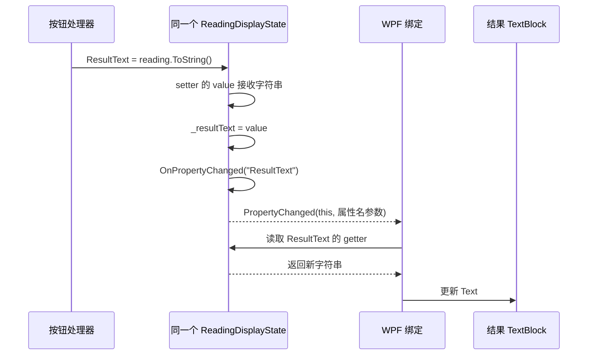

# TASK-010 知识笔记：Binding、DataContext 与属性变化通知

> 整理日期：2026-10-13。任务：用 Binding 更新模拟温度读数。状态：✅ 已通关（2026-10-09）。
>
> 本笔记根据当前三个任务源码文件、任务卡、学习进度和既有问答提取。标为“当前实现”的代码来自当前作品；“说明示例”“展开写法”用于解释，不表示已写入项目或已运行。历史审查与本次静态核对分开记录，阅读笔记不新增掌握或验收证据。

## 来源与阅读顺序

| 来源 | 对应内容 |
| :--- | :--- |
| [TASK-010 任务卡](../tasks/TASK-010.md) | 场景、TODO、DoD、过程反馈与最终审查 |
| [Task010Window.xaml](../../WpfBae/Exercises/TASK-010-reading-binding/Task010Window.xaml) | 结果和状态的两个 OneWay Binding |
| [Task010Window.xaml.cs](../../WpfBae/Exercises/TASK-010-reading-binding/Task010Window.xaml.cs) | 数据对象创建、DataContext、按钮逻辑与 Reading |
| [ReadingDisplayState.cs](../../WpfBae/Exercises/TASK-010-reading-binding/ReadingDisplayState.cs) | 字段、属性、接口、事件和通知方法 |
| [App.xaml](../../WpfBae/App.xaml) | 当前启动入口 |
| [学习进度](../learning.md) | 已验证范围与保留的待复习内容 |
| [绑定问答](../questions/wpf-binding.md) | Binding、对象来源、Rider 提示和参数类 |
| [C# 属性问答](../questions/csharp-properties.md) | 完整 get/set、value 与箭头简写 |
| [C# 事件问答](../questions/csharp-events.md) | 委托、事件、订阅和调用的基础 |
| [集合问答](../questions/wpf-collections.md) | TASK-010 属性通知与 TASK-011 集合通知的区别 |
| [TASK-009 笔记](./TASK-009-wpf-window-events.md) | 已有窗口、布局和按钮事件背景 |

阅读建议：先认清两个自定义类及实例，再理解属性读写，然后学习 DataContext/Binding，最后把通知代码逐步接起来。后端经验有助于理解普通对象和方法，但不能替代 C# 属性及 WPF 的必要说明。

## 1. TASK-010 相比 TASK-009 改了什么

两次都输入设备 ID、点击按钮、显示固定温度。变化发生在“如何把结果送到界面”。

TASK-009：

```csharp
ResultTextBlock.Text = reading.ToString();
StatusTextBlock.Text = "读取成功";
```

TASK-010：

```csharp
_state.ResultText = reading.ToString();
_state.StatusText = "读取成功";
```

第二段修改的是数据对象属性。窗口 XAML 事先把两个 TextBlock.Text 与这些属性连接，数据对象再发布变化通知，WPF 完成显示更新。

| 对比 | TASK-009 | TASK-010 |
| :--- | :--- | :--- |
| 文字保存位置 | 直接写控件 Text | 先保存到 ReadingDisplayState 属性 |
| 按钮如何更新输出 | 访问两个 TextBlock | 修改同一个 _state 的两项属性 |
| 界面取值连接 | 处理器直接赋值 | 两个 XAML Binding |
| 后续更新依据 | 每次直接赋值 | setter 保存并发布 PropertyChanged |
| 输入取得方式 | DeviceIdTextBox.Text | 仍为 DeviceIdTextBox.Text |

目的在于让显示数据不必持有控件引用，并让窗口声明自己显示哪些属性。当前仍采用按钮 Click 和后台代码，不因出现数据类就认定实现了完整 MVVM。

## 2. 文件分工与名字来源

### 2.1 三个任务文件

专属目录：`WpfBae/Exercises/TASK-010-reading-binding/`。

- Task010Window.xaml：窗口、输入框、按钮、两个显示绑定和布局。
- Task010Window.xaml.cs：创建显示状态对象，设置数据来源，处理点击及输入校验。
- ReadingDisplayState.cs：保存结果/状态文字，提供属性读取与赋值，并发布属性变化事件。

复用现有 WPF 项目，没有引入通信库、异步等待或新依赖。Window、StackPanel、Margin 等已有基础见 TASK-009 笔记，此处只解释与绑定有关的连接。

### 2.2 关键名字各是什么

| 名称 | 身份与来源 |
| :--- | :--- |
| Reading | 学员自定义的数据类，保存 DeviceId、Value、Unit |
| ReadingDisplayState | 教练骨架定义的普通 C# 类，保存两段显示文字与通知机制 |
| _state | 窗口类自行命名的字段，保存 ReadingDisplayState 实例引用 |
| ResultText、StatusText | ReadingDisplayState 的公开属性名 |
| _resultText、_statusText | 这个类的私有字段，实际保存字符串 |
| ResultTextBlock、StatusTextBlock | XAML 中取的控件名称，不是数据属性 |
| DataContext | WPF 已有属性，为这里的 Binding 提供默认源对象 |
| Binding、Path、Mode | WPF 绑定类型及其配置 |
| INotifyPropertyChanged | .NET 接口，规定 PropertyChanged 事件 |
| PropertyChangedEventHandler | .NET 提供的委托类型，规定处理方法参数形状 |
| PropertyChangedEventArgs | .NET 参数类，携带属性名 |
| PropertyChanged | 数据类实现接口时声明的事件名称 |
| OnPropertyChanged | 骨架自定义的普通辅助方法名，不是 WPF 自动调用的固定 API |
| new、readonly、sealed、event、nameof | C# 语法或关键字 |

特别注意三组区别：ResultText 是数据属性，ResultTextBlock 是控件引用，Text 是控件的属性；PropertyChangedEventHandler 是类型，PropertyChanged 是事件，OnPropertyChanged 是普通方法。

## 3. Reading 与 ReadingDisplayState 分别保存什么

Reading 表达设备读数：

```text
DeviceId = TEMP-001
Value    = 26.5
Unit     = °C
```

ReadingDisplayState 表达窗口当前需要显示的内容：

```text
ResultText = TEMP-001 26.5 °C 后面还有一个空格
StatusText = 读取成功
```

一次有效点击创建新的 Reading，然后通过 ToString 得到文字，保存到长期供窗口绑定的 _state。它们不是同一个对象：

```text
本次 Reading 对象
  └─ ToString() 生成字符串
       └─ 赋给 _state.ResultText
            └─ WPF 将它显示为 ResultTextBlock.Text
```

ReadingDisplayState 不持有 TextBlock、Window 或输入框，也不负责真实设备通信。它是此练习定义的数据类，名字可以自行选择；当前所有连接使用这个名字，不应把它误认为框架里必须知道的类型。

## 4. 字段、属性、get、set 与 value

### 4.1 先用完整写法理解

当前 ResultText 的 getter 用箭头简写。先看等价展开的属性，未修改源码：

```csharp
private string _resultText = "尚未读取";

public string ResultText
{
    get
    {
        return _resultText;
    }
    set
    {
        _resultText = value;
        OnPropertyChanged("ResultText");
    }
}
```

_resultText 是字段，负责实际存值；ResultText 是属性，规定外部读和写时执行什么代码。

读取：

```csharp
string text = _state.ResultText;
```

会进入 get，取得 _resultText。赋值：

```csharp
_state.ResultText = "读取完成";
```

会进入 set，本次 value 为“读取完成”；`_resultText = value` 保存它，然后调用通知方法。

### 4.2 value 从哪里来

value 是 C# 在 setter 中提供的隐式参数，类型与属性一致，此处是 string。它来自本次赋值的右侧，不需要另外声明。

若右侧是 `reading.ToString()`，先求出这个调用返回的字符串，再把字符串交给 setter 的 value。

setter 的代码决定如何保存。空的 `set { }` 会接收赋值但不保存到字段；声明 setter 不会替手写访问器自动完成存值。

### 4.3 与普通方法的对照

说明示例：

```csharp
public string GetResultText()
{
    return _resultText;
}

public void SetResultText(string newText)
{
    _resultText = newText;
    OnPropertyChanged("ResultText");
}
```

可类比 Java 的 getter/setter 思路，但 C# 属性访问用 `对象.ResultText` 和赋值语法。示例只是理解对照，不要求把任务属性换成方法，当前 Binding 按公开属性路径取值。

## 5. getter 的箭头简写与属性的读写权限

当前源码：

```csharp
get => _resultText;
```

在这里等价于：

```csharp
get
{
    return _resultText;
}
```

箭头用于简写访问器，不是在传 Lambda 给 Binding，也不是给字段赋值。StatusText 的 getter 同理。

两项属性声明为 public，WPF 可以按属性名读取；字段声明为 private，属于对象内部存储。当前绑定应写 ResultText，不写 _resultText。

与 Reading 的 `get; init;` 区分：读数属性在初始化后不随意重新赋值；显示状态 ResultText/StatusText 使用带方法体的 set，可以多次更新并附带通知。自动属性、手写属性和 init 的一般规则仍按既有属性问答复习。[C# 属性说明](https://learn.microsoft.com/en-us/dotnet/csharp/programming-guide/classes-and-structs/properties)

## 6. new()、readonly 与 sealed

窗口当前字段：

```csharp
private readonly ReadingDisplayState _state = new();
```

先看完整类型写法：

```csharp
private readonly ReadingDisplayState _state = new ReadingDisplayState();
```

new 创建 ReadingDisplayState 实例，_state 保存实例引用。`new()` 是省略可由声明推断出的类型名称的 C# 写法，不会让实例类型变成“任意对象”。

private 表示字段供窗口类内部访问。readonly 表示这个字段只能在规定的初始化位置（字段初始化器、所属类构造函数等）赋值；普通方法中不能把它改为指向另一个对象。它**不禁止修改所引用对象的属性**。

```csharp
_state.ResultText = "新结果"; // 当前允许：修改对象属性。
// _state = new ReadingDisplayState(); // 普通点击方法中不允许重赋 readonly 字段。
```

readonly 不是深度不可变、不是线程安全保证。当前类还使用 `sealed`：

```csharp
public sealed class ReadingDisplayState : INotifyPropertyChanged
```

sealed 表示此类不能被其他类继承，不妨碍创建实例、修改可写属性或实现接口。[readonly 官方说明](https://learn.microsoft.com/en-us/dotnet/csharp/language-reference/keywords/readonly)、[sealed 官方说明](https://learn.microsoft.com/en-us/dotnet/csharp/language-reference/keywords/sealed)

## 7. DataContext = _state：设置默认来源对象

当前构造函数：

```csharp
public Task010Window()
{
    InitializeComponent();
    DataContext = _state;
}
```

InitializeComponent 加载 XAML 并连接控件/Click；随后为窗口设置数据上下文。此处 DataContext 来自 WPF，等价写法是：

```csharp
this.DataContext = _state;
```

this 是当前 Task010Window 对象。右侧是前面创建的 ReadingDisplayState 实例引用。这句话没有复制对象、没有新建第二个对象，也没有把类名字符串交给窗口。

```text
窗口中的 _state 字段 ───────┐
                         ├─ 都引用同一个 ReadingDisplayState 对象
窗口的 DataContext ───────┘
```

DataContext 给默认绑定指定来源，不会把对象全部属性自动画到界面。控件若仍是静态 `Text="某段文字"`，单独设置 DataContext 不会把它改成动态数据。

DataContext 接受普通对象，不要求所有对象实现 INotifyPropertyChanged。接口在本任务解决的是对象属性**后续变化通知**，与“是否能作为数据来源”是两件事。[WPF 绑定与数据上下文](https://learn.microsoft.com/en-us/dotnet/desktop/wpf/data/)

## 8. 子控件怎样取得同一个 DataContext

当前结构：

```text
Task010Window：DataContext = _state
└─ StackPanel：未另设 DataContext
   ├─ 输入 TextBox：未绑定 Text
   ├─ 读取 Button：Click 仍连到方法
   ├─ ResultTextBlock：绑定 ResultText
   └─ StatusTextBlock：绑定 StatusText
```

DataContext 在当前元素树中可以继承。子控件没有另设自己的 DataContext，所以两个输出控件取得窗口提供的 _state。

结果取值路径：

```text
ResultTextBlock 的默认数据来源
→ 继承得到窗口的 DataContext
→ 得到 ReadingDisplayState 实例
→ 读取这个实例的 ResultText
→ 用作 TextBlock.Text
```

两个控件读取同一对象的不同属性，不是各创建一个状态对象。如果子控件或容器另设 DataContext，会改变其默认来源。Binding 也可以显式设置 Source 等来源方式，但当前源码没有使用，暂不展开其他绑定形式。

DataContext 改变时，受影响的默认绑定会重新解析；本任务正常操作并不反复重设它，保持同一实例即可。[Binding 声明与源对象](https://learn.microsoft.com/en-us/dotnet/desktop/wpf/data/binding-declarations-overview)

## 9. 逐项阅读 Binding 表达式

当前两个输出控件：

```xml
<TextBlock x:Name="ResultTextBlock"
           Text="{Binding ResultText, Mode=OneWay}"
           TextWrapping="Wrap" />
<TextBlock x:Name="StatusTextBlock"
           Text="{Binding StatusText, Mode=OneWay}"
           Margin="0,12,0,0" TextWrapping="Wrap" />
```

按结果控件拆开：

| 部分 | 意义 |
| :--- | :--- |
| Text | 接收显示值的目标控件属性 |
| `{...}` | XAML 标记扩展表达式，当前用于建立 Binding |
| Binding | 指定绑定配置，不是显示的普通单词 |
| ResultText | 默认源对象上的属性路径 |
| Mode=OneWay | 数据到控件的单向传递方向 |
| x:Name=ResultTextBlock | 当前控件名字，与源属性路径不同 |

隐式路径写法与显式路径写法在此等价：

```xml
Text="{Binding ResultText, Mode=OneWay}"
Text="{Binding Path=ResultText, Mode=OneWay}"
```

Path 不是文件路径，而是在源对象上查找值的路径。当前仅使用一个公开属性名，没有嵌套对象路径。

对比 `Text="ResultText"`：这是静态文字，直接显示单词 ResultText。Binding 表达式才会按名称取得属性当前值。[Binding 标记扩展与隐式 Path](https://learn.microsoft.com/en-us/dotnet/desktop/wpf/advanced/binding-markup-extension)

## 10. 一条绑定的四个组成部分

| 组成部分 | 结果绑定 | 状态绑定 |
| :--- | :--- | :--- |
| 目标对象 | ResultTextBlock | StatusTextBlock |
| 目标属性 | Text | Text |
| 源对象 | DataContext 提供的 _state | 同一个 _state |
| 源路径 | ResultText | StatusText |

名称大小写要与公开属性匹配。Binding 不要求控件名与属性名相同，所以 ResultTextBlock 对应 ResultText 是合理的。

WPF 绑定目标需要支持其属性系统，TextBlock.Text 是现成的可绑定目标属性。源对象在这里是普通 C# 对象，不需要继承 Window 或包含控件。此处无需自己定义 WPF 属性。[WPF 绑定的基本组成](https://learn.microsoft.com/en-us/dotnet/desktop/wpf/data/)

本任务曾把状态也绑定到 ResultText，导致两处都显示“尚未读取”。这时绑定未必取值失败，而是成功读取了错误的业务属性。当前已经修正为 StatusText，错误属于修复前历史。

## 11. OneWay 是单向，不是只更新一次

当前方向：

```text
_state.ResultText → ResultTextBlock.Text
_state.StatusText → StatusTextBlock.Text
```

OneWay 控制“从哪里流向哪里”，不是“最多更新几次”。来源具备适当通知时，可以持续更新显示。

| 模式 | 用途对照 |
| :--- | :--- |
| OneWay | 数据到控件，适合当前只读结果和状态显示 |
| TwoWay | 数据与控件可双向传递，常用于可编辑输入；本任务没使用 |
| OneTime | 适合初始快照，不按普通属性变化通知持续跟踪；本任务没使用 |

当前 TextBox.Text 是静态初值加直接读取，**没有**输入 TwoWay Binding。不是因为窗口设了 DataContext，所有输入控件就自动回写数据对象。

后续输入绑定的 UpdateSourceTrigger 控制的是“目标变化何时写回源对象”，与此处 PropertyChanged 通知源属性变化不同，不需要为了更新这两个 OneWay 输出增加它。[绑定方向说明](https://learn.microsoft.com/en-us/dotnet/desktop/wpf/data/)

## 12. 初始取值与后续通知是两步

当前数据字段初值：

```csharp
private string _resultText = "尚未读取";
private string _statusText = "请输入设备 ID，然后读取温度。";
```

绑定取得源对象后可通过 getter 读到初始值，即使还没点击按钮，界面也应出现这两段文字。

初次显示不意味着 setter 通知已生效。若当前普通 C# 属性保存了新值却没有通知，绑定不应被想象成一直循环轮询字段；界面可能仍停在以前读取的文字。

本任务需要两类证据：初始文字证明对象来源与路径有效；多次点击、改 ID、空白/恢复及独立属性修改证明后续更新链路。

对普通 .NET 源属性而言，INotifyPropertyChanged 是常用通知方式，WPF 也支持其他来源通知机制，不应把本任务方式泛化为所有绑定都只有这一种实现。[属性变化通知实践](https://learn.microsoft.com/en-us/dotnet/desktop/wpf/data/how-to-implement-property-change-notification)

## 13. INotifyPropertyChanged 规定什么

当前声明：

```csharp
public sealed class ReadingDisplayState : INotifyPropertyChanged
```

这里冒号后是接口，表示实现接口，可联系 Java implements 理解。接口来自 .NET 的 System.ComponentModel 命名空间，规定 PropertyChanged 事件。

这不是继承一个会自动监视所有字段的数据类。单写接口名不能替你完成字段赋值或发布通知；当前仍要声明事件，并在 setter 保存后调用工具方法发出事件。

```text
实现接口       → 对监听方提供约定的事件入口
声明事件       → 允许登记接收变化的处理方法
setter 中通知  → 本次赋值时真正报告属性变化
```

文件开头 `using System.ComponentModel;` 允许这些 .NET 类型使用短名称，可联系 Java import；不要求自行定义接口或安装额外通知库。[INotifyPropertyChanged 定义](https://learn.microsoft.com/en-us/dotnet/api/system.componentmodel.inotifypropertychanged)

## 14. 委托类型、事件、辅助方法分别是什么

当前事件声明：

```csharp
public event PropertyChangedEventHandler? PropertyChanged;
```

逐项解释：

- public：外部可按事件规则订阅。
- event：C# 事件声明关键字，限制外部通常使用 +=/-= 登记与取消。
- PropertyChangedEventHandler：.NET 已定义的委托类型，不是事件名。
- `?`：可空引用类型标注，允许当前没有订阅者、事件对应的委托引用为空。
- PropertyChanged：此类提供的事件名称，接口要求这个事件。

委托保存符合参数/返回值要求的处理方法引用，后续可通过委托调用这些方法。这里的类型约定可写成以下说明，**不需在项目重新声明**：

```csharp
public delegate void PropertyChangedEventHandler(
    object? sender,
    PropertyChangedEventArgs e);
```

sender 报告通知来源，e 携带属性变化信息。WPF 绑定在需要跟踪源变化时建立监听关系；当前窗口无需手动登记一个“更新 TextBlock”的方法。

OnPropertyChanged 则是骨架自行写的普通方法，内部负责发布事件。调用它不是通过名字让 WPF 自动找到属性；后面的参数对象和事件调用才完成报告。[PropertyChangedEventHandler 定义](https://learn.microsoft.com/en-us/dotnet/api/system.componentmodel.propertychangedeventhandler)

委托/事件完整基础仍见 C# 事件问答，本任务已验证的是使用提供的通知工具，不据此认定独立设计通知机制的能力。

## 15. PropertyChangedEventArgs 携带属性名，不携带新文字

当前工具方法：

```csharp
private void OnPropertyChanged(string propertyName)
{
    PropertyChanged?.Invoke(this, new PropertyChangedEventArgs(propertyName));
}
```

先拆开参数对象的说明示例：

```csharp
PropertyChangedEventArgs args = new PropertyChangedEventArgs("ResultText");
string name = args.PropertyName; // 值为 "ResultText"。
```

PropertyChangedEventArgs 是 .NET 类，new 创建实例；构造参数是属性名称。args/name 是解释用局部变量名。

当前 setter 调用 `OnPropertyChanged("ResultText")`，这个字符串成为方法参数 propertyName，再成为 args.PropertyName。

事件参数不是 `TEMP-001 26.5 °C `，也不是 Reading 对象。它告诉监听方“ResultText 需要重新取值”；WPF 再调用对应 getter 取得最新文字。

StatusText 同理，携带名称为 StatusText。不要用字段名 _resultText、控件名 ResultTextBlock 或“读取成功”作为当前属性名参数。[PropertyChangedEventArgs 官方说明](https://learn.microsoft.com/en-us/dotnet/api/system.componentmodel.propertychangedeventargs)

## 16. nameof 与当前字符串名称写法

骨架 TODO 推荐 nameof，但学员当前实现为：

```csharp
OnPropertyChanged("ResultText");
OnPropertyChanged("StatusText");
```

这两项名称正确，合法且已通过历史审查，不必为了通关强制改写。

对应 nameof 说明写法：

```csharp
OnPropertyChanged(nameof(ResultText));
```

nameof(ResultText) 得到编译期名称字符串“ResultText”，不会执行 getter、不会读取当前结果，也不会发布事件。

手写字符串依赖拼写正确；nameof 对有效标识符有编译期检查，配合重命名工具有助于降低名称遗漏风险。它也不会验证该通知是否放在正确的 setter、是否通知了业务上需要更新的属性。[nameof 官方说明](https://learn.microsoft.com/en-us/dotnet/csharp/language-reference/operators/nameof)

## 17. ?.Invoke 与 this：先展开普通写法

当前语句包含两个不同位置的问号：事件类型上的 `?` 是可空标注；调用中的 `?.` 是空值条件访问。

理解当前发布动作，可在 ReadingDisplayState 内用以下说明展开：

```csharp
private void OnPropertyChanged(string propertyName)
{
    PropertyChangedEventHandler? handler = PropertyChanged;
    if (handler != null)
    {
        PropertyChangedEventArgs args = new PropertyChangedEventArgs(propertyName);
        handler.Invoke(this, args);
    }
}
```

handler 是局部委托变量，取得当前登记的处理方法引用；不是一个另外声明的普通方法。Invoke 是委托调用方法，不是骨架新建的辅助方法，`handler(this, args)` 也是委托调用写法。

在 ReadingDisplayState 的方法里，this 指向**发出通知的显示状态对象**，不是 Window，也不是临时 Reading。它作为 sender 参数报告变化来源。

没有订阅者时 handler 可为 null，完整 if 跳过调用。原 `PropertyChanged?.Invoke(...)` 对应有订阅者才调用的简写；它不会把 null 自动变成处理器，也不会吞掉处理器内部抛出的异常。[空值条件访问说明](https://learn.microsoft.com/en-us/dotnet/csharp/language-reference/operators/member-access-operators)

new PropertyChangedEventArgs 的用途是构造参数，并非触发事件；Invoke 才是调用已登记处理方法的步骤。

## 18. 必须先保存，再通知

当前 ResultText setter：

```csharp
set
{
    _resultText = value;
    OnPropertyChanged("ResultText");
}
```

先保存，通知后监听方再读 getter 才能取得新值。若先通知后保存，监听方处理通知时可能读到旧值。

完整链路：



这是职责顺序说明，不是对 WPF 内部方法名、线程调度或屏幕逐帧绘制时机的精确描述。数据保存和更新请求完成后，实际绘制由 WPF 处理，不能要求每行赋值都立刻形成一帧可见画面。

状态更新同样走自己的 setter 和通知，不因为结果已通知，就认为状态自动得到通知。

## 19. 两项通知与重复赋值的边界

当前 StatusText 属性：

```csharp
public string StatusText
{
    get => _statusText;
    set
    {
        _statusText = value;
        OnPropertyChanged("StatusText");
    }
}
```

ResultText、StatusText 两个 setter 都没有“新旧值相同就跳过”的比较。所以每次调用 setter 都调用通知工具，即使两次状态都赋“读取成功”。

历史审查记录每次测试都收到 ResultText 与 StatusText 各一次通知，与当前实现一致。收到通知不保证值一定与上次不同；发布者是在请求监听方重新读取。

如果直接在类内部修改 _resultText，绕过 ResultText setter，又没另外通知，会遗漏当前更新链路。当前按钮应通过公开属性更新。

进一步减少重复通知可以先比较新旧值，但那是可选设计，本次没有改代码、追加要求或运行该优化。

## 20. 当前按钮处理器：输入、分支与恢复

以下取自当前作品，省略旧 TODO 注释并展开排版：

```csharp
private void ReadButton_Click(object sender, RoutedEventArgs e)
{
    string id = DeviceIdTextBox.Text.Trim();
    if (string.IsNullOrEmpty(id))
    {
        _state.StatusText = "Id 为空或者异常";
        _state.ResultText = "";
        return;
    }

    Reading reading = new Reading
    {
        DeviceId = id,
        Value = 26.5,
        Unit = "°C"
    };
    _state.ResultText = reading.ToString();
    _state.StatusText = "读取成功";
}
```

### 20.1 输入仍来自控件

每次点击读取当前 Text，再 Trim 清理两端空白。Trim 返回字符串，这里不赋回输入框，所以结果中的 ID 被清理不表示输入框也自动移除了空格。

string.IsNullOrEmpty 是 .NET 提供的静态方法，判断参数为 null 或空字符串。纯空格本身不是空串，但这里先 Trim，所以会得到空串并进入分支。

它不会捕获任意异常或验证 ID 格式。当前提示“Id 为空或者异常”来自学员选择的文字，不表示代码检测了设备故障、通信异常或所有输入规则。

### 20.2 空白与成功路径都修改数据属性

空白时先修改 StatusText，再清 ResultText，最后 return，阻止继续创建成功读数。两项 setter 分别通知 WPF；return 只结束本次调用，不关闭窗口。

成功时创建本次 Reading，再更新结果和成功状态。温度固定 26.5，没有真实通信，也没有异步操作；多次 ID 不同而数值相同符合当前场景。

## 21. Reading、ToString 与对象身份

当前 Reading：

```csharp
public class Reading
{
    public string DeviceId { get; init; } = "";
    public double Value { get; init; }
    public string Unit { get; init; } = "";

    public override string ToString()
    {
        return $"{DeviceId} {Value} {Unit} ";
    }
}
```

init 属性在创建对象时赋值，ToString 通过插值生成文字。末尾有一个真实空格，历史审查结果保留了它；可选整理去掉，不影响必需验收。

TASK-009 与 TASK-010 都有名为 Reading 的类，但分别处在 Task009 和 Task010 命名空间，是不同完整名称的类型，不能仅凭短名相同认定共享同一个类。

### 21.1 按钮必须修改绑定使用的同一实例

当前 DataContext 和按钮都使用 _state。错误用法的说明示例，未写入项目：

```csharp
ReadingDisplayState otherState = new ReadingDisplayState();
otherState.ResultText = "新结果";
```

这改了第二个实例，窗口仍绑定原 _state，因此不会因为同类对象的其他实例发生通知就更新。两个同类型对象不等于同一个对象。

也不应以每次点击都新建并重设 DataContext 来替代本任务的通知学习。当前方案保持状态对象，更新其属性即可。

## 22. 为什么不要直接给已绑定 Text 再赋值

错误混用的说明示例：

```csharp
ResultTextBlock.Text = "绕过数据对象的显示";
```

当前 Text 通过 XAML 绑定取得值；给同一属性普通赋新值会替换原先作为本地值设置的绑定来源，后续 _state 的通知可能不再驱动此控件。

问题不只是“这次文字显示了什么”，还包括原绑定是否仍存在。必需验收要求按钮修改数据属性，无直接修改两项显示 Text 的替代路径；历史审查也检查绑定一直保留。

WPF 有保留既有绑定来源的其他赋值方式，但不是本任务需要的路线。这里直接修改 _state 即可，不要求学习整套属性优先级规则。[本地值与绑定替换规则](https://learn.microsoft.com/en-us/dotnet/desktop/wpf/properties/dependency-property-value-precedence)

## 23. Rider 提示、预览与绑定路径错误

### 23.1 灰色 Path= 和 (???) 是编辑器提示

历史截图出现灰色 Path= 与 (???)，实际磁盘 XAML 没有这些字符。Rider 可以显示 XAML 内嵌提示，提示不是自动写入的源码，也不是 Binding 必须填写的参数。

对当时 (???) 的含义，问答根据提示位置与源码解释为编辑器尚不能确定数据来源类型，这是针对当时提示的判断，不能当作 WPF 运行错误证据。[Rider XAML 内嵌提示说明](https://www.jetbrains.com/help/rider/Settings_Inlay_Hints_XAML.html)

### 23.2 设计预览不等于实际窗口

本任务运行时在 C# 构造函数设置 DataContext，历史预览没显示这些数据，不代表实际程序不能取值。也不能泛化为所有设计器绝不执行后台代码。

先检查磁盘源码，再实际运行窗口观察初始值及点击变化。编译成功只能说明构建通过，不证明运行时路径与通知正确。

### 23.3 当前已修复的状态路径

早期 StatusTextBlock 也绑定了 ResultText，实际两处都显示“尚未读取”。正确修复是状态路径改为 StatusText；当前已自主修复并审查通过，不重复记录为未解决问题。

如果把属性名拼成不存在的名称，Binding 表达式的字符串路径可能仍可编译，但运行时找不到目标属性，应查看绑定诊断和实际源对象。编译检查不能代替路径有效性检查。

## 24. 历史显示结果与排查表

### 24.1 操作对照

下表以 `␠` 明示结果末尾的一个空格，实际窗口并不显示这个标记。初始值来自源码；按钮场景来自 2026-10-09 任务卡记录，本轮没有重新运行。

| 操作 | ResultText 与结果显示 | StatusText 与状态显示 |
| :--- | :--- | :--- |
| 初次绑定，尚未点击 | 尚未读取 | 请输入设备 ID，然后读取温度。 |
| TEMP-001，点击 | TEMP-001 26.5 °C␠ | 读取成功 |
| 改 TEMP-002，再点击 | TEMP-002 26.5 °C␠ | 读取成功 |
| 空字符串，点击 | 空字符串 | Id 为空或者异常 |
| 三个空格，点击 | 空字符串 | Id 为空或者异常 |
| 两侧带空格的 TEMP-003，点击 | TEMP-003 26.5 °C␠ | 读取成功 |

### 24.2 现象 → 原因 → 检查位置

以下为排查线索，不把可能问题自动记为学员错题。

| 现象 | 可能原因 | 检查位置 |
| :--- | :--- | :--- |
| 运行打开 TASK-017 | 当前入口确实是 TASK-017 | App.xaml 的 StartupUri |
| 初始值也不出现 | 来源为空/不是预期对象、路径错误或仍是静态文字 | DataContext 与两个 Binding.Path |
| 两处都显示结果文字 | 状态也绑定 ResultText | StatusTextBlock 的 Path |
| 初值有，点击后不变 | 没通知、通知名错、改了其他实例或绑定被替换 | setter、OnPropertyChanged 参数、对象引用与绑定 |
| 结果变，状态不变 | StatusText 路径/通知/赋值遗漏 | 状态属性和状态绑定 |
| 发通知但读到旧值 | 通知在存值之前 | setter 内执行顺序 |
| 空白最后变成成功 | 没有提前 return | 按钮空白分支 |
| 空白提示有，但旧结果不消失 | 未清 ResultText 或其通知失败 | 空白分支与 ResultText setter |
| readonly 字段仍能改属性 | readonly 限制字段引用重赋 | 区分字段与对象内部属性 |
| OnPropertyChanged 有方法却没效果 | 定义方法不等于调用/发事件 | setter 是否调用，方法内部是否发布 |
| 预览空白但程序正常 | 设计时与运行时数据来源不同 | 实际窗口行为，不只看预览 |
| 字符串名称写法能通过 | 正确字符串就是合法属性名 | 不把 nameof 当作验收硬要求 |

## 25. 一个可观察的复习动作与运行条件

这是可选复习说明，不新建任务或追加验收要求。

1. 文件：`D:\host-computer-st\WpfBae\Exercises\TASK-010-reading-binding\ReadingDisplayState.cs`。
2. 位置：字段 `_resultText = "尚未读取"`。
3. 只将初始文字改为“等待读取温度”。
4. 实际打开 Task010Window，预期结果初值变为新文字，状态仍是“请输入设备 ID，然后读取温度。”。

这项只验证初始取值，不证明后续通知；之后按 TEMP-001 → TEMP-002 → 空串 → 纯空格 → 两侧带空格 TEMP-003 观察，才覆盖持续更新与恢复。

**当前入口条件：**2026-10-13 App.xaml 的 StartupUri 为 `Exercises/TASK-017-button-controltemplate/Task017Window.xaml`。以后用户选择重跑 TASK-010 时，先记录当前入口，临时换为 `Exercises/TASK-010-reading-binding/Task010Window.xaml`，在工作区根目录执行：

```powershell
dotnet run --project .\WpfBae\WpfBae.csproj
```

关闭旧窗口再重新运行。观察完成后恢复对照文字与入口，避免影响后续任务。本次只是写复习说明，没有执行这些源码修改或启动命令。

## 26. 实际证据、掌握范围与后续连接

### 26.1 历史审查记录

任务卡记录 2026-10-09 三项必需 DoD 全部通过：

- 构建退出 0、0 警告/错误，原程序实际打开任务窗口并正常关闭。
- DataContext 与私有 _state 同一实例，两个路径分别 ResultText/StatusText，Mode 都为 OneWay，初始文字正确。
- 通过实际按钮自动化 Invoke 触发原事件链，改 ID、空白清除和恢复均正确。
- 每次记录两个对应属性名的通知，事件来源与 DataContext 相同，源值和控件文字一致，绑定保留。
- 审查程序最后单独修改同一对象的结果/状态，界面更新为“属性变化验证”“状态变化验证”，说明更新不只依赖按钮直接写控件。

这是历史记录，不是 2026-10-13 新运行结论。任务卡引用的 `docx/tasks/evidence/TASK-010/results.json` 当前缺失，本次无法重读原 JSON，故不提供不存在文件的链接。按钮自动化结果不扩大为手工鼠标、键盘等未记录的验证方式。

### 26.2 本次静态核对

本轮实际读取三个任务源码并计算 SHA256，结果与任务卡历史审查中这三个源码哈希一致。当前 App.xaml 已指向 TASK-017，不应要求其与 TASK-010 时的入口哈希相同。

| 文件 | 本次读取的 SHA256 |
| :--- | :--- |
| Task010Window.xaml | D9417073B745D4B5C771AAE332D2F03B833AF1A7186602A11926EB3CB79EDE3F |
| Task010Window.xaml.cs | 1B924D24EEFD098F051680AE2236C456C116473DD1B8E16D84C91BABE3370180 |
| ReadingDisplayState.cs | 021D997C18D06852A3D4BD2D0776B90E3F2CF74261B470053E7C47D4656F53DC |

哈希一致证明这些文件字节内容一致，不能替代今天重新构建和运行。本次没有修改学员源码或切换入口。

### 26.3 应用通关与概念掌握分开

| 范围 | 目前记录 |
| :--- | :--- |
| DataContext 连接、两个 OneWay Binding、setter 内对应通知调用、按钮修改同一 _state | 学员自主应用并通过历史验证；绑定问答 Q1 按此范围已掌握 |
| 状态路径修复、空白清除、不同 ID 与恢复 | 有自主实现及历史运行记录 |
| 类结构、字段存值/get/set、接口事件声明及发布工具 | 骨架提供，不算独立设计 |
| new()/readonly、完整属性/value、nameof、?.Invoke、参数类来源与一般机制 | 保留既有待复习范围；本笔记解释不自动升级 |
| 编辑器提示、设计预览机制、独立设计绑定数据层 | 不因功能通过认定全部掌握 |

### 26.4 到 TASK-011 的边界

TASK-010 变化在文字属性，所以显示状态对象发布 PropertyChanged；TASK-011 变化在同一个 ObservableCollection 的新增/清空，集合发布 CollectionChanged。

DataContext 两处都提供默认来源，但并不代替通知。更换外层属性指向的集合，与往原集合里加记录，是不同变化；已有记录内部属性更新又是另一层。详细对照见集合问答 Q2，不把某种通知方式套到所有场景。

## 官方资料对照

本地任务实现与证据以上述来源为准；官方资料用于核对框架及语言机制。

- [WPF 数据绑定概述](https://learn.microsoft.com/en-us/dotnet/desktop/wpf/data/)
- [Binding 标记扩展](https://learn.microsoft.com/en-us/dotnet/desktop/wpf/advanced/binding-markup-extension)
- [绑定声明与来源](https://learn.microsoft.com/en-us/dotnet/desktop/wpf/data/binding-declarations-overview)
- [实现属性变化通知](https://learn.microsoft.com/en-us/dotnet/desktop/wpf/data/how-to-implement-property-change-notification)
- [INotifyPropertyChanged](https://learn.microsoft.com/en-us/dotnet/api/system.componentmodel.inotifypropertychanged)
- [PropertyChangedEventHandler](https://learn.microsoft.com/en-us/dotnet/api/system.componentmodel.propertychangedeventhandler)
- [PropertyChangedEventArgs](https://learn.microsoft.com/en-us/dotnet/api/system.componentmodel.propertychangedeventargs)
- [C# 属性](https://learn.microsoft.com/en-us/dotnet/csharp/programming-guide/classes-and-structs/properties)
- [C# readonly](https://learn.microsoft.com/en-us/dotnet/csharp/language-reference/keywords/readonly)
- [C# sealed](https://learn.microsoft.com/en-us/dotnet/csharp/language-reference/keywords/sealed)
- [C# nameof](https://learn.microsoft.com/en-us/dotnet/csharp/language-reference/operators/nameof)
- [空值条件访问](https://learn.microsoft.com/en-us/dotnet/csharp/language-reference/operators/member-access-operators)
- [WPF 属性值与绑定替换](https://learn.microsoft.com/en-us/dotnet/desktop/wpf/properties/dependency-property-value-precedence)
- [Rider XAML 内嵌提示](https://www.jetbrains.com/help/rider/Settings_Inlay_Hints_XAML.html)
