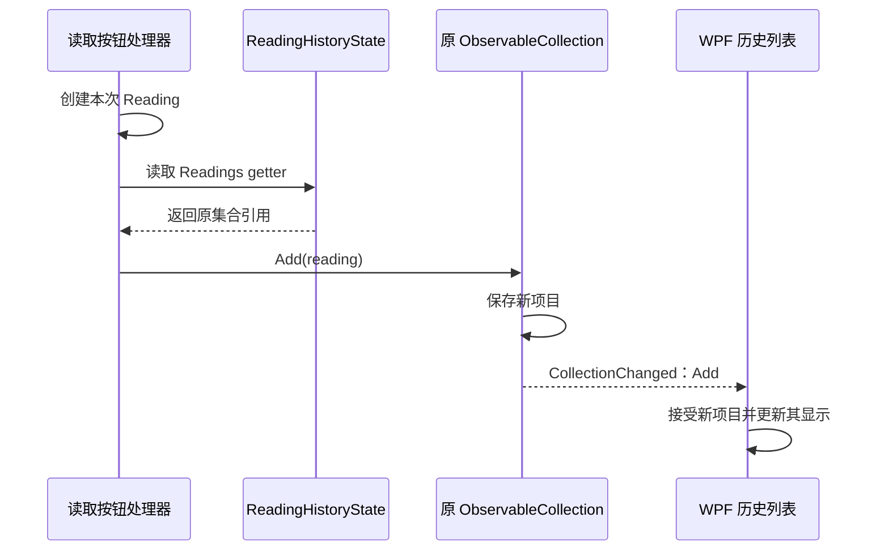

# TASK-011 知识笔记：ObservableCollection 与温度读取历史

> 整理日期：2026-10-13。任务：用 ObservableCollection 显示温度读取历史。状态：✅ 已通关（2026-10-11）。
>
> 根据当前源码、任务卡、学习进度和已有问答详细提取。标为“当前实现”的代码来自当前作品；“说明示例”“展开写法”仅用于解释，不表示已写入项目或已运行。本轮整理不新增掌握或交互验收证据。

## 来源与阅读顺序

| 来源 | 用途 |
| :--- | :--- |
| [TASK-011 任务卡](../tasks/TASK-011.md) | 场景、TODO、DoD 与历史审查 |
| [Task011Window.xaml](../../WpfBae/Exercises/TASK-011-reading-history/Task011Window.xaml) | 窗口结构、ListBox.ItemsSource 与两个按钮 |
| [Task011Window.xaml.cs](../../WpfBae/Exercises/TASK-011-reading-history/Task011Window.xaml.cs) | 状态对象、数据上下文、新增/清空及提示 |
| [ReadingHistoryState.cs](../../WpfBae/Exercises/TASK-011-reading-history/ReadingHistoryState.cs) | 历史集合、字段与完整 getter |
| [复用的 TASK-010 Reading](../../WpfBae/Exercises/TASK-010-reading-binding/Task010Window.xaml.cs) | 读数属性、init 与 ToString |
| [App.xaml](../../WpfBae/App.xaml) | 当前启动入口 |
| [学习进度](../learning.md) | 已验证应用及待复习边界 |
| [集合问答](../questions/wpf-collections.md) | ObservableCollection/List 的差异及通知责任 |
| [属性问答](../questions/csharp-properties.md) | get/set、字段、对象与属性 |
| [TASK-009 笔记](./TASK-009-wpf-window-events.md) | 控件、布局与按钮事件基础 |
| [TASK-010 笔记](./TASK-010-wpf-binding.md) | DataContext、Binding 与属性通知 |

建议先读“对象结构与 getter”，再读“ItemsSource 与 Add/Clear”，最后对照属性通知和集合通知。已有集合使用经验可帮助理解保存数据，但集合怎样通知 WPF 仍需单独解释。

## 1. 从单条结果变成历史列表

TASK-010 显示当前一段结果文字；再次读取会用新文字替换旧文字。TASK-011 改成保存多条 Reading，每次有效读取追加一条，旧记录保留。

```text
第一次 TEMP-001：
  [TEMP-001 26.5 °C]

第二次 TEMP-001：
  [TEMP-001 26.5 °C]
  [TEMP-001 26.5 °C]

第三次 TEMP-002：
  [TEMP-001 26.5 °C]
  [TEMP-001 26.5 °C]
  [TEMP-002 26.5 °C]
```

两次相同 ID 也是两次读取，所以保留两条记录。当前不是按 ID 去重的设备字典，而是按读取顺序保留记录的集合。

场景仍是同步固定温度 26.5，没有实际设备通信、异步采集或文件持久化。这里的“历史”保存在当前窗口数据对象的内存集合中，源码没有将记录写到数据库或磁盘。

## 2. 文件分工与名称身份

专属目录：`WpfBae/Exercises/TASK-011-reading-history/`。

| 名称 | 来源与作用 |
| :--- | :--- |
| Task011Window | 任务骨架定义的窗口类 |
| ReadingHistoryState | 骨架自定义的普通 C# 类，保存历史集合 |
| _state | 窗口里的私有字段，引用 ReadingHistoryState 实例 |
| _readings | 状态类里的私有字段，引用实际集合 |
| Readings | 状态类的公开只读属性，返回原集合 |
| Reading | 学员在 TASK-010 定义的读数类，本任务复用 |
| ObservableCollection<T> | .NET 提供的泛型集合类 |
| ListBox | WPF 提供的列表控件 |
| HistoryListBox | 骨架给当前 ListBox 取的 x:Name |
| ItemsSource | 列表控件提供的数据来源属性 |
| DataContext | WPF 属性，为当前 Binding 提供默认来源对象 |
| CollectionChanged | 集合变化事件名称，由 ObservableCollection 实现 |
| INotifyCollectionChanged | .NET 的集合变化通知接口 |
| Add、Clear、Count | 集合的新增方法、清空方法与数量属性 |
| ReadButton_Click、ClearButton_Click | 骨架关联的按钮处理器，学员补充核心动作 |

ReadingHistoryState、Readings、_readings 不是 WPF 固定 API。先找到当前类定义、对象创建和 getter，才能理解各个名字指向谁。

## 3. using 与 Reading 的跨文件复用

窗口和状态类均引入：

```csharp
using WpfBae.Exercises.Task010;
```

它允许在 TASK-011 的命名空间内用短名称 Reading 表示 `WpfBae.Exercises.Task010.Reading`。这个类型定义在 TASK-010 的 Task010Window.xaml.cs 中，但并不因此只能供 Task010Window 使用。

类型能否访问取决于项目编译、命名空间和访问权限；文件名和目录不是运行时“导入对象”的依据。Reading 声明为 public，两个任务又在同一个项目里，当前可以复用。

using 不会运行 TASK-010 窗口，也不会创建一个 Reading 实例。new Reading 才创建读数对象。TASK-011 没复制或修改旧 Reading 文件。

状态文件还引入：

```csharp
using System.Collections.ObjectModel;
```

这让 .NET 的 ObservableCollection 可以使用短类型名，可联系 Java import 理解。它不是本任务新装的框架。

## 4. ObservableCollection<Reading> 与泛型参数

先看创建语句：

```csharp
ObservableCollection<Reading> readings = new ObservableCollection<Reading>();
```

这是说明示例，readings 是示例变量名；当前实际字段叫 _readings。

ObservableCollection 是集合类型；尖括号中的 Reading 指定元素类型，表示这份集合保存 Reading 对象。类定义常用 T 作为类型占位，使用时把 T 指定为 Reading。

它不是保存一段完整历史字符串，也不是只能保存一个 Reading。Add 的参数在当前类型下应是 Reading；`Add("TEMP-001")` 不能代替创建读数对象，因为字符串不是当前要求的元素类型。

new ObservableCollection<Reading>() 创建空集合，初始 Count 为 0。空集合是一个存在的对象，不等于 null。[ObservableCollection 官方定义](https://learn.microsoft.com/en-us/dotnet/api/system.collections.objectmodel.observablecollection-1)

## 5. 三层对象：状态、集合、读数

当前创建链：

```text
Task011Window 对象
└─ _state → ReadingHistoryState 对象
   └─ _readings → ObservableCollection<Reading> 对象
      ├─ 第 1 个 Reading 对象
      ├─ 第 2 个 Reading 对象
      └─ 第 3 个 Reading 对象
```

窗口创建状态对象：

```csharp
private ReadingHistoryState _state = new ReadingHistoryState();
```

状态对象创建集合：

```csharp
private ObservableCollection<Reading> _readings = new ObservableCollection<Reading>();
```

每次有效点击再创建一个 Reading。_state 引用状态对象，_readings 引用集合对象，集合中的项目引用各次 Reading；它们不在同一层级。

当前两个字段都没有写 readonly。运行期间保持同一对象是现有代码没有重新赋值的结果，不能说是语言已经强制所有引用永远不变。

## 6. 当前 ReadingHistoryState 的完整结构

以下来自当前文件，仅省略注释：

```csharp
using System.Collections.ObjectModel;
using WpfBae.Exercises.Task010;

namespace WpfBae.Exercises.Task011;

public class ReadingHistoryState
{
    private ObservableCollection<Reading> _readings = new ObservableCollection<Reading>();

    public ObservableCollection<Reading> Readings
    {
        get
        {
            return _readings;
        }
    }
}
```

private 字段保存集合引用；public 属性给外部代码和 Binding 一个读取入口；get 返回这个字段保存的对象。

该类没有继承 Window，没有 TextBlock，也没有 INotifyPropertyChanged 声明。本任务只需要固定集合的内容增删通知，相关原因见第 20 节。

## 7. 没有 setter，为什么仍能 Add/Clear

读取 `_state.Readings` 会进入：

```csharp
get
{
    return _readings;
}
```

返回的是原集合引用，不是副本，也不是再次 new 出来的空集合。因此读取属性后，可以调用这个集合的方法：

```csharp
_state.Readings.Add(reading);
_state.Readings.Clear();
```

这两句修改**原集合内容**，没有给 Readings 属性重新赋值。

没有 setter 限制的是下面这种外部赋值：

```csharp
// _state.Readings = new ObservableCollection<Reading>(); // 当前属性没有 setter，不能这样写。
```

只读属性返回可变对象，仍能修改该对象内部。可类比 Java 一个只提供 getReadings() 的对象：调用 getter 得到清单后，仍可能向清单 add 项目。

注意不要把 getter 改成每次 `return new ObservableCollection<Reading>();`。那会让每次读取取得不同集合，按钮修改的未必是 ListBox 已连接的那个集合。

## 8. 展开 _state.Readings.Add(reading)

当前核心动作：

```csharp
_state.Readings.Add(reading);
```

按普通步骤理解：

1. _state 取得当前显示状态对象。
2. Readings getter 返回这个对象内部的原集合。
3. 对这个集合调用 Add。
4. 参数 reading 是刚创建的 Reading 对象引用。

对应说明展开，未修改源码：

```csharp
ObservableCollection<Reading> history = _state.Readings;
history.Add(reading);
```

history 是临时示例变量，它与 _readings 引用同一个集合。Add 不调用 Readings 的 setter，当前也没有 setter；方法调用与属性重新赋值是不同操作。

Clear 同样先通过 getter 取得原集合，再清空其中的项目。

## 9. DataContext 把默认来源设为状态对象

当前构造函数：

```csharp
public Task011Window()
{
    InitializeComponent();
    DataContext = _state;
}
```

InitializeComponent 加载窗口 XAML、连接控件和按钮事件。DataContext 是 WPF 属性，这里把默认源对象设置为 ReadingHistoryState 实例，不是设置成集合本身。

当前连接：

```text
Window.DataContext = _state（状态对象）
                  ↓
Binding.Path = Readings
                  ↓
_state.Readings（集合对象）
                  ↓
HistoryListBox.ItemsSource
```

内部控件没有另设 DataContext，沿当前元素树继承窗口提供的对象。DataContext 不复制数据，也不自动给每个控件绑定；列表要有自己的 Binding 才会按属性取值。

## 10. ListBox 与当前窗口布局

ListBox 是 WPF 列表控件，用于逐项显示数据。当前 XAML 核心部分：

```xml
<ListBox x:Name="HistoryListBox"
         ItemsSource="{Binding Readings, Mode=OneWay}"
         Height="170" />
```

x:Name 给控件取名，ItemsSource 指定其数据集合，Height 为列表留出 170 个 WPF 布局单位的显示区域。列表里的数据项目与生成的界面显示不是同一种对象。[ListBox 官方说明](https://learn.microsoft.com/en-us/dotnet/desktop/wpf/controls/listbox)

当前窗口整体结构：

```text
Window：标题 TASK-011：温度读取历史
└─ StackPanel，Margin=20
   ├─ 设备 ID 标题
   ├─ DeviceIdTextBox，初值 TEMP-001
   ├─ 读取温度按钮 → ReadButton_Click
   ├─ 读取历史标题
   ├─ HistoryListBox，Height=170
   ├─ 清空历史按钮 → ClearButton_Click
   └─ StatusTextBlock，允许换行
```

窗口 Width=560、Height=460、MinWidth=360、MinHeight=460。最小高度限制与固定列表区域为布局提供约束，但不能据源码推断任意内容和尺寸都已经实际验证。长 ID、很多记录的显示细节不属于任务卡记录的必需场景。

## 11. ItemsSource 绑定的四个组成部分

| 组成 | 当前值 |
| :--- | :--- |
| 目标对象 | HistoryListBox |
| 目标属性 | ItemsSource |
| 默认源对象 | DataContext 提供的 _state |
| 源属性路径 | Readings |

ItemsSource 是 WPF 提供的属性，Readings 是本任务自定义数据属性。路径名要与公开属性一致，不写字段名 _readings，也不写类型名 ReadingHistoryState。

当前写法可等价理解为显式 Path：

```xml
ItemsSource="{Binding Path=Readings, Mode=OneWay}"
```

ItemsSource 接受可遍历数据来源；它不限定只能使用 ObservableCollection。普通 List 也能作为初始来源，但后续变化是否能动态显示，还取决于通知机制。[ItemsSource 官方说明](https://learn.microsoft.com/en-us/dotnet/api/system.windows.controls.itemscontrol.itemssource)

OneWay 表示源到目标的绑定方向，不是“集合只能增加一次”，也不禁止源集合自行 Add/Clear。集合内容变化与“目标属性反向写回源对象”不是同一件事。

## 12. 空列表是正常初始状态，ToString 决定文字

当前集合创建时没有预填 Reading，所以窗口初次打开列表为空。空列表本身不是绑定失败证据，应同时检查 ItemsSource 是否已取得集合。

有效点击后，集合新增的是 Reading 对象，不是 ToString 返回的字符串。当前没有 DataTemplate 或 DisplayMemberPath，列表默认通过对象的文字表示显示项目。[默认对象展示与 ToString](https://learn.microsoft.com/en-us/dotnet/desktop/wpf/data/data-templating-overview)

复用 Reading 的当前方法：

```csharp
public override string ToString()
{
    return $"{DeviceId} {Value} {Unit} ";
}
```

所以一条记录的文字为 `TEMP-001 26.5 °C `，末尾有一个真实空格。任务卡常把可见文本写成不含末尾空格的形式，当前方法仍保留它；本次没有修改旧模型。

```text
集合实际保存：Reading 对象
列表显示：该对象转换出的文字
```

重写 ToString 让默认显示更有业务意义。它不是集合通知方法，也不负责把对象加进集合。

## 13. ObservableCollection 与 List 的关键区别

两者都能保存多个元素，支持 Add、Remove、Clear、Count 和索引读取。List 来自 System.Collections.Generic，ObservableCollection 来自 System.Collections.ObjectModel。

说明示例，未写入项目：

```csharp
List<string> list = new List<string>();
list.Add("TEMP-001");

ObservableCollection<string> history = new ObservableCollection<string>();
history.Add("TEMP-001");
```

两个 Add 都保存数据。关键区别是 ObservableCollection 提供集合变化通知，普通 List 没有内置的同类通知。

| 比较 | List<T> | ObservableCollection<T> |
| :--- | :--- | :--- |
| 保存、遍历数据 | 可以 | 可以 |
| 可作为列表初始数据来源 | 可以 | 可以 |
| 自带 CollectionChanged | 没有 | 有 |
| 已连接后 Add/Clear 驱动当前列表自动更新 | 不能仅靠这些方法保证 | 有集合通知支持 |
| 自动替元素转发内部属性变化 | 没有 | 也没有 |

普通 List 可以显示绑定时已有项目，所以不能说“List 完全不能用于 Binding”。连接后再 Add 时，数据增加不等于列表已经知道增加，需要适当通知或其他刷新机制。

ObservableCollection 也不会自己画界面；仍需要 ItemsSource 把它连接到 WPF 列表。[集合绑定与变化通知](https://learn.microsoft.com/en-us/dotnet/api/system.collections.objectmodel.observablecollection-1)

## 14. CollectionChanged、接口与事件参数

INotifyCollectionChanged 是 .NET 接口，规定 CollectionChanged 事件。ObservableCollection 已实现这个接口，本任务不需要自己声明、实现或手工发布集合通知。[接口定义](https://learn.microsoft.com/en-us/dotnet/api/system.collections.specialized.inotifycollectionchanged)

集合在规定操作发生后发事件，WPF 的列表及数据视图机制跟踪这些变化并更新显示。这里用“集合通知列表”描述职责，不表示省略所有内部转发后框架只调用一个固定方法。

事件相关名字：

| 名称 | 来源与作用 |
| :--- | :--- |
| CollectionChanged | 集合提供的事件名称 |
| NotifyCollectionChangedEventHandler | .NET 的委托类型，约定接收方法签名 |
| NotifyCollectionChangedEventArgs | .NET 的事件参数类，描述集合变化 |
| Action | 参数属性，说明 Add、Remove、Reset 等变化种类 |
| NewItems、OldItems | 涉及的新增/旧项目，是否提供取决于动作 |
| NewStartingIndex、OldStartingIndex | 相应项目的位置，不同动作适用情况不同 |

Action 中的 Add 与集合 Add 方法不是同一个成员：一个是动作种类，一个是执行新增的方法。当前新增通知报告 Add，清空报告 Reset，均有历史审查记录。[事件参数类](https://learn.microsoft.com/en-us/dotnet/api/system.collections.specialized.notifycollectionchangedeventargs)

订阅方由框架连接，学员无需再写“Add 后更新 ListBox”的处理器。独立设计事件记录工具和所有集合动作不属于本任务已掌握范围。

## 15. Add 如何把一次读数变成新的一行

当前有效输入后创建：

```csharp
Reading reading = new Reading
{
    DeviceId = id,
    Value = 26.5,
    Unit = "°C"
};
_state.Readings.Add(reading);
```

new Reading 创建本次实例，对象初始化器设置 ID、数值与单位；Add 把这个实例加入原集合末尾。默认情况下不按 ID 去重，也不自动替换上一条。



时序图表示当前职责顺序，省略 WPF 数据视图、容器生成和绘制细节，不保证调用的每一步都立即成为屏幕上的一帧。

当前 .NET 实现是在集合内容更新后发布新增通知，所以接收方可读取已增加的内容。集合通知代码由 .NET 提供，不是骨架额外手写的实现。[ObservableCollection 官方源码](https://github.com/dotnet/dotnet/blob/b0f34d51fccc69fd334253924abd8d6853fad7aa/src/runtime/src/libraries/System.ObjectModel/src/System/Collections/ObjectModel/ObservableCollection.cs)

## 16. Clear 清内容，保留原集合

当前清空核心动作：

```csharp
_state.Readings.Clear();
```

Clear 不需要参数，移除集合中的全部项目。Count 变为 0，但集合对象仍然存在，Readings getter 仍返回同一个对象，ItemsSource 也继续连接它。

```text
清空前：集合 A → [Reading 1, Reading 2, Reading 3]
清空后：集合 A → []
再读取：集合 A → [Reading 4]
```

它不是给字段设 null，也不是新建集合 B 替换 A。移除记录不等于修改原 Reading 的数值，更没有删除文件或真实设备数据。

当前 Clear 引发集合重置通知 Reset，不应理解为必须对每个旧项目逐个收到 Remove。WPF 接收集合重置后重新反映其内容；当前结果就是空列表。[Clear 的实现与重置通知](https://github.com/dotnet/dotnet/blob/b0f34d51fccc69fd334253924abd8d6853fad7aa/src/runtime/src/libraries/System.ObjectModel/src/System/Collections/ObjectModel/ObservableCollection.cs)

## 17. 当前两个按钮处理器

以下提取当前实现，仅省略 TODO 注释：

```csharp
private void ReadButton_Click(object sender, RoutedEventArgs e)
{
    string id = DeviceIdTextBox.Text.Trim();
    if (string.IsNullOrEmpty(id))
    {
        StatusTextBlock.Text = "请输入设备 ID；本次没有新增记录。";
        return;
    }

    Reading reading = new Reading
    {
        DeviceId = id,
        Value = 26.5,
        Unit = "°C"
    };
    _state.Readings.Add(reading);
    StatusTextBlock.Text = "读取成功";
}

private void ClearButton_Click(object sender, RoutedEventArgs e)
{
    _state.Readings.Clear();
    StatusTextBlock.Text = "已清空";
}
```

XAML 的 Click 分别连接两个方法。读取方法校验后新增；清空方法不读取设备 ID，直接清空历史。所以空白 ID 只影响读取路径，不是清空历史的前置条件。

当前清空按钮没有 Command 或 CanExecute 条件，没有在历史为空时自动禁用的实现。本任务不要求这一点，后续 TASK-012 才学习动作与执行条件。

## 18. 空白输入保留历史，与前两任务不同

空白路径先 Trim，再用 string.IsNullOrEmpty 判断。纯空格经 Trim 变空串，进入提示分支。

提示后 return，阻止创建 Reading 和 Add。因此不会增加空 ID 成功记录，也不会清空已有历史。

| 场景 | TASK-009/010 单结果区 | TASK-011 历史列表 |
| :--- | :--- | :--- |
| 本次输入无效 | 提示并清除旧结果文字 | 提示但保留以前有效记录 |
| 为什么 | 避免把旧单结果当作本次结果 | 以前有效历史仍有保留价值 |
| 何时清空 | 空白分支按对应卡清结果 | 用户点击专门的清空历史按钮 |

不能把前面“空白清结果”的规则直接复制成这里的 Clear。任务需求已经变成保存历史。

Trim 返回新字符串，不在这里回写输入框；带两侧空格的 TEMP-003 以清理后的 ID 创建 Reading。return 结束本次方法调用，窗口仍可在有效输入后继续新增。

## 19. 为什么状态文字仍直接设置 Text

当前状态控件的 XAML 使用静态 Text，未绑定状态属性：

```xml
<TextBlock x:Name="StatusTextBlock"
           Text="历史为空。先完成 TODO 1，再读取温度。"
           Margin="0,12,0,0" TextWrapping="Wrap" />
```

按钮直接赋值：

```csharp
StatusTextBlock.Text = "读取成功";
StatusTextBlock.Text = "已清空";
```

本任务只要求历史列表使用 Binding，状态提示沿用 TASK-009 的方式，避免额外引入一套属性通知骨架。

TASK-010 要避免直接赋已绑定的结果/状态 Text；TASK-011 的这个状态 Text 没有绑定，所以直接赋值符合当前设计。判断是否应修改源数据，要看属性实际是否已绑定与任务要求，不能把前面的规则无条件套用。

当前初始提示和源码仍含已完成 TODO 的字样，属于保留的旧说明。是否完成应看实际 Add/Clear 与验收，而不是只凭注释判断。

## 20. 为什么 ReadingHistoryState 不实现 INotifyPropertyChanged

TASK-010 变化是对象的文字属性值：

```text
_state.ResultText = 新字符串
→ ReadingDisplayState 发布 PropertyChanged("ResultText")
→ 绑定重新读属性并更新 Text
```

TASK-011 变化是原集合内部的项目：

```text
_state.Readings.Add(reading)
→ Readings 仍返回原集合
→ 集合发布 CollectionChanged(Add)
→ 列表更新项目
```

DataContext 都只是默认来源。当前没有替换 Readings 返回的集合，也没有绑定外层持续变化的 StatusText，所以外层状态类不需要为这些操作再发布属性通知。

不是因为“属性有 getter 就会自动通知”，也不是因为“DataContext 会观察任何数据变化”，而是实际变化由集合自己的通知覆盖。

ObservableCollection 同时实现 INotifyCollectionChanged 和 INotifyPropertyChanged，后者用于集合自身的 Count、索引项等属性通知。它不替 ReadingHistoryState 报告 Readings 属性更换，也不自动替每个 Reading 转发内部属性变化。[集合的接口与通知定义](https://learn.microsoft.com/en-us/dotnet/api/system.collections.objectmodel.observablecollection-1)

## 21. 三种变化必须分清

| 变化位置 | 举例 | 需要关注的通知 |
| :--- | :--- | :--- |
| 同一集合的内容 | Add/Clear 原历史集合 | 集合的 CollectionChanged，当前已使用 |
| 外层属性指向的对象 | 以后把 Readings 改为另一份集合 | 外层 Readings 属性变化通知，让绑定取得新集合 |
| 已有元素的内部属性 | 以后修改已存在 Reading 的 Value | 元素自身的属性通知与对应字段绑定，不靠集合增删通知 |

第二种在当前代码中没有可写属性实现，仅说明未来设计边界。第三种当前 Reading.Value 使用 init，初始化结束后不能直接 `reading.Value = 30`；本任务也没有逐字段的行内 Binding，不能认为 ToString 一定会因内部变化自动重新显示。

将来若要修改已有读数并动态显示，需要具体设计可写属性、通知和字段显示方式；只把集合类型选为 ObservableCollection 并不能完成这些事。本次不追加实现或验收要求。

## 22. ItemsSource 与 Items：不要混用两条新增路径

当前列表的数据来自 ItemsSource，因此正确修改入口是：

```csharp
_state.Readings.Add(reading);
```

以下是错误混用说明，未写入项目：

```csharp
// HistoryListBox.Items.Add(reading);
// HistoryListBox.Items.Clear();
```

Items 是列表控件提供的项目集合入口；已设置 ItemsSource 时，这个项目集合不允许像独立维护 Items 那样直接增删。应修改实际数据源，由控件反映变化。[ItemsSource 与只读 Items 的关系](https://learn.microsoft.com/en-us/dotnet/api/system.windows.controls.itemscontrol.itemssource)

同样不要每次新增都重新 new 一个集合、反复设置 DataContext 或 ItemsSource 来迫使刷新。这会绕过要学习的集合通知，并可能造成数据与显示来源分离。

读取 `HistoryListBox.Items.Count` 用于观察数量与直接调用 Items.Add/Clear 改项目不是同一回事，前者可用于验证。

## 23. 数量、顺序与输出对照

Count 表示集合当前实际项目数量，Add 成功后增加，Clear 后为 0。它不是设备总数，也不是不同 ID 的数量。

```csharp
int historyCount = _state.Readings.Count;
int listCount = HistoryListBox.Items.Count;
```

这是说明观察方式，未添加到源码。本任务没有筛选或排序配置，历史审查核对集合与列表项目数量相同。项目总数不等于窗口视口当前同时看得到的行数。

下面的场景结果来自 2026-10-11 任务卡历史记录，本次未重新运行：

| 操作 | 集合/列表数量 | 记录变化 | 状态 |
| :--- | :--- | :--- | :--- |
| 初始 | 0 / 0 | 空历史，来自源码初始状态 | 历史为空。先完成 TODO 1，再读取温度。 |
| TEMP-001 第一次读取 | 1 / 1 | 新增第一条 | 读取成功 |
| TEMP-001 第二次读取 | 2 / 2 | 保留第一条，再追加一条 | 读取成功 |
| 改 TEMP-002 再读取 | 3 / 3 | 前两条保留，新条使用 TEMP-002 | 读取成功 |
| 空字符串读取 | 3 / 3 | 不增删，无集合通知 | 请输入设备 ID；本次没有新增记录。 |
| 纯空格读取 | 3 / 3 | 同上 | 同上 |
| 点击清空历史 | 0 / 0 | Clear，Reset 通知 | 已清空 |
| 两侧带空格的 TEMP-003 读取 | 1 / 1 | 原集合重新 Add，ID 已 Trim | 读取成功 |

每条有效读数显示 ID、26.5 与 °C；复用 ToString 的末尾空格未在表中逐行重复标出。

## 24. 常见问题与排查线索

以下为机制排查，不表示学员在 TASK-011 都发生过这些错误。

| 现象 | 可能原因 | 先检查 |
| :--- | :--- | :--- |
| 初始列表空 | 集合本来为空，或来源没有连接 | ItemsSource 是否取得 Readings，不能只看空白 |
| 集合 Count 增加，列表不增 | 使用普通 List、改了另一份集合或连接错误 | 类型、实例、ItemsSource 与 Binding.Path |
| 每次都只剩一条 | 每次 Clear 或新建集合 | 是否保持原集合并仅 Add |
| 改 ID 后旧行也变了 | 反复修改/复用旧对象，而非按当前流程新建 | Reading 创建位置与元素引用 |
| 无 setter 就以为不能新增 | 混淆属性重赋与对象内部修改 | getter 返回对象后调用其方法 |
| 初值能显示，后来新增不显示 | 初始枚举有效但缺少增删通知 | 集合是否提供 CollectionChanged |
| 清空后再读无显示 | 来源被设 null、换集合或绑定被移除 | Clear 操作与原连接是否保留 |
| 空白导致历史消失 | 错用前一任务的清结果规则 | 空白分支是否调用 Clear |
| 空白仍出现成功行 | 提示后没有 return | 是否继续创建 Reading 并 Add |
| Items.Add 报错 | 当前列表由 ItemsSource 管理 | 改数据集合，不直接改控件 Items |
| 改已有读数值不刷新 | 内部属性变化未被集合转发，显示未逐字段绑定 | 区分集合、元素与显示路径 |
| 状态文字未随集合自动变 | 状态当前是单独的直接赋值 | 按钮是否设置 StatusTextBlock.Text |
| 有 TODO 就认为没完成 | 注释未整理但代码已实现 | Add/Clear 与既有验收证据 |
| 运行打开 TASK-017 | 当前启动入口已推进到该任务 | App.xaml 的 StartupUri |

## 25. 可选复习与真实运行方式

先做一个可观察动作，无需改代码：在 Task011Window 中保持 TEMP-001 连续点击读取两次，观察历史增加为两条，而不是第二次覆盖第一条。这能把“每次创建 Reading + 原集合 Add”与结果对应起来。

文件对应：`D:\host-computer-st\WpfBae\Exercises\TASK-011-reading-history\Task011Window.xaml.cs` 的 ReadButton_Click，核心语句为 `_state.Readings.Add(reading);`。

**当前入口条件：**2026-10-13 App.xaml 实际指向 `Exercises/TASK-017-button-controltemplate/Task017Window.xaml`。以后用户选择重跑 TASK-011 时，先记录当前入口，临时设为 `Exercises/TASK-011-reading-history/Task011Window.xaml`，在工作区根目录执行：

```powershell
dotnet run --project .\WpfBae\WpfBae.csproj
```

关闭旧窗口再运行，观察结束后恢复入口。本次整理没有执行这些修改或启动命令。

后续复习可以沿第 23 节顺序检查换 ID、两种空白、清空与恢复，同时看数量、旧行、状态。编译成功、编辑器提示和 XAML 预览都不能替代实际按钮与列表变化。

## 26. 历史证据、掌握边界与下一主题

### 26.1 历史审查记录

任务卡记录 2026-10-11 必需 DoD 全部通过：构建 0 警告/错误，原应用实际启动并正常退出；审查程序显示原 Task011Window，并确认 DataContext、集合、ItemsSource 与绑定连接。

历史操作通过原按钮的 Click 路由事件触发；两次 TEMP-001、换 TEMP-002、空白保护、Clear 与带空格 TEMP-003 恢复均正确。Add 有新增通知，Clear 有 Reset，空白没有集合通知；数据对象、原集合与绑定引用全过程保留。

这些是历史任务卡结论，不是 2026-10-13 新运行结果，也不扩大为手工鼠标、键盘等未记录的测试。

任务卡引用的 `docx/tasks/evidence/TASK-011/results.json` 和 `verification.json` 当前缺失，本次无法重读原结果及原哈希明细，故不提供这些不存在文件的链接。当前可以直接核对任务卡、源码和学习记录。

### 26.2 本次整理的静态核对

本轮读取三个 TASK-011 文件、复用 Reading 的 TASK-010 文件及 App.xaml，并记录源码哈希用于确认整理前后未修改代码。哈希核对只证明文件内容保留，不能代替重新运行。

历史任务卡只说明当时五个文件运行前后哈希一致，当前缺失其原明细，因此本笔记不声称当前三个任务文件已逐一匹配历史哈希。

### 26.3 已验证范围与待复习范围

| 内容 | 当前证据边界 |
| :--- | :--- |
| 在已有骨架上使用原集合 Add/Clear，设置成功/清空提示 | 学员自主实现，历史实际窗口行为验证通过 |
| 连续新增、换 ID 保留旧行、空白保护、清空恢复 | 有代码与历史运行记录 |
| 数据类、集合创建、完整 getter、DataContext/ItemsSource、输入校验 | 骨架提供，不算学员独立设计整个绑定模型 |
| 集合问答 Q1 | 已掌握，限 Add/Clear 驱动已有列表绑定的应用 |
| 集合问答 Q2、完整属性与一般通知机制 | 继续待复习，不因本笔记解释自动升级 |
| 已有元素属性自动刷新、自定义集合事件、列表模板与完整监控系统 | 本任务未验收 |

### 26.4 到 TASK-012 的连接

现在清空按钮通过 Click 调用 ClearButton_Click，历史为空时仍可点击。TASK-012 将学习 Command，把执行动作与“什么时候允许执行”分开，例如历史有记录时才允许清空。

这里先掌握原集合 Add/Clear 的职责，再按对应任务学习命令连接；本次只整理 TASK-011，不生成新任务或改变 TASK-018 的未开始状态。

## 官方资料对照

实现与审查以本地记录为来源，官方资料用于核对集合、列表和通知机制。

- [ObservableCollection<T>](https://learn.microsoft.com/en-us/dotnet/api/system.collections.objectmodel.observablecollection-1)
- [INotifyCollectionChanged](https://learn.microsoft.com/en-us/dotnet/api/system.collections.specialized.inotifycollectionchanged)
- [NotifyCollectionChangedEventArgs](https://learn.microsoft.com/en-us/dotnet/api/system.collections.specialized.notifycollectionchangedeventargs)
- [ItemsControl.ItemsSource](https://learn.microsoft.com/en-us/dotnet/api/system.windows.controls.itemscontrol.itemssource)
- [ListBox](https://learn.microsoft.com/en-us/dotnet/desktop/wpf/controls/listbox)
- [默认对象显示、ToString 与数据模板](https://learn.microsoft.com/en-us/dotnet/desktop/wpf/data/data-templating-overview)
- [ObservableCollection 官方源码中的新增与清空](https://github.com/dotnet/dotnet/blob/b0f34d51fccc69fd334253924abd8d6853fad7aa/src/runtime/src/libraries/System.ObjectModel/src/System/Collections/ObjectModel/ObservableCollection.cs)
