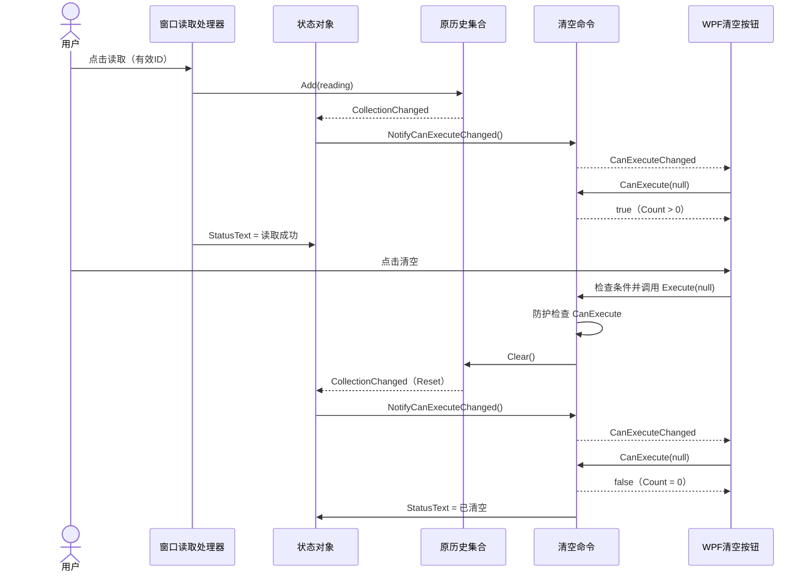

# TASK-012 知识笔记：ICommand、按钮可用条件与清空历史

> 整理日期：2026-10-13。任务：用 Command 清空历史并控制按钮是否可用。状态：✅ 已通关（2026-10-11）。
>
> 本笔记依据当前源码、任务卡、学习进度及已有问答提取。“当前实现”来自现有作品；“展开写法”“说明示例”用于理解，不表示已写入项目或已运行。本轮仅整理文档，不新增运行验收或自主掌握证据。

## 来源与阅读顺序

| 来源 | 用途 |
| :--- | :--- |
| [TASK-012 任务卡](../tasks/TASK-012.md) | 场景、骨架/TODO、DoD 与历史验证 |
| [ClearHistoryCommand.cs](../../WpfBae/Exercises/TASK-012-clear-history-command/ClearHistoryCommand.cs) | 条件、执行动作与命令事件 |
| [ReadingCommandState.cs](../../WpfBae/Exercises/TASK-012-clear-history-command/ReadingCommandState.cs) | 集合、命令、状态文字及两种通知连接 |
| [Task012Window.xaml](../../WpfBae/Exercises/TASK-012-clear-history-command/Task012Window.xaml) | ItemsSource、Command、状态文字绑定 |
| [Task012Window.xaml.cs](../../WpfBae/Exercises/TASK-012-clear-history-command/Task012Window.xaml.cs) | 创建状态对象、DataContext 与读取按钮 |
| [复用的 Reading](../../WpfBae/Exercises/TASK-010-reading-binding/Task010Window.xaml.cs) | 读数属性和 ToString |
| [App.xaml](../../WpfBae/App.xaml) | 当前应用启动入口 |
| [学习进度](../learning.md) | 已验证应用范围与待复习内容 |
| [WPF 命令问答](../questions/wpf-commands.md) | 命令绑定、WPF 订阅和重查条件的追问 |
| [C# 事件问答 Q6](../questions/csharp-events.md#q6委托是什么为什么-handler-变量可以像方法一样调用) | 委托、event、EventHandler 与 Invoke |
| [TASK-010 笔记](./TASK-010-wpf-binding.md) | 完整属性语法、DataContext 与属性通知 |
| [TASK-011 笔记](./TASK-011-wpf-reading-history.md) | 集合、ItemsSource 与 Add/Clear |

建议依次理解“对象是谁、怎样连接”“条件和动作”“通知如何到达按钮”。已有 Java 接口和回调经验可以用于对照，但 C# 的委托、事件和 WPF 自动订阅需要单独说明。

## 1. 本任务解决什么问题

TASK-011 已经能新增和清空历史。TASK-012 增加一个界面规则：没有历史时不允许清空，有历史时才允许。

| 用户操作 | 历史条数 | 清空按钮 | 状态文字 |
| :--- | :--- | :--- | :--- |
| 打开 TASK-012 | 0 | 禁用 | 当前骨架保留的初始提示 |
| 读取有效 ID | 1 | 可用 | 读取成功 |
| 再次读取 | 2 | 仍可用 | 读取成功 |
| 点击清空 | 0 | 禁用 | 已清空 |
| 清空后再读取 | 1 | 恢复可用 | 读取成功 |
| 输入空白并读取 | 保持原数量 | 保持对应条件 | 请输入设备 ID；本次没有新增记录。 |

这里的温度仍固定为 26.5 °C；没有设备通信、后台采集或磁盘保存。历史是当前状态对象里的内存集合。

## 2. 从 Click 到 Command：把条件和动作放在一个对象中

原来的 Click 思路是：按钮被点击，窗口的处理方法运行。Command 思路是：按钮持有一个命令对象，由这个对象提供“现在能执行吗”和“执行什么”。

本任务只把清空动作改为 Command；读取仍保留 Click。当前窗口没有 `ClearButton_Click`，也没有在读取后直接设置 `ClearButton.IsEnabled`。

```text
读取按钮 → ReadButton_Click → 校验输入 → 新增记录
清空按钮 → Command 对象
             ├─ CanExecute：历史数量是否大于 0
             └─ Execute：清空历史，更新状态文字
```

Command 在这里是 WPF 按钮属性和相关机制的名称，不是 C# 关键字。自定义命令类也不要求先引入 MVVM 框架、通用 RelayCommand 或第三方依赖。

## 3. 文件分工与名字来源

专属目录：`WpfBae/Exercises/TASK-012-clear-history-command/`。

| 名称 | 来源 | 当前作用 |
| :--- | :--- | :--- |
| Task012Window | 任务自定义窗口类 | 设置数据上下文，处理读取 Click |
| ReadingCommandState | 骨架自定义数据类 | 保存历史、命令和状态文字 |
| ClearHistoryCommand | 骨架自定义命令类 | 实现清空条件与动作 |
| Reading | TASK-010 自定义读数类 | 保存 ID、数值和单位 |
| ICommand | .NET 的接口，System.Windows.Input | 约定命令的成员 |
| Button.Command | WPF 属性 | 让按钮连接命令对象 |
| ClearCommand | 自定义公开属性名 | 把命令对象提供给 Binding |
| NotifyCanExecuteChanged | 自定义辅助方法 | 发布命令条件可能变化的通知 |
| EventHandler | .NET 的委托类型，System | 规定命令事件处理方法的形状 |
| CanExecuteChanged | ICommand 要求的事件 | 请求使用者重新判断条件 |
| ObservableCollection、CollectionChanged | .NET 集合类型及事件 | 保存历史并通知增删变化 |
| INotifyPropertyChanged、PropertyChanged | .NET 接口及事件 | 通知状态文字属性变化 |

`_state`、`_readings`、`_clearCommand`、`_statusText`、`handler` 都是代码中自行命名的字段或变量，不是框架 API。下划线只是命名习惯。

## 4. ICommand 是接口，ClearHistoryCommand 是实现类

当前声明：

```csharp
public class ClearHistoryCommand : ICommand
```

`class` 声明类；`: ICommand` 表示实现这个接口。类似 Java 中 `class ClearHistoryCommand implements ICommand` 的角色，但 C# 使用冒号。

接口规定的核心成员是：

| 成员 | 形式 | 负责什么 |
| :--- | :--- | :--- |
| CanExecute | 方法，返回 bool | 查询当前能否执行 |
| Execute | 方法，返回 void | 执行动作 |
| CanExecuteChanged | 事件 | 通知使用者重新查询条件 |

可以把接口理解成调用约定：WPF 不需要知道我们的类名，只要它实现 ICommand，就能通过这些成员使用它。接口本身不会自动写出清空算法；具体实现仍在 ClearHistoryCommand 中。接口成员依据：[Microsoft ICommand 文档](https://learn.microsoft.com/en-us/dotnet/api/system.windows.input.icommand?view=net-10.0)。

## 5. 窗口创建状态对象，并交给 DataContext

当前实现：

```csharp
private ReadingCommandState _state = new ReadingCommandState();

public Task012Window()
{
    InitializeComponent();
    DataContext = _state;
}
```

第一行包含两个动作：`new ReadingCommandState()` 创建实例，字段 `_state` 保存它的引用。不是创建一个叫 `_state` 的类，也不是把类源码存入字段。

`InitializeComponent()` 是 WPF 构建 XAML 时生成的初始化方法，创建并连接界面控件。`DataContext` 是 WPF 属性；这里赋值后，窗口内没有另行指定来源的 Binding 可以从该状态对象读取属性。

所以代码修改的 `_state` 与 Binding 读取的 DataContext 指向同一个对象。不能为 DataContext 另外 `new ReadingCommandState()`，否则读取处理器和界面会各用一份历史。

## 6. 数据对象创建命令：new ClearHistoryCommand(this)

ReadingCommandState 的构造函数：

```csharp
public ReadingCommandState()
{
    _clearCommand = new ClearHistoryCommand(this);
    _readings.CollectionChanged += Readings_CollectionChanged;
}
```

构造函数与类同名，没有返回类型；在创建该数据对象时运行。执行 `new ClearHistoryCommand(this)` 时，`this` 是正在构造的 ReadingCommandState 实例。

命令构造函数接收并保存它：

```csharp
private ReadingCommandState _state;

public ClearHistoryCommand(ReadingCommandState state)
{
    _state = state;
}
```

`state` 是参数名，接收传入对象的引用；命令的字段 `_state` 保存这个引用。赋值不会复制状态对象或集合。窗口类也有一个叫 `_state` 的字段，但它们属于不同的类；名字相同不代表同一字段，引用却可以指向同一实例。

```text
窗口的 _state ─────────────────────┐
                                  ▼
                        ReadingCommandState 实例 S
                                  │
                    ┌─────────────┴────────────┐
                    ▼                          ▼
          ObservableCollection R     ClearHistoryCommand 实例 C
                                               │
                                      命令的 _state → S
```

命令从 S 获取 R。没有额外创建“命令专用的第二份历史”。当前命令在构造时只保存引用，没有在状态初始化中执行清空。

## 7. Readings getter：属性不允许替换，集合仍允许变化

当前实现：

```csharp
private ObservableCollection<Reading> _readings =
    new ObservableCollection<Reading>();

public ObservableCollection<Reading> Readings
{
    get
    {
        return _readings;
    }
}
```

`ObservableCollection<Reading>` 是泛型集合类型，尖括号限定元素是 Reading。getter 返回原集合的引用，读取属性不会创建新集合。

Readings 没有 setter，因此外部不能写 `_state.Readings = 新集合`，却可以写 `_state.Readings.Add(reading)` 和 `_state.Readings.Clear()`。没有 setter 只限制属性赋值，不意味着返回的集合不可修改。

列表和命令始终使用原集合，是本任务稳定连接的基础。替换集合还涉及重新绑定和重新订阅，当前实现没有这个需求。

## 8. ClearCommand getter：声明为接口，返回实际命令实例

当前实现：

```csharp
private ClearHistoryCommand _clearCommand;

public ICommand ClearCommand
{
    get
    {
        return _clearCommand;
    }
}
```

`ClearHistoryCommand` 是字段使用的具体类型，`ICommand` 是公开属性声明的类型。实现接口的对象可以通过接口类型的引用使用，实际对象仍然是原 ClearHistoryCommand 实例。

说明示例，未添加到项目：

```csharp
ICommand command = _state.ClearCommand;
bool canUse = command.CanExecute(null);
```

`command` 是示例局部变量，从 ClearCommand getter 取得对象；第二行通过接口调用实际实现。不是根据类名找方法，也不是由事件参数 `sender` 给这行赋值。

属性每次返回原 `_clearCommand`；不要把 getter 改成每次 `new ClearHistoryCommand(...)`，否则可能反复得到不同命令对象。

## 9. XAML Command 绑定的每个部分

当前清空按钮：

```xml
<Button x:Name="ClearButton"
        Content="清空历史"
        Command="{Binding ClearCommand, Mode=OneWay}"
        HorizontalAlignment="Left"
        Padding="12,6"
        Margin="0,12,0,0" />
```

| 部分 | 含义 |
| :--- | :--- |
| x:Name="ClearButton" | 当前控件的名字 |
| Content="清空历史" | 按钮显示的文字 |
| Command=... | 设置 WPF 按钮的命令属性 |
| Binding ClearCommand | 默认来源是 DataContext，路径是公开属性 ClearCommand |
| Mode=OneWay | 从数据对象读取到按钮属性，不将按钮属性写回来源 |

具体取得过程：`DataContext → ReadingCommandState.ClearCommand → getter → _clearCommand → ClearButton.Command`。

XAML 中写的是公开属性名 ClearCommand，不是类名 ClearHistoryCommand，也不是私有字段 `_clearCommand`。OneWay 描述绑定传值方向；它不妨碍按钮调用命令的 Execute，也不决定命令能执行几次。

## 10. CanExecute 的完整写法与 bool 判断

学员当前实现：

```csharp
public bool CanExecute(object? parameter)
{
    if (_state.Readings.Count > 0)
    {
        return true;
    }
    return false;
}
```

从左到右：命令字段 `_state` 找到状态对象；Readings getter 取得集合；Count 读取数量；`> 0` 比较得到 bool。数量为 0 返回 false，大于 0 返回 true。

| Count | Count > 0 | 返回值 | 在本窗口中的按钮条件 |
| :--- | :--- | :--- | :--- |
| 0 | false | false | 禁用 |
| 1 | true | true | 可用 |
| 2 | true | true | 仍可用 |

先理解普通 if 后，可以看等价的简写：

```csharp
return _state.Readings.Count > 0;
```

当前完整写法正确，不需要为了简短而改作品。`CanExecute` 的任务是查询条件；不要在里面 Add/Clear、更新状态文字或执行设备读取，因为框架可能多次查询。

## 11. object? parameter、null 与 CommandParameter

`object` 是 C# 类型名，对应 .NET 的 System.Object；`object?` 表示在启用可空引用类型分析的项目里，这个参数允许为 null。它不是“可选参数”语法，也不是 WPF 会把状态对象自动放进去。

本项目启用了 `<Nullable>enable</Nullable>`。命令方法的 parameter 名字用于接收命令来源传来的参数；当前按钮没有设置 CommandParameter，因此使用默认 null，两个方法都不读取它。

| 参数 | 出现位置 | 当前含义 |
| :--- | :--- | :--- |
| state | 命令构造函数 | 创建时传入的状态对象引用 |
| parameter | CanExecute/Execute | 命令参数，本任务为 null |
| sender | 事件处理方法 | 发布通知的对象 |
| e | 事件处理方法 | 事件附加信息 |

它们是不同调用中的参数，不能因为都涉及对象就互相替代。命令中的历史来自构造函数保存的 `_state`，不来自 parameter。

## 12. Execute：防护、清空和完成提示

当前实现：

```csharp
public void Execute(object? parameter)
{
    if (!CanExecute(parameter))
    {
        return;
    }

    _state.Readings.Clear();
    _state.StatusText = "已清空";
}
```

`void` 表示方法不返回结果；`!` 对 bool 取反。如果不能执行，`!CanExecute(...)` 为 true，进入 if 提前 return，下面两行不会运行。

历史非空时，Clear 删除原集合的全部元素，随后 StatusText 赋值为“已清空”。没有创建新集合，也没有直接改 ListBox.Items。

WPF 正常按钮路径会检查可执行条件；这里 Execute 内再检查，是骨架提供的防护，用来照顾其他代码直接调用的情况。比如空集合时手动调用 Execute，也会提前返回，原状态文字保持不变。按钮禁用只约束正常界面交互，不能代替方法自身的条件设计。

## 13. CanExecuteChanged 是事件：声明不等于通知

当前声明：

```csharp
public event EventHandler? CanExecuteChanged;
```

逐个拆开：

| 片段 | 身份 |
| :--- | :--- |
| public | C# 访问修饰符，对外公开 |
| event | C# 声明事件的关键字 |
| EventHandler | .NET 提供的委托类型 |
| ? | 允许当前没有订阅者 |
| CanExecuteChanged | ICommand 要求的事件名 |

声明建立了订阅入口，本身不会调用任何方法。事件也不保存可用状态；实际 true/false 由 CanExecute 返回。

对于这里的普通事件，外部代码可以 `+=` 订阅、`-=` 取消订阅，不能直接调用它发布通知，也不能用 `=` 替换整个订阅关系。发布动作由声明它的类内部负责。

名字带 Changed，表达的是“影响可执行条件的状态可能变了，请重新检查”。从 1 条变成 2 条也会通知，但条件检查仍得到 true。

## 14. 委托基础：为什么变量可以带括号调用

先看普通方法。以下是独立说明示例，三个成员放在同一个示例类中，不添加到学员项目：

```csharp
public delegate void MessageHandler(string text);

private void ShowMessage(string text)
{
    Console.WriteLine(text);
}

private void Demonstrate()
{
    MessageHandler handler = new MessageHandler(ShowMessage);
    handler("读取成功");
}
```

`delegate` 声明委托类型；MessageHandler 是示例取的类型名，规定“接收一个 string、返回 void”。ShowMessage 的参数和返回类型符合要求。

`new MessageHandler(ShowMessage)` 创建保存该方法引用的委托。这里传的是没有括号的方法名，尚未运行 ShowMessage。下一行 `handler("读取成功")` 才通过变量调用它。

handler 保存可调用的方法引用，不是调用结果，不是方法名字符串，也不是一个另行声明的普通方法。委托还可以连接多个匹配的方法。它的用途是让另一段代码决定要调用的行为，适合回调和事件订阅；固定只调用已知方法时，直接调用就足够。

## 15. EventHandler 是已有委托类型，event 使用它

.NET 已经提供 EventHandler，理解其形状即可，不要在项目中重复声明：

```csharp
public delegate void EventHandler(object? sender, EventArgs e);
```

它规定匹配的处理方法接收 sender 与 EventArgs 两个参数、返回 void。因此可以用于接收“命令条件可能变化”的通知。定义来源：[Microsoft EventHandler 文档](https://learn.microsoft.com/en-us/dotnet/api/system.eventhandler?view=net-10.0)。

| 名称 | 身份 | 回答的问题 |
| :--- | :--- | :--- |
| delegate | 定义委托类型的关键字 | 怎样定义可调用类型？ |
| EventHandler | 框架已经定义好的委托类型 | 能接什么形状的方法？ |
| event | 声明事件的关键字 | 怎样公开受约束的订阅入口？ |
| CanExecuteChanged | 命令对象上的事件 | 订阅哪个通知？ |
| handler | 类内部的局部委托变量 | 当前要调用哪些已登记方法？ |

CanExecute 返回 bool、接收一个参数，与 EventHandler 要求的“两个参数、void”不匹配。CanExecuteChanged 不直接指向 CanExecute，也不会按名称自动匹配它。

## 16. 订阅是登记方法，触发才执行方法

完整订阅说明示例：

```csharp
private void OnCommandChanged(object? sender, EventArgs e)
{
    Console.WriteLine("收到命令变化通知");
}

private void SubscribeForExplanation()
{
    ICommand command = _state.ClearCommand;
    command.CanExecuteChanged += new EventHandler(OnCommandChanged);
}
```

OnCommandChanged、SubscribeForExplanation 是示例自定义方法；它们不在当前作品中，也无需为了按钮工作而添加。

`new EventHandler(OnCommandChanged)` 创建引用处理方法的委托，`+=` 把它登记到事件上。这一行不会立即打印文字。之后命令类内部发布事件，已登记的方法才被调用。

常见简写 `command.CanExecuteChanged += OnCommandChanged;` 省去了显式创建委托的形式，仍然是登记方法。取消订阅用对应的 `-=`。本任务按钮的订阅工作由 WPF 框架负责。

## 17. NotifyCanExecuteChanged：先完整展开，再看 ?.Invoke

当前实现：

```csharp
public void NotifyCanExecuteChanged()
{
    CanExecuteChanged?.Invoke(this, EventArgs.Empty);
}
```

NotifyCanExecuteChanged 是骨架自己命名的普通方法，不是 ICommand 要求的第四个成员。为了理解，可展开为以下写法；这是说明，不改当前代码：

```csharp
public void NotifyCanExecuteChanged()
{
    EventHandler? handler = CanExecuteChanged;
    if (handler != null)
    {
        handler(this, EventArgs.Empty);
    }
}
```

第一行在命令类内部取得当前已登记方法的委托，并保存到局部变量 handler。if 判断是否有可调用的订阅方法。最后一行通过委托调用这些方法，将两个实参交给接收方。

`handler(...)` 与 `handler.Invoke(...)` 都是调用委托；Invoke 是委托提供的调用方法，不是我们另写的通知工具。`?.` 是 C# 空值条件访问：没有订阅者时跳过，否则调用。它只处理 null，不会吞掉接收方法自身抛出的异常。

EventArgs.Empty 是 .NET 提供的无附加数据事件参数，不是 false、空历史或空字符串。依据：[Microsoft EventArgs.Empty 文档](https://learn.microsoft.com/en-us/dotnet/api/system.eventargs.empty?view=net-10.0)。

## 18. 两个位置的 this 与 sender 分别是谁

| 代码位置 | this 所指对象 | 目的 |
| :--- | :--- | :--- |
| ReadingCommandState 构造函数的 new ClearHistoryCommand(this) | 状态实例 S | 把保存数据的对象交给命令 |
| ClearHistoryCommand.NotifyCanExecuteChanged 中的 Invoke(this, ...) | 命令实例 C | 报告谁发布了命令事件 |

this 总是当前实例方法或构造函数所属的那个对象，不因名字一样就一直指窗口。

```text
命令内部调用 handler(this, EventArgs.Empty)
                         │             │
                         ▼             ▼
接收方法参数：        sender           e
```

这是普通参数传递：sender 接到命令对象引用，e 接到事件参数。不会复制对象，不会将整个类源码传过去，也不会创建另一个命令。

接收方可以用 sender 识别来源，但并非每个接收方法都必须使用它。本任务 WPF 按钮重查条件时，从自己已经持有的 Command 取得命令。上文示例的 `command = _state.ClearCommand` 来自属性读取，与 sender 参数的取得路径不同。

## 19. 集合事件怎样连接到命令事件

构造函数已订阅：

```csharp
_readings.CollectionChanged += Readings_CollectionChanged;
```

这里右侧没有括号，是登记处理方法，不是立即执行。该处理方法的当前实现：

```csharp
private void Readings_CollectionChanged(
    object? sender, NotifyCollectionChangedEventArgs e)
{
    _clearCommand.NotifyCanExecuteChanged();
}
```

NotifyCollectionChangedEventArgs 来自 .NET 的 System.Collections.Specialized，描述集合发生了什么变化。sender 是发生变化的原集合。当前方法不读取 e，任何收到的集合变化都会通知清空命令重查条件。

```text
Readings.Add / Readings.Clear
       ↓ 集合发布 CollectionChanged
Readings_CollectionChanged 被调用
       ↓ 普通方法调用
NotifyCanExecuteChanged
       ↓ 命令发布 CanExecuteChanged
WPF 接收并重新检查 CanExecute
```

集合并不知道业务上有一个清空按钮；状态类中的处理方法把“集合变化”转换成“命令条件可能变化”。读取 Count、遍历或查询不会触发 CollectionChanged；修改某条 Reading 的内部属性也不等于增删集合元素。

## 20. WPF 在哪里订阅，收到通知后怎样调用 CanExecute

按钮的 Command 连接后，WPF 内部代码登记接收方法，并做初次条件检查。不是因为学员项目里存在一个同名方法就自动执行。

官方源码核对到的路径：

```text
ButtonBase 连接 Command
    → CanExecuteChangedEventManager 登记按钮处理方法
    → 内部 HandlerSink 订阅命令事件并转发通知
    → ButtonBase.OnCanExecuteChanged
    → UpdateCanExecute
    → CommandHelpers 从按钮 Command 取得对象
    → 普通 ICommand 分支调用 command.CanExecute(parameter)
```

ButtonBase 是 WPF 按钮基类；事件管理工具及 CommandHelpers 也是框架内部实现，不在本工作区源码中。当前 ClearHistoryCommand 属于普通 ICommand 实现，不是 RoutedCommand。

按钮连接命令时也会调用条件更新，所以初始 Count 为 0 时即可禁用，无需先 Add/Clear。框架会把命令条件纳入按钮的有效 IsEnabled；其他显式禁用或父级禁用也可能限制可用性，因此一般场景不能说返回 true 就必然可点击。

来源：[ButtonBase 命令连接与条件更新](https://github.com/dotnet/wpf/blob/main/src/Microsoft.DotNet.Wpf/src/PresentationFramework/System/Windows/Controls/Primitives/ButtonBase.cs)、[命令事件订阅与转发](https://github.com/dotnet/wpf/blob/main/src/Microsoft.DotNet.Wpf/src/PresentationCore/System/Windows/Input/Command/CanExecuteChangedEventManager.cs)、[CommandHelpers 接口调用](https://github.com/dotnet/wpf/blob/main/src/Microsoft.DotNet.Wpf/src/PresentationFramework/MS/Internal/Commands/CommandHelpers.cs)。这是官方 main 分支机制核对，不是本轮在本地运行时枚举订阅列表。

## 21. 这条通知链不是反射，也不会执行清空

事件存的是已登记处理方法的委托。通知时先调用 WPF 的接收方法，接收方法再通过 ICommand 调用 CanExecute。不存在“CanExecuteChanged 按名称找 CanExecute”的规则。

Java 对照可以帮助区分：接口调用负责约定的方法；监听器/回调负责收到通知后执行接收逻辑。反射通常是通过运行时类型信息查找成员，这里重查条件的普通 ICommand 分支已有明确接口约定。

| 当前调用 | 会查询条件吗 | 会清空历史吗 |
| :--- | :--- | :--- |
| 创建/连接 Command | 框架初次检查 | 不会 |
| 发布 CanExecuteChanged | 接收方重新检查 | 不会 |
| 直接调用 CanExecute | 会 | 不会 |
| 正常点击可用的清空按钮 | 框架检查并调用 Execute | 会 |
| 直接调用 Execute | 当前实现先检查 | 仅条件满足时 |

不要把“通知按钮更新是否可用”理解为按钮被自动点击。重复 Add 会触发通知，不能让通知处理方法反过来 Execute，否则刚新增的记录可能立即被清掉。

## 22. 三种通知：列表、状态文字和按钮条件

当前程序有三条职责不同的通知路径：

| 通知 | 发布对象 | 当前接收用途 | 当前携带的信息 |
| :--- | :--- | :--- | :--- |
| CollectionChanged | ObservableCollection 实例 | 列表跟随增删；状态处理方法继续通知命令 | 集合变化参数 |
| PropertyChanged | ReadingCommandState 实例 | StatusText 绑定重新读取文字 | 属性名 StatusText |
| CanExecuteChanged | ClearHistoryCommand 实例 | 按钮重新查询可执行条件 | EventArgs.Empty |

```text
Readings.Add/Clear
  ├─ CollectionChanged → 列表跟随集合变化
  └─ CollectionChanged → 状态处理方法 → CanExecuteChanged → 按钮重查

StatusText = "..."
  └─ PropertyChanged("StatusText") → 状态 TextBlock 更新
```

列表更新不代表按钮必然知道要重查；PropertyChanged("StatusText") 也不代表命令条件被通知。它们要分别连接。

ObservableCollection 还具备其自身的属性通知能力，但本任务新增/清空列表和通知命令的连接使用 CollectionChanged。这里只列出当前业务链，不把集合通知误说成它唯一实现的通知接口。

## 23. StatusText：从直接改控件到绑定数据属性

TASK-011 的状态文字由窗口直接赋给控件 Text。TASK-012 将状态提示也放入 ReadingCommandState，使窗口和命令都能通过同一属性更新提示。

当前属性：

```csharp
public string StatusText
{
    get
    {
        return _statusText;
    }
    set
    {
        _statusText = value;
        OnPropertyChanged("StatusText");
    }
}
```

赋值 `_state.StatusText = "读取成功"` 时，右侧字符串成为 setter 内的 value；先保存到字段，再调用通知工具。getter 在绑定重新读取时返回保存的值。

该类实现 INotifyPropertyChanged，并提供当前通知工具：

```csharp
public event PropertyChangedEventHandler? PropertyChanged;

private void OnPropertyChanged(string propertyName)
{
    PropertyChangedEventHandler? handler = PropertyChanged;
    if (handler != null)
    {
        handler(this, new PropertyChangedEventArgs(propertyName));
    }
}
```

PropertyChangedEventHandler 是另一种 .NET 委托类型，第二个参数为 PropertyChangedEventArgs；不要与命令事件使用的 EventHandler 混为同一类型。这里 this 是状态对象。

对应 XAML：

```xml
<TextBlock x:Name="StatusTextBlock"
           Text="{Binding StatusText, Mode=OneWay}"
           Margin="0,12,0,0"
           TextWrapping="Wrap" />
```

当前 setter 没有相等值过滤：再次设置“读取成功”也会发布属性通知。这是实际实现，不能描述成“只有文字不同才通知”。绑定在初次连接时读取初始文字，初始显示不需要先触发 PropertyChanged。

## 24. 读取分支完整流程：空白保护、追加与两条通知

当前读取仍由 ReadButton_Click 处理，主体如下：

```csharp
string id = DeviceIdTextBox.Text.Trim();
if (string.IsNullOrEmpty(id))
{
    _state.StatusText = "请输入设备 ID；本次没有新增记录。";
    return;
}

Reading reading = new Reading
{
    DeviceId = id,
    Value = 26.5,
    Unit = "°C"
};

_state.Readings.Add(reading);
_state.StatusText = "读取成功";
```

Trim 得到去掉首尾空白的新字符串，保存为 id；它没有把输入框 Text 改写成新字符串。空字符串和纯空格都会进入提示分支。

return 提前结束本次处理器，所以空白分支没有创建 Reading、没有 Add、没有 Clear。旧记录保留；不发布本次 CollectionChanged，也不沿这条路径发布 CanExecuteChanged。只有 StatusText 属性赋值通知文字更新。

有效输入时，每次 new 创建一条 Reading，Add 到同一集合，旧记录继续保留。重复 ID 仍是新读取记录，不去重。集合通知让列表更新，并经状态类通知清空命令；最后属性赋值更新“读取成功”。

读取代码和状态通知骨架已提供，不能因代码出现在 TASK-012 就认定是本任务学员自主重写。

## 25. Reading、init 和列表显示沿用 TASK-010

TASK-012 文件通过 `using WpfBae.Exercises.Task010;` 使用原 Reading 类型。这是 C# 命名空间导入，不是创建对象或连接窗口。

Reading 的属性保留 `get; init;`，允许在创建对象的初始化阶段设置 ID、Value、Unit。`new Reading { ... }` 是对象初始化器，花括号内依次为属性赋值，不是 JSON 文本或匿名对象。

列表绑定：

```xml
<ListBox x:Name="HistoryListBox"
         ItemsSource="{Binding Readings, Mode=OneWay}"
         Height="170" />
```

当前没有 ItemTemplate，自定义 Reading.ToString 提供默认文字展示，形状为“ID 数值 单位”。源 ToString 在单位后还有一个空格；不影响条数和命令判断。

TASK-012 没有要求设计每行多个控件或修改 Reading；记录数量决定清空条件，与 ToString 的内容格式无关。

## 26. 从新增到清空的完整时序



这是解释主要业务顺序的图，不列出 WPF 每个内部转发方法，也不承诺框架只调用一次 CanExecute。应验证结果和关键连接，不依赖精确查询次数。

本任务调用是同步的：Clear 导致集合变化通知，在 Clear 返回前可执行条件已沿当前连接重查；然后 Execute 才设置完成提示。按钮变禁用不会中断已经进入的 Execute，后面的状态赋值仍会运行。

## 27. 关键结果与排查方法

| 现象 | 优先核对 | 机制线索 |
| :--- | :--- | :--- |
| 空历史清空按钮仍可用 | Command 绑定路径、DataContext、CanExecute 返回值 | 无有效命令或条件错误，初次检查不能反映空历史 |
| 读取后列表增加，按钮仍禁用 | 集合订阅、通知辅助方法、命令实例是否相同 | 列表跟随 CollectionChanged，按钮还需命令通知 |
| 清空提示显示，但历史没变化 | Execute 是否 Clear 原 _state.Readings | 文字通知与集合变化相互独立 |
| 历史清空，按钮仍可用 | CanExecute 是否 Count > 0，Clear 后是否发布通知 | 数据变化不自动替代条件重查 |
| 按钮点了没执行清空 | 当前是否启用、Command 是否连接、Execute 分支 | CanExecute 查询不执行动作 |
| 新增后立刻历史消失 | 通知处理方法是否错误调用 Execute | 通知只能要求重查，不能自动执行清空 |
| 状态文字不更新 | StatusText setter、PropertyChanged 名称、Text 绑定 | 三种通知不能互相代替 |
| 有历史但 CanExecute 为 false | 窗口与命令是否引用同一状态/集合 | 两份数据会使界面和条件脱节 |
| 空白读取改变旧历史 | 是否提前 return，是否误 Clear | 本任务空白输入只提示，保留历史 |
| 运行后窗口不是 TASK-012 | App.xaml 的 StartupUri | 当前入口指向 TASK-017 |

排查时先确认真实启动窗口，再跟踪对象引用、绑定属性、条件、通知和执行动作。设计预览、IDE 路径提示或方法代码存在都不能代替实际按钮行为验证。

保留源码里的 TODO 注释不是自动判定未完成的依据：当前 TODO 对应的判断、Clear 和“已清空”已存在，要看实际实现及验收记录。

## 28. 运行入口与一个小的观察步骤

当前项目是 `net10.0-windows`，启用 UseWPF。App.xaml 的真实入口为：

```xml
StartupUri="Exercises/TASK-017-button-controltemplate/Task017Window.xaml"
```

因此从工作区运行下面命令，当前打开的是 TASK-017：

```powershell
dotnet run --project .\WpfBae\WpfBae.csproj
```

若以后要单独复跑 TASK-012，需要先明确使用它的启动入口，例如将 StartupUri 指到实际存在的 `Exercises/TASK-012-clear-history-command/Task012Window.xaml`，并在观察后恢复当前入口。这是说明步骤，本轮没有切换入口或执行上述命令。

最小观察可以先不改业务逻辑：确认实际窗口标题为“TASK-012：清空历史命令”，初始清空禁用；只读取一次，再观察是否可用。这一对现象对应 CanExecute 的 0 条/1 条判断及通知连接。下一步才检查点击清空、禁用和恢复，避免一次同时修改多个部分。

需要调试时，真实位置是 ClearHistoryCommand.cs 的 CanExecute；观察 `_state.Readings.Count` 和返回值。初次检查并不要求先发生集合变化，查询次数也可能多于用户操作次数。

## 29. 骨架、学生实现与历史验收的边界

| 内容 | 当前依据 | 可以得出的结论 |
| :--- | :--- | :--- |
| 状态类、命令构造/getter、集合订阅 | 任务卡标为骨架提供 | 可以解释连接，不算自主设计证据 |
| 属性通知工具、命令事件通知工具、XAML 绑定 | 骨架提供 | 不因代码存在认定事件机制已掌握 |
| Count > 0 的完整 if/return | 学员实现，历史验收覆盖 | 已验证在提供骨架上的条件应用 |
| Execute 中 Clear 原集合 | 学员实现，历史按钮调用覆盖 | 已验证清空动作应用 |
| 设置“已清空” | 学员实现，历史状态显示覆盖 | 已验证完成提示应用 |
| 委托基础、WPF 事件订阅/转发 | 后续讲解和复述，问答仍有待复习边界 | 保留复习，不增加自主应用认定 |

任务卡记录 2026-10-11 最终审查：构建无警告/错误、原程序启动退出正常；8 个实际窗口场景覆盖初始禁用、两次读取、清空、Trim 后恢复、再次清空及空字符串/空格保护。审查还核对同状态、同集合、Command 绑定、集合/命令通知和按钮可用性。

任务卡说明实际清空通过 ButtonAutomationPeer/IInvokeProvider.Invoke 驱动按钮命令路径，区别于直接手动调用 Execute 的方法级检查。这些是历史记录，不是本轮重新执行的结果。

本地 `docx/tasks/evidence/TASK-012/` 当前不存在，任务卡引用的 results.json、verification.json 和 Review.cs 无法在本轮直接复核。历史通过结论据任务卡保留；笔记不把缺失附件链接作为新验证证据。

当前源码初始 StatusText 仍保留“历史为空。先完成 TODO 1，观察清空按钮是否可用。”的骨架提示。本轮如实提取，不把该提示当作运行故障，也不改写学员作品。

## 30. 复习时应能串起的主线

```text
窗口创建状态对象 S → DataContext = S
S 创建命令 C，并把自己传给 C
S.ClearCommand getter 返回 C → 清空按钮 Command 持有 C

初始查询：C.CanExecute → 原历史集合 Count = 0 → 禁用

有效读取：Add 到原集合
 → CollectionChanged
 → Readings_CollectionChanged
 → C.NotifyCanExecuteChanged
 → CanExecuteChanged 调用已订阅的 WPF 方法
 → 按钮从已持有的 Command 重查 CanExecute
 → Count > 0 → 可用

实际点击：C.Execute → 防护检查 → 原集合 Clear
 → 同样的通知链 → Count = 0 → 禁用
 → StatusText = 已清空 → PropertyChanged → 提示更新
```

需要复习的区别：接口与实现类、公开属性与私有字段、查询与执行、登记与调用、委托类型与事件、构造函数的 this 与发布通知的 this、三种通知的分工，以及同一个对象引用与同名变量。

本笔记不扩展通用 RelayCommand、参数业务、读取 Command 化或完整 MVVM；这些不是 TASK-012 必需验收内容。阅读后仍按实际练习证据更新掌握范围，TASK-012 保持 ✅ 已通关，后续任务和问答状态由现有记录管理。
