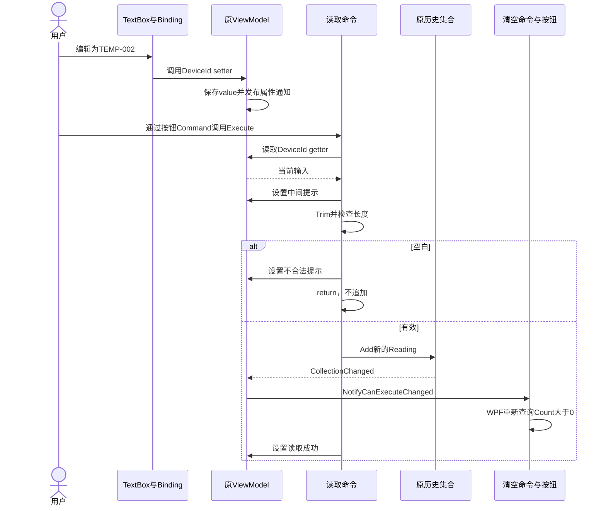

# TASK-013 知识笔记：ViewModel、双向输入绑定与读取命令

> 整理日期：2026-10-13。任务：把读取逻辑从窗口移到 ViewModel。状态：✅ 已通关（2026-10-12）。
>
> 根据当前源码、任务卡、学习进度、问答及错题记录详细提取。标为“当前实现”的代码来自当前作品；“说明示例”“展开写法”仅帮助理解，不表示新增到项目或已经运行。本轮不修改学员源码，不新增验收或自主掌握证据。

## 来源与阅读顺序

| 来源 | 提取内容 |
| :--- | :--- |
| [TASK-013 任务卡](../tasks/TASK-013.md) | 场景、骨架分工、TODO、DoD、修复与历史审查 |
| [Task013Window.xaml](../../WpfBae/Exercises/TASK-013-reading-viewmodel/Task013Window.xaml) | 输入 TwoWay 与四处 OneWay 绑定 |
| [Task013Window.xaml.cs](../../WpfBae/Exercises/TASK-013-reading-viewmodel/Task013Window.xaml.cs) | 创建一个 ViewModel、设置 DataContext |
| [ReadingViewModel.cs](../../WpfBae/Exercises/TASK-013-reading-viewmodel/ReadingViewModel.cs) | 完整属性、原集合、两个命令、通知连接 |
| [ReadTemperatureCommand.cs](../../WpfBae/Exercises/TASK-013-reading-viewmodel/ReadTemperatureCommand.cs) | 取得输入、Trim、提前 return、追加及提示 |
| [ClearHistoryCommand.cs](../../WpfBae/Exercises/TASK-013-reading-viewmodel/ClearHistoryCommand.cs) | 复用清空条件、动作和通知 |
| [复用的 Reading](../../WpfBae/Exercises/TASK-010-reading-binding/Task010Window.xaml.cs) | init 属性及默认行文字 |
| [ViewModel 问答](../questions/wpf-mvvm.md) | 输入写回、通知用途、Mode 与更新时机的追问 |
| [错题本](../mistakes.md) | 空白分支漏 return 的现象、根因与自主修复 |
| [学习进度](../learning.md) | 已验证应用范围及待复习边界 |
| [TASK-010 笔记](./TASK-010-wpf-binding.md) | DataContext、get/set/value、属性通知基础 |
| [TASK-011 笔记](./TASK-011-wpf-reading-history.md) | ObservableCollection、ItemsSource 与同一集合 |
| [TASK-012 笔记](./TASK-012-wpf-commands.md) | ICommand、委托/事件和清空按钮条件链 |
| [App.xaml](../../WpfBae/App.xaml) | 当前启动入口 |

建议先看角色与对象关系，再看完整 DeviceId 属性及输入方向，最后逐行跟踪读取命令。Java 后端经验可帮助理解类、接口和职责拆分，但不据此默认熟悉 WPF 的绑定与输入时机。

## 1. 核心目标：读取动作使用数据，而不是读取控件

TASK-012 的读取代码在窗口中，直接取 `DeviceIdTextBox.Text`。TASK-013 先让输入框将文字写入 ViewModel.DeviceId，再由读取命令使用这个属性。

```text
TASK-012：点击读取 → 窗口 Click → TextBox.Text → Reading → 历史

TASK-013：编辑输入 → Binding → ViewModel.DeviceId
         点击读取 → ReadCommand.Execute → DeviceId → Reading → 历史
```

界面仍有设备 ID、读取温度、历史、清空和状态提示；有效读取追加记录，空白只提示，清空条件仍为历史非空。重心是代码的连接和职责变化，不是换一个新业务。

当前读数固定为 26.5 °C，代码同步执行，没有实际设备、异步服务、文件保存或数据库操作。

## 2. TASK-012 与 TASK-013 的具体差异

| 位置 | TASK-012 | TASK-013 |
| :--- | :--- | :--- |
| 界面数据类 | ReadingCommandStatez | ReadingViewModel |
| 设备 ID 来源 | 读取时取 TextBox.Text | 命令读取 DeviceId 属性 |
| 输入 XAML | 固定初始 Text="TEMP-001" | Text 绑定 DeviceId |
| 读取按钮 | Click="ReadButton_Click" | Command 绑定 ReadCommand |
| 读取逻辑 | 窗口处理方法 | ReadTemperatureCommand.Execute |
| 清空命令保存的对象 | ReadingCommandState | 同一个 ReadingViewModel |
| 窗口后台 | 初始化、DataContext、读取业务 | 初始化和 DataContext |
| 历史与状态 | 集合和属性绑定 | 继续复用相同机制 |

这次迁移不是只把类名加上 ViewModel。关键变化是业务代码不再通过控件引用取得输入，两个按钮都通过命令使用同一数据对象。

## 3. MVVM 三个角色在当前项目中是什么

MVVM 是 Model、View、ViewModel 的代码组织方式，不是 C# 关键字，也不是必须安装的包。

| 角色 | 当前对应 | 当前职责 |
| :--- | :--- | :--- |
| Model | TASK-010 的 Reading | 表示一次读取的 ID、温度和单位 |
| View | Task013Window 的 XAML 与必要后台 | 布局、显示、输入交互、连接 DataContext |
| ViewModel | 自定义 ReadingViewModel | 保存输入、历史、提示，公开两个命令 |

读取业务实际写在独立的 ReadTemperatureCommand 类里，由 ViewModel 创建并公开它。任务名称中的“移到 ViewModel”指迁入 ViewModel 所提供的数据和命令体系，不是说 Execute 的方法体就在 ReadingViewModel.cs 中。

Model 不等于数据库实体的唯一形式；当前普通 Reading 数据类即可。ViewModel 不继承 Window，也不需要保存 TextBox、TextBlock 或 ListBox 对象。

这种分工让界面布局与读取动作可以分别理解和修改。微软的 [MVVM 架构说明](https://learn.microsoft.com/en-us/dotnet/architecture/maui/mvvm)说明了这些一般角色；该页面面向 .NET MAUI，本任务使用的是 WPF DataContext，不使用页面中的 BindingContext 或 MAUI 控件。

## 4. 文件、类型和自定义名字的身份

专属目录：`WpfBae/Exercises/TASK-013-reading-viewmodel/`。

| 名称 | 来源 | 用途 |
| :--- | :--- | :--- |
| ReadingViewModel | 教练自定义普通 C# 类 | 数据与命令的统一入口 |
| ReadTemperatureCommand | 自定义类，实现 ICommand | 使用输入并新增读数 |
| ClearHistoryCommand | 本任务自定义类，实现 ICommand | 清空原历史集合 |
| DeviceId、StatusText、Readings | 自定义公开属性 | 提供输入、提示和历史 |
| ReadCommand、ClearCommand | 自定义公开属性 | 提供原命令对象 |
| DataContext、TextBox.Text、Button.Command | WPF 属性 | 数据来源、输入值及命令连接 |
| Binding、Mode、UpdateSourceTrigger | WPF 绑定机制与设置 | 路径、方向和写回时机 |
| ICommand、INotifyPropertyChanged | .NET 接口 | 命令约定和属性通知约定 |
| ObservableCollection、EventHandler | .NET 类型 | 集合变化及命令事件委托 |
| OnPropertyChanged、NotifyCanExecuteChanged | 自定义普通方法 | 分别发布属性与命令条件通知 |

同名 ClearHistoryCommand 同时存在于 TASK-012 和 TASK-013，但命名空间不同：本任务是 `WpfBae.Exercises.Task013`。它们是两个类型，不是覆盖原文件。

`using WpfBae.Exercises.Task010;` 允许用短名字 Reading 访问已有类型，类似 Java import；它不会创建 Reading 或打开 TASK-010 窗口。

## 5. ReadingViewModel 保存哪些状态

当前字段：

```csharp
private string _deviceId = "TEMP-001";
private string _statusText = "先完成 TODO 1，观察命令取得的设备 ID。";
private ObservableCollection<Reading> _readings =
    new ObservableCollection<Reading>();
private ReadTemperatureCommand _readCommand;
private ClearHistoryCommand _clearCommand;
```

字段存数据或对象引用；公开属性提供访问入口。`_deviceId` 是用户当前输入，`_statusText` 是当前提示，`_readings` 引用原历史集合，两个命令字段保存命令实例。

初始 ID 的来源已经从 XAML 固定文本移到 `_deviceId`。初始状态文字仍保留骨架提示，源码并未改成“尚未读取”；应按当前实现描述，不因为任务已通关就擅自改文案。

历史集合在该 ViewModel 的生命周期内保留；关闭窗口后没有本任务的持久化恢复机制。

## 6. 窗口的后台代码为什么变短

当前核心代码：

```csharp
private ReadingViewModel _viewModel = new ReadingViewModel();

public Task013Window()
{
    InitializeComponent();
    DataContext = _viewModel;
}
```

`new ReadingViewModel()` 创建实例，窗口字段保存引用。InitializeComponent 是 WPF 生成的初始化方法，用来创建和连接 XAML 界面。DataContext 指向这个实例，内部 Binding 就能按公开属性名读取它。

当前窗口没有读取/清空 Click 方法，也没有通过控件 Text 或 Items 完成业务。后台仍有正常的初始化代码；MVVM 不要求把所有后台代码删空。

只写一个叫 ReadingViewModel 的类不会自动连接界面。当前明确的连接点就是 `DataContext = _viewModel`。

## 7. 一个 ViewModel、两个命令、一份历史集合

当前构造函数：

```csharp
public ReadingViewModel()
{
    _readCommand = new ReadTemperatureCommand(this);
    _clearCommand = new ClearHistoryCommand(this);
    _readings.CollectionChanged += Readings_CollectionChanged;
}
```

此处 this 是正在创建的 ReadingViewModel，不是窗口。两个命令构造函数接到同一个引用并保存到各自字段。读取命令构造函数如下，清空命令同样保存传入对象：

```csharp
private ReadingViewModel _viewModel;

public ReadTemperatureCommand(ReadingViewModel viewModel)
{
    _viewModel = viewModel;
}
```

`viewModel` 是参数，`_viewModel` 是命令自己的字段；窗口也有同名字段，属于不同类。赋值保存引用，不复制对象或集合。

```text
窗口字段 _viewModel → ViewModel 实例 V ← DataContext
                        ├─ DeviceId / StatusText
                        ├─ 历史集合 R
                        ├─ 读取命令 A ── _viewModel → V
                        └─ 清空命令 B ── _viewModel → V

列表 ItemsSource → R
读取 Add → R；清空 Clear → R
```

不能在命令中再 new 一份 ViewModel 当作当前数据，也不能给 DataContext 另建一份而窗口仍使用旧字段。这样会让输入、条件与历史脱节；在当前构造关系中，命令内部再次创建 ViewModel 还会继续创建命令。

## 8. 三个 getter 返回已有对象，不是工厂方法

当前 Readings、ReadCommand、ClearCommand 只有 getter：

```csharp
public ObservableCollection<Reading> Readings
{
    get
    {
        return _readings;
    }
}

public ICommand ReadCommand
{
    get
    {
        return _readCommand;
    }
}

public ICommand ClearCommand
{
    get
    {
        return _clearCommand;
    }
}
```

读取属性就执行 getter 中的 return，返回原字段保存的引用。两个命令属性声明为 ICommand，但实际对象仍是具体的 ReadTemperatureCommand、ClearHistoryCommand。

Readings 没有 setter，只限制外部替换该属性；集合本身仍可 Add/Clear。命令 getter 也不会每次创建新命令。构造与获取分开，才能让绑定与通知使用稳定的对象关系。

## 9. 五处 Binding 的来源、目标和方向

当前窗口没有给这些 Binding 单独指定 Source，因此从继承的 DataContext 取得 ViewModel。

| 控件目标属性 | 来源属性 | 模式 | 当前目的 |
| :--- | :--- | :--- | :--- |
| DeviceIdTextBox.Text | DeviceId | TwoWay | 初始显示与编辑写回 |
| ReadButton.Command | ReadCommand | OneWay | 取得读取命令对象 |
| HistoryListBox.ItemsSource | Readings | OneWay | 显示原历史集合 |
| ClearButton.Command | ClearCommand | OneWay | 取得清空命令对象 |
| StatusTextBlock.Text | StatusText | OneWay | 显示程序提示 |

“来源”是对象属性，“目标”是控件属性，读方向时先说清两端。`Binding DeviceId` 中 DeviceId 是属性路径，不能换成私有字段 `_deviceId`、控件名字或类型名。

命令的 OneWay 仅表示命令对象由 ViewModel 提供给按钮，不禁止按钮调用 Execute。列表的 OneWay 不表示集合只能显示一次，集合通知仍让行数更新。

模式和来源的基础依据：[WPF 数据绑定概览](https://learn.microsoft.com/en-us/dotnet/desktop/wpf/data/)。

## 10. 完整 DeviceId 属性：get、set、value

当前实现：

```csharp
public string DeviceId
{
    get
    {
        return _deviceId;
    }
    set
    {
        _deviceId = value;
        OnPropertyChanged("DeviceId");
    }
}
```

`get` 在读取属性时运行，返回保存的字符串。`set` 在给属性赋值时运行，赋值右侧的新字符串成为 value。

说明示例，未添加到项目：

```csharp
_viewModel.DeviceId = "TEMP-002";
string currentId = _viewModel.DeviceId;
```

第一行进入 setter，value 为 TEMP-002，先保存字段，再通知。第二行进入 getter，得到保存后的字符串。DeviceId 是属性，`_deviceId` 是实际保存值的字段，不是两份独立设备 ID。

对于 Java 背景，可对照 getter/setter 方法的职责；C# 把访问器写在属性声明内，调用处用赋值和读取语法。OnPropertyChanged 是自定义工具，不是每个 C# 属性自动拥有的行为。

## 11. TwoWay 怎样让输入框的文字进入对象

当前输入：

```xml
<TextBox x:Name="DeviceIdTextBox"
         Text="{Binding DeviceId, Mode=TwoWay, UpdateSourceTrigger=PropertyChanged}"
         Margin="0,8,0,12" />
```

两条方向分别是：

```text
来源 → 目标：ViewModel.DeviceId getter → TextBox.Text
目标 → 来源：用户编辑 TextBox.Text → Binding → DeviceId setter
```

打开窗口，初始 DeviceId 为 TEMP-001，绑定读取并显示。用户改成 TEMP-002，绑定将新文字写到同一个 ViewModel 的属性中，setter 的 value 接到新字符串。

可以把写回效果理解为 `_viewModel.DeviceId = "TEMP-002"`，这是解释效果的示意，不是需要在项目里补写的代码，也不表示 WPF 框架知道我们的字段变量名。

更新数据与执行读取分开：编辑文字会写入 DeviceId，但不自动执行 ReadCommand。只有实际调用命令后才追加读数。

## 12. UpdateSourceTrigger 决定何时写回，不决定写向哪里

TwoWay 指定方向；UpdateSourceTrigger 指定控件变化何时更新来源。

| 设置 | TextBox 的写回时机 | 是否当前实现 |
| :--- | :--- | :--- |
| PropertyChanged | Text 属性变化时写回 | 是 |
| LostFocus | 输入框失去焦点时写回 | TextBox.Text 的默认时机，本任务明确改用上一项 |
| Explicit | 代码显式要求更新来源时 | 本任务未使用 |

本骨架明确使用 PropertyChanged，因此无需等待点击读取或离开输入框才保存新文字。LostFocus 只是绑定写回时机，不是保存文件、提交设备配置或点击“保存”的同义词。

该设置控制“控件 → 对象”方向，不能替代“对象 → 控件”的属性变化通知；也不会自动调用 Execute。来源：[Microsoft TextBox 写回时机说明](https://learn.microsoft.com/en-us/dotnet/desktop/wpf/data/how-to-control-when-the-textbox-text-updates-the-source)。

实际 XAML 写 TwoWay 和 PropertyChanged，不把讲解用的强调星号放进枚举值。

## 13. 三个相似名字：更新时机、事件、通知工具

| 写法 | 身份 | 起作用的方向 |
| :--- | :--- | :--- |
| UpdateSourceTrigger=PropertyChanged | WPF Binding 设置，PropertyChanged 是枚举值 | 控件文字变化时写回对象 |
| PropertyChanged | INotifyPropertyChanged 要求的事件 | 对象通知绑定属性变了 |
| OnPropertyChanged("DeviceId") | 本项目自定义普通方法调用 | 发布上述事件，指定属性名 |

它们名字相近，职责不同。输入绑定负责取得 TextBox 的新文字并调用 setter，OnPropertyChanged 不去读取输入框；setter 中的字段赋值负责保存值，通知工具负责让接收方重读属性。

```text
输入框变了 → Binding 写回 → setter(value)
                                  ├─ 保存 _deviceId
                                  └─ 发布 PropertyChanged("DeviceId")
```

不要新建一个叫 UpdateSourceTrigger 的事件，也不要把属性通知当作输入写回触发设置。

## 14. 输入框已经变了，setter 为什么还通知

要分清修改来源。当前 setter 原样保存 value 时，用户输入框本来就显示新文字；字段赋值已经足以保存这次输入，OnPropertyChanged 不是从输入框取得值的必要步骤。

但 DeviceId 还可能由普通代码赋值。说明示例：

```csharp
_viewModel.DeviceId = "TEMP-004";
```

这次用户没有编辑 TextBox。字段变化后，在当前 INotifyPropertyChanged 路径上，需要对象通知绑定重新读取，才能让输入框显示 TEMP-004。

如果另一个控件也绑定 DeviceId，用户编辑原输入框后，另一个控件也需要收到对象变化通知才能跟随。当前任务没有这个额外控件，此处仅解释用途。

因此“这次输入能写到字段”不能推广成“所有绑定都不需要通知”。TwoWay 支持两个方向，不自动探测任意字段赋值。依据：[Microsoft 属性变化通知说明](https://learn.microsoft.com/en-us/dotnet/desktop/wpf/data/how-to-implement-property-change-notification)。

## 15. StatusText 为什么只用 OneWay

状态提示由程序设置，用户通过 TextBlock 阅读，没有在该控件编辑并写回对象的操作。所以当前 XAML 为：

```xml
<TextBlock x:Name="StatusTextBlock"
           Text="{Binding StatusText, Mode=OneWay}"
           Margin="0,12,0,0"
           TextWrapping="Wrap" />
```

当前完整属性：

```csharp
public string StatusText
{
    get
    {
        return _statusText;
    }
    set
    {
        _statusText = value;
        OnPropertyChanged("StatusText");
    }
}
```

命令赋值 StatusText，setter 保存文字并通知，OneWay 绑定重读并更新显示。OneWay 不是“只初始化一次”；只是没有控件写回来源的方向，所以这里不需要 UpdateSourceTrigger。

DeviceId 和 StatusText 都是 string，但绑定模式不同。选择模式取决于使用场景和控件是否编辑数据，而不是属性类型或名字。

## 16. INotifyPropertyChanged 与完整通知工具

当前类实现 INotifyPropertyChanged，并提供：

```csharp
public event PropertyChangedEventHandler? PropertyChanged;

private void OnPropertyChanged(string propertyName)
{
    PropertyChangedEventHandler? handler = PropertyChanged;
    if (handler != null)
    {
        handler(this, new PropertyChangedEventArgs(propertyName));
    }
}
```

INotifyPropertyChanged、PropertyChangedEventHandler、PropertyChangedEventArgs 来自 System.ComponentModel。PropertyChangedEventHandler 是委托类型；PropertyChanged 是事件；handler 是局部委托变量，保存已登记的接收方法引用。

`?` 允许没有订阅者时为 null，if 检查有接收方法才调用。this 是发布属性通知的 ReadingViewModel 实例。新建的 PropertyChangedEventArgs 保存属性名，不保存新 ID、温度或状态文字。绑定收到名称后再通过 getter 读取值。

`OnPropertyChanged("DeviceId")` 和 `OnPropertyChanged("StatusText")` 分别通知不同路径。当前 setter 没有比较新旧值，相同字符串再次赋值也会通知；不能将现有实现描述成“值不同才发布”。

等价的常见通知简写是 `PropertyChanged?.Invoke(this, new PropertyChangedEventArgs(propertyName))`；先理解完整 null 判断和委托调用即可，本轮不改作品。完整委托基础见 [TASK-012 笔记](./TASK-012-wpf-commands.md)。

## 17. 读取按钮为什么始终可用

当前命令条件：

```csharp
public bool CanExecute(object? parameter)
{
    return true;
}
```

本任务保留“空白也能点击读取，然后显示提示”的行为。因此读取可用条件固定 true；输入是否合法由 Execute 判断。

true 不是“输入已经合法”的结论，只是“允许调用读取动作”。若把空白判断放入 CanExecute 并禁用按钮，用户将无法通过该次点击得到当前不合法提示，那会改变任务行为。

读取命令仍声明 CanExecuteChanged，因为 ICommand 要求该事件。骨架提供 NotifyCanExecuteChanged，但当前条件不会变化，不需要因每次输入变化发布读取命令条件通知。事件工具存在不表示当前代码必然使用它。

ICommand 的约定依据：[Microsoft ICommand 文档](https://learn.microsoft.com/en-us/dotnet/api/system.windows.input.icommand?view=net-10.0)。

## 18. 读取按钮怎样取得并执行 ReadCommand

当前 XAML：

```xml
<Button x:Name="ReadButton"
        Content="读取温度"
        Command="{Binding ReadCommand, Mode=OneWay}"
        HorizontalAlignment="Left"
        Padding="12,6" />
```

取得对象的链是：`DataContext → ReadingViewModel.ReadCommand → getter → 原 _readCommand → Button.Command`。不是按类名在点击时新建命令，也不读取私有字段。

WPF 用 ICommand 查询条件，正常按钮调用时使用 Execute。当前没有 CommandParameter，默认参数为 null，读取命令不读取该参数。`object? parameter` 是接口方法接收的命令参数，不是 ViewModel 引用；后者已由构造函数保存。

`object?` 的问号表示允许 null，不表示调用时可以省掉实参。窗口不需要再写 Click 来转发读取业务。

## 19. 当前 Execute 完整顺序

去掉注释和空行后的当前业务语句如下，保持原顺序：

```csharp
public void Execute(object? parameter)
{
    string id = _viewModel.DeviceId;
    _viewModel.StatusText = "命令取得的设备 ID：" + id;

    id = id.Trim();
    if (id.Length == 0)
    {
        _viewModel.StatusText = "该 Id 不合法";
        return;
    }

    _viewModel.Readings.Add(new Reading
    {
        DeviceId = id,
        Value = 26.5,
        Unit = "°C"
    });

    _viewModel.StatusText = "读取成功";
}
```

对象初始化器在源码中写在一行，此处只展开排版。当前还保留 TODO 1 的“命令取得的设备 ID”中间提示；后面会根据分支再设置最终提示。

| 步骤 | 当前动作 | 是否可能改变历史 |
| :--- | :--- | :--- |
| 取得属性 | 保存 DeviceId 到局部 id | 否 |
| 中间提示 | 设置原始输入文字提示 | 否 |
| Trim/校验 | 得到处理后的局部 ID | 否 |
| 空白分支 | 提示并 return | 否 |
| 有效分支 | new Reading 后 Add | 是，追加一条 |
| 成功提示 | 设置读取成功 | 否 |

读取命令不直接访问任何控件，其输入和结果都通过 ViewModel 属性及集合表达。

## 20. 局部 id、Trim 和输入属性并不是同一个值槽

当前两次赋值：

```csharp
string id = _viewModel.DeviceId;
id = id.Trim();
```

第一行读取属性，局部变量 id 保存当前字符串；第二行将去掉首尾空白的结果再赋给局部变量。String.Trim 返回处理后的字符串，不修改原字符串内容。依据：[Microsoft String.Trim 文档](https://learn.microsoft.com/en-us/dotnet/api/system.string.trim?view=net-10.0)。

| 输入/属性 | Trim 后局部 id | 新 Reading.DeviceId | 是否由此改写输入框 |
| :--- | :--- | :--- | :--- |
| TEMP-001 | TEMP-001 | TEMP-001 | 否 |
| 两侧有空格的 TEMP-003 | TEMP-003 | TEMP-003 | 否 |
| 空字符串 | 空字符串 | 不创建 | 否 |
| 纯空格 | 空字符串 | 不创建 | 否 |

当前没有 `_viewModel.DeviceId = id`，因此 Trim 不会把 ViewModel.DeviceId 或输入框自动规范化。它只规范化本次用于读数的局部 ID。

`id.Length == 0` 在 Trim 后判断字符串长度是否为零，能覆盖当前空字符串与纯空格输入。DeviceId 初始为非空字符串，正常 Text 绑定提供字符串；当前没有额外 null 防护，也没有验证任意设备 ID 格式或检查设备是否真实存在。非空 ID 即进入模拟读取。

## 21. return 是空白保护的关键，提示不是控制流

当前分支：

```csharp
if (id.Length == 0)
{
    _viewModel.StatusText = "该 Id 不合法";
    return;
}
```

if 的花括号结束，只表示分支结束。若没有 return，程序仍会执行后面的 Add 和“读取成功”。修改提示文字不会自动终止方法。

`return;` 在 void Execute 中立即结束本次方法调用，不退出整个应用，不删除历史，也不禁用读取按钮。依据：[C# return 语句说明](https://learn.microsoft.com/en-us/dotnet/csharp/language-reference/statements/jump-statements#the-return-statement)。

历史真实问题已在 [错题本](../mistakes.md)记录：首次审查空白分支漏 return，空字符串让 3 条历史变 4 条，纯空格继续变 5 条，不合法提示又被成功提示覆盖。学员随后自主补 return，最终两种空白均保留原 3 条并显示“该 Id 不合法”。

这是已修复历史，不是当前仍存在的错误。本轮只提取原因和复查点，不重复创建错题条目，也不因这个修复推定所有控制流概念都已掌握。

## 22. new Reading、init 属性和对象初始化器

Reading 是 TASK-010 的自定义数据类，包含：

```csharp
public string DeviceId { get; init; } = "";
public double Value { get; init; }
public string Unit { get; init; } = "";
```

`init` 允许在对象初始化阶段赋值。当前 `new Reading { DeviceId = id, Value = 26.5, Unit = "°C" }` 创建一个 Reading 实例，并设置这三个属性；不是 JSON 或匿名对象。

DeviceId 左侧是新 Reading 的属性，右侧 id 是命令中的局部变量。它与 ViewModel.DeviceId 同名但属于不同对象：一个表示当前输入，一个表示某次历史读数的 ID。

每次有效读取都 new 一条记录，重复 ID 也追加，不按设备 ID 去重。旧 Reading 不因为后来改了输入就改变。

当前 ListBox 没有 ItemTemplate，复用 Reading.ToString 的默认文字形状“ID 数值 单位”。源码的 ToString 在单位后还有一个空格；不影响读取逻辑或清空条件。

## 23. Add 原集合：为什么旧记录保留、列表自动增加

当前调用是 `_viewModel.Readings.Add(...)`。Readings getter 返回原 ObservableCollection，Add 把新对象放到末尾，没有替换原集合。

```text
读取前：R = [Reading1, Reading2]
读取后：R = [Reading1, Reading2, Reading3]
```

ItemsSource 的 OneWay 绑定仍指向 R。ObservableCollection 的 CollectionChanged 通知让列表跟随新增，不需要手动调用 HistoryListBox.Items.Add 或重建列表。

ViewModel 同时登记了集合变化处理方法：

```csharp
private void Readings_CollectionChanged(
    object? sender, NotifyCollectionChangedEventArgs e)
{
    _clearCommand.NotifyCanExecuteChanged();
}
```

sender 是原集合，e 描述集合变化。当前处理方法将变化转换成清空条件重查；不是执行清空，也不是通知读取命令执行。

Readings 没有被替换，所以 Add 不要求 ViewModel 发布 `PropertyChanged("Readings")` 来更新行数。若未来允许替换整个集合，属性绑定与集合订阅需要另行处理，当前没有这种路径。

## 24. 清空命令继续共用原历史

当前核心实现：

```csharp
public bool CanExecute(object? parameter)
{
    return _viewModel.Readings.Count > 0;
}

public void Execute(object? parameter)
{
    if (!CanExecute(parameter))
    {
        return;
    }

    _viewModel.Readings.Clear();
    _viewModel.StatusText = "已清空";
}
```

CanExecute 查询数量，Execute 实际清空。空历史时防护 return，因此不执行 Clear 或设置“已清空”。有效清空删除 R 的元素，R 本身保持原实例。

集合变化后，ViewModel 调用清空命令的 NotifyCanExecuteChanged，发布 CanExecuteChanged；WPF 重新查询，Count 变 0 后按钮禁用。再次读取 Add 后又启用。

```text
CollectionChanged
 → ViewModel.Readings_CollectionChanged
 → ClearHistoryCommand.NotifyCanExecuteChanged
 → CanExecuteChanged
 → WPF 重新调用 CanExecute
 → Count > 0 的 bool 决定命令可用条件
```

本任务清空实现由骨架复用 TASK-012 已验证内容，不算学员在 TASK-013 独立重写的部分。声明或发布条件事件不执行 Execute，详细委托与 WPF 接收路径见 [TASK-012 笔记](./TASK-012-wpf-commands.md)。

## 25. 三种通知与两条输入方向的完整分工

| 机制 | 当前触发来源 | 当前效果 |
| :--- | :--- | :--- |
| TwoWay + UpdateSourceTrigger | TextBox.Text 编辑 | 将文字写到 DeviceId setter |
| PropertyChanged | DeviceId/StatusText 属性赋值 | 通知绑定重读指定属性 |
| CollectionChanged | 原集合 Add/Clear | 列表更新，并让状态处理方法通知清空命令 |
| CanExecuteChanged | 清空命令发布通知 | WPF 重新检查清空条件 |

把当前所有通知都叫“更新界面”会隐藏关键区别。输入写回负责数据进入对象；属性通知负责对象变化被绑定看到；集合通知负责元素增删；命令通知负责条件重新查询。

空白读取也会更新 StatusText 并发属性通知，但不会 Add/Clear，因此当前链路没有集合事件或清空条件事件。改 DeviceId 本身也不增删历史。

ObservableCollection 还具备集合自身的属性通知能力；这里讨论的是任务实际使用的 CollectionChanged 业务连接，不将该类型描述成仅有一种事件。

## 26. 当前输入与历史读数为什么各自保持

说明场景：先用 TEMP-001 读取，再把输入改成 TEMP-002。

```text
ViewModel.DeviceId = TEMP-002
原历史第 1 条 Reading.DeviceId = TEMP-001
```

只编辑输入时，原记录不改变；再次点击读取，才创建 TEMP-002 的新 Reading 并追加。历史保存每次读取时的值，不直接绑定到当前 DeviceId。

同理，清空只 Clear 历史并改提示，没有清空或重置 DeviceId。因此清空后输入仍可用于再次读取。

读取命令每次 Execute 都重新从 getter 取得当前 DeviceId，没有在构造函数中缓存最初的 TEMP-001；这是修改输入后新记录能使用新 ID 的原因。

## 27. 中间提示与最终提示：不要把一行赋值当成最终显示

当前每次 Execute 都先设置：

```csharp
_viewModel.StatusText = "命令取得的设备 ID：" + id;
```

随后有效分支改成“读取成功”，空白分支改成“该 Id 不合法”。当前两个分支都会进行两次 StatusText 赋值和对应通知。

| 分支 | 第一次提示 | 最终提示 |
| :--- | :--- | :--- |
| 有效输入 | 命令取得的设备 ID：原始输入 | 读取成功 |
| 空白输入 | 命令取得的设备 ID：原始输入 | 该 Id 不合法 |

这是首个观察 TODO 留下的实现。命令同步执行，两次赋值可能在一次绘制前完成，用户不一定看到中间文字；不能把它承诺为运行时必定出现的短暂提示。

理解通知时应看当前所有赋值，理解用户结果时应看最终分支。笔记如实保留中间行，不为整理知识而改动作品，也不把旧 TODO 注释当作代码未完成的证明。

## 28. 完整时序：编辑、读取、显示与清空条件



这是主要业务链说明图，不列出每个 WPF 内部调用，不限定 CanExecute 的查询次数。历史列表通过集合通知显示新行，StatusText 的属性通知更新提示。

清空路径继续是“按钮命令调用 → 条件防护 → 原集合 Clear → 集合/命令条件通知 → 禁用 → 设置已清空”。按钮在清空途中变禁用，不会阻止已进入 Execute 的后续提示赋值。

## 29. 场景结果与排查线索

下表是根据当前代码整理的预期结果，历史审查覆盖情况见后文；本轮没有重新运行。

| 操作 | 历史/状态结果 | 关键连接或分支 |
| :--- | :--- | :--- |
| 初始打开 | 空历史，清空禁用；输入 TEMP-001 | 初次绑定读取和 CanExecute |
| TEMP-001 连读两次 | 两条旧记录保留 | 每次创建 Reading 后 Add |
| 改 TEMP-002 再读 | 追加第三条，新 ID 正确 | TwoWay 写回与 Execute 重新取属性 |
| 空字符串读取 | 原三条保持，提示该 Id 不合法 | 校验后 return |
| 纯空格读取 | 同上 | Trim 后长度为零 |
| 点击清空 | 零条、已清空、清空禁用 | 同一集合 Clear 与条件通知 |
| 两侧空格 TEMP-003 读取 | 一条已 Trim 的记录，清空恢复可用 | 局部字符串处理与 Add |
| 代码设置 DeviceId | 输入框随属性通知更新 | 来源到目标方向 |

| 异常现象 | 优先核对 |
| :--- | :--- |
| 输入改了，记录仍使用初始 ID | DeviceId 绑定路径、Mode、写回时机、命令是否使用同一 ViewModel |
| 输入写回了，但代码改属性不刷新输入框 | setter 是否发布对应 PropertyChanged |
| 空白最终显示读取成功并新增行 | 不合法分支是否提前 return |
| 列表新增，清空仍禁用 | 集合订阅、NotifyCanExecuteChanged、命令实例与 Count |
| 状态字段变了，提示不变 | StatusText 通知名称与 Text 绑定路径 |
| 新输入改变旧记录 | 是否混淆 ViewModel.DeviceId 与各 Reading.DeviceId |
| 点击一次新增两条 | 是否同时保留旧业务 Click 和读取 Command，或重复 Add |
| 运行标题不是 TASK-013 | App.xaml 当前启动入口 |

两个字符串属性名字相似时，优先确定“当前在访问哪个对象”；多个命令问题先确认返回的是哪个实例，再跟踪条件和通知。

## 30. 实际运行、绑定保留与最小观察

当前项目为 `net10.0-windows`，启用 Nullable、UseWPF；当前 [App.xaml](../../WpfBae/App.xaml) 指向 TASK-017：

```xml
StartupUri="Exercises/TASK-017-button-controltemplate/Task017Window.xaml"
```

所以现在执行以下命令，会打开 TASK-017，而非 TASK-013：

```powershell
dotnet run --project .\WpfBae\WpfBae.csproj
```

将来单独复跑 TASK-013，需明确切换到真实入口 `Exercises/TASK-013-reading-viewmodel/Task013Window.xaml`，观察后恢复当前入口。本轮没有切换入口、构建或运行窗口。

最小观察是确认窗口标题“TASK-013：读取逻辑与 ViewModel”，将输入改为一个新 ID，只读取一次，核对新行使用该 ID且旧行保留。需要看输入写回时，可在 ReadingViewModel.cs 的 DeviceId setter 设断点，观察 value；需要看读取时，可在 ReadTemperatureCommand.Execute 的第一行观察 getter 结果。说明步骤不要求改核心逻辑。

历史审查用 TextBox.SetCurrentValue 改控件值以保留 Binding，并在点击前核对 DeviceId 已写回；按钮经自动化提供程序走 WPF 命令路径。验证绑定时，随意直接给绑定目标属性赋本地值可能替换绑定，不能用“控件出现了新文字”单独证明写回成功。绑定保留的 WPF 机制见 [依赖属性值优先级说明](https://learn.microsoft.com/en-us/dotnet/desktop/wpf/properties/dependency-property-value-precedence)。

必须区分源码、IDE 提示、设计预览、运行窗口与验收记录。直接调用 Execute 可核对命令业务，但不能独自证明 TextBox 写回、Button.Command 绑定和真实界面全链路。

## 31. 历史验收、骨架与自主实现的边界

| 内容 | 任务卡标明的来源 | 当前学习边界 |
| :--- | :--- | :--- |
| ViewModel、完整属性、集合、命令构造 | 教练骨架提供 | 不能算独立 MVVM 设计证据 |
| 输入 TwoWay/PropertyChanged、两个 Command 绑定 | 骨架提供 | 运行验证连接有效，机制问答仍待复习 |
| 清空条件、动作和通知工具 | 复用 TASK-012，由骨架提供 | 不算 TASK-013 重新自主设计 |
| Execute 取得 DeviceId、Trim、空白 return | 学员实现和自主修复 | 已验证在现有连接上应用 |
| new Reading、Add 原集合、成功提示 | 学员实现 | 已验证当前读取逻辑 |

任务卡记录 2026-10-12 最终构建 0 警告/错误、原程序打开并正常关闭退出 0；学员补 return 后，10 个实际窗口场景全部通过。还核对窗口与两个命令同 ViewModel、同历史集合、输入写回、各 Binding 保留、按钮命令路径及通知。

附加观察记录代码设置 DeviceId=TEMP-004 后输入框更新，证明当前对象到输入框的通知连接；这项由审查验证，不是新增学员独立实现证据。任务通过不表示完整属性、委托、绑定引擎与 MVVM 设计全部掌握。[ViewModel 问答 Q1](../questions/wpf-mvvm.md)继续待复习。

本地 `docx/tasks/evidence/TASK-013/` 当前不存在，results.json、verification.json、审查工程及修正前附件无法在本轮直接读取。上述是任务卡与错题本保留的历史结论，不是本轮复跑；缺失附件不作为本轮新证据链接。

本轮对照当前五个专属文件、共享 Reading 和 App.xaml 整理文档，不重新评定 DoD，不开始下一任务，不更改已有任务/问答状态。

## 32. 复习主线与本任务范围

```text
View：显示布局并连接 DataContext
  ↓ Binding
ViewModel：保存 DeviceId、StatusText、原集合，公开两个命令
  ↓ 命令使用同一对象
ReadTemperatureCommand：取当前 ID → Trim → 空白提示并 return
                        → 有效则创建 Reading → Add → 成功提示
ClearHistoryCommand：Count > 0 → Clear → 完成提示

输入写回：TwoWay + UpdateSourceTrigger → setter 保存 value
对象通知：PropertyChanged → Binding 重读属性
历史通知：CollectionChanged → 列表更新
条件通知：CanExecuteChanged → WPF 重查 CanExecute
```

复习时要能区分：类和实例、同名字段和同一对象引用、输入属性和历史属性、Mode 和写回时机、UpdateSourceTrigger 的枚举值和属性事件、提示赋值和提前返回、条件查询和动作执行。

当前任务是 MVVM 起步的最小拆分，不要求服务层、依赖注入、通用 RelayCommand、异步读取或完整应用架构。这些不因命令类存在就算已实现，也不因阅读本笔记就算已掌握。

TASK-013 保持 ✅ 已通关；已验证范围是学员在既有骨架上自主完成的读取逻辑。机制继续结合以后实践复习，后续状态以学习记录为准。
