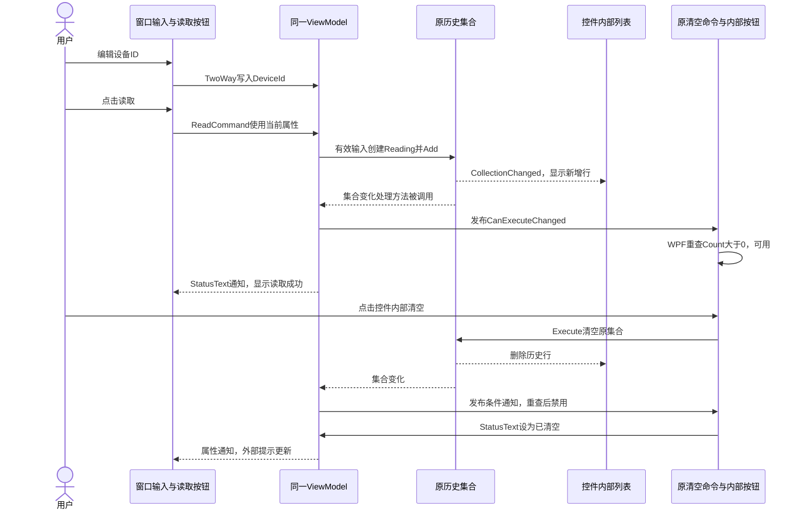

# TASK-014 知识笔记：UserControl 封装、DataContext 继承与历史区域复用

> 整理日期：2026-10-13。任务：用 UserControl 封装读取历史区域。状态：✅ 已通关（2026-10-12）。
>
> 根据当前源码、任务卡、学习记录、问答和本地历史验收文件提取。“当前实现”来自现有作品；“说明示例”“排查反例”用于理解，不表示新增到项目或已运行。本轮整理文档并核对历史材料，不修改源码、切换入口或重新验收。

## 来源与阅读顺序

| 来源 | 用途 |
| :--- | :--- |
| [TASK-014 任务卡](../tasks/TASK-014.md) | 封装目标、骨架/TODO、DoD 与历史审查 |
| [Task014Window.xaml](../../WpfBae/Exercises/TASK-014-history-usercontrol/Task014Window.xaml) | 窗口布局、前缀声明、嵌入控件及原绑定 |
| [Task014Window.xaml.cs](../../WpfBae/Exercises/TASK-014-history-usercontrol/Task014Window.xaml.cs) | 创建数据实例、初始提示、DataContext |
| [ReadingHistoryControl.xaml](../../WpfBae/Exercises/TASK-014-history-usercontrol/ReadingHistoryControl.xaml) | 标题、列表、清空按钮及两项绑定 |
| [ReadingHistoryControl.xaml.cs](../../WpfBae/Exercises/TASK-014-history-usercontrol/ReadingHistoryControl.xaml.cs) | 自定义控件类与初始化 |
| [复用的 ReadingViewModel](../../WpfBae/Exercises/TASK-013-reading-viewmodel/ReadingViewModel.cs) | 同一集合与两个命令、属性/集合通知 |
| [原读取命令](../../WpfBae/Exercises/TASK-013-reading-viewmodel/ReadTemperatureCommand.cs) | 输入、Trim、空白 return、追加与提示 |
| [原清空命令](../../WpfBae/Exercises/TASK-013-reading-viewmodel/ClearHistoryCommand.cs) | 条件、清空和条件通知 |
| [复用的 Reading](../../WpfBae/Exercises/TASK-010-reading-binding/Task010Window.xaml.cs) | 单条读数及默认显示文字 |
| [UserControl 问答](../questions/wpf-usercontrol.md) | 配对文件、前缀、继承对象与命名的解释 |
| [学习进度](../learning.md) | 已验证应用与待复习边界 |
| [9 个历史运行场景](../tasks/evidence/TASK-014/results.json) | 数量、状态、绑定数据对象及按钮条件 |
| [历史构建/启动/源码核对](../tasks/evidence/TASK-014/verification.json) | 2026-10-12 的验证记录和 SHA256 |
| [历史审查程序](../tasks/evidence/TASK-014/Review.cs) | 实际窗口、对象引用和绑定检查方法 |
| [TASK-013 笔记](./TASK-013-wpf-viewmodel.md) | 原 ViewModel、输入绑定和读取命令 |
| [TASK-012 笔记](./TASK-012-wpf-commands.md) | 命令事件与 WPF 条件重查 |
| [App.xaml](../../WpfBae/App.xaml) | 当前应用入口 |

建议先看“封装哪一块”和“类/实例”，再读 XAML 与后台连接，最后跟踪 DataContext、集合和命令。类与组合的概念可以联系 Java 经验，但 WPF 的前缀、生成代码及属性值继承需要分别说明。

## 1. 任务目标：让历史区域成为一个可放置的控件

原 TASK-013 窗口直接包含历史标题、ListBox 和清空按钮。TASK-014 把这三个元素组织到一个 ReadingHistoryControl 中，窗口只放置它的一处标签。

```text
窗口负责：设备 ID、读取按钮、历史控件的位置、状态提示
历史控件负责：读取历史标题、历史列表、清空按钮的组合
原 ViewModel/命令负责：输入、记录、校验、清空和通知
```

封装的对象是界面区域。没有把记录另存一份，也没有把读取/清空业务搬进控件后台。有效读取、空白保护、禁用/启用及恢复保持原行为。

当前场景仍为固定 26.5 °C 的同步模拟读取；没有新增通信、采集线程或持久化。

## 2. UserControl、ReadingHistoryControl 和 Window 的区别

| 名称 | 身份 | 当前用途 |
| :--- | :--- | :--- |
| UserControl | WPF 提供的基类，System.Windows.Controls | 组合现有界面元素 |
| ReadingHistoryControl | 本任务自定义的类 | 具体的历史区域 |
| Task014Window | 自定义窗口类，继承 WPF Window | 容纳整页界面 |

ReadingHistoryControl 不是现成 API，也不是数据类。它继承 UserControl，因此可以像其他控件一样放在窗口的布局里。

Window 是顶层窗口；当前历史控件是其中的一部分，不用 `Show()` 单独打开。历史审查中的 `window.Show()` 是显示 Task014Window，不是显示 UserControl。

UserControl 适合把现有控件组合起来。本任务不要求从零绘制控件或提供复杂模板化 API。基类来源与组合用途依据：[Microsoft UserControl 文档](https://learn.microsoft.com/en-us/dotnet/api/system.windows.controls.usercontrol?view=windowsdesktop-10.0)。

## 3. 封装前后的界面层次

```text
TASK-013 窗口 StackPanel
  ├─ 设备 ID 标题与输入框
  ├─ 读取按钮
  ├─ 历史标题
  ├─ ListBox
  ├─ 清空按钮
  └─ 状态提示

TASK-014 窗口 StackPanel
  ├─ 设备 ID 标题与输入框
  ├─ 读取按钮
  ├─ ReadingHistoryControl
  │    └─ 内部 StackPanel
  │         ├─ 历史标题
  │         ├─ ListBox
  │         └─ 清空按钮
  └─ 状态提示
```

窗口的读取按钮在控件外，清空按钮在控件内。它们依然使用同一 ViewModel 提供的两个命令。

“封装”是把这部分结构放入单独定义的类和 XAML，作为一个整体放置。界面看起来仍相似，但代码归属已经改变；不能仅凭外观相似就认定没有封装。

## 4. 新建四个文件，复用原数据与动作

实际目录：`WpfBae/Exercises/TASK-014-history-usercontrol/`。

| 文件 | 当前分工 | 实现来源 |
| :--- | :--- | :--- |
| Task014Window.xaml | 输入、读取、历史控件、状态 | 骨架提供 |
| Task014Window.xaml.cs | 创建 ViewModel、提示与数据连接 | 骨架提供 |
| ReadingHistoryControl.xaml | 标题、列表、清空按钮与绑定 | 容器骨架上由学员补齐 |
| ReadingHistoryControl.xaml.cs | 类声明、构造与初始化 | 骨架提供 |

原 ReadingViewModel、ReadTemperatureCommand、ClearHistoryCommand 和 Reading 留在原任务文件中。`using WpfBae.Exercises.Task013;` 让窗口后台能使用原 ViewModel 类型，并没有复制类或调用原窗口。

控件命名空间是 `WpfBae.Exercises.Task014`。文件目录有助于整理源码，但真正的 C# 命名空间以源码声明为准，不能靠文件夹名称猜类型位置。

## 5. 复用类不等于复用原窗口的数据实例

当前窗口字段：

```csharp
private ReadingViewModel _viewModel = new ReadingViewModel();
```

ReadingViewModel 是已存在的类型；`new` 创建 TASK-014 窗口自己的一份实例，字段 `_viewModel` 保存它的引用。不是从 TASK-013 窗口取原 `_viewModel`，也不是所有同类型对象共用一份历史。

本任务中的“同一对象”范围是：当前 Task014Window、它的历史控件、列表和按钮以及两个命令共用这一份实例。

说明对照，未实际同时打开两个窗口：

```text
Task013Window 自己创建的 ViewModel → 自己的历史
Task014Window 自己创建的 ViewModel → 自己的历史
```

复用的是类定义和已完成的行为；实例仍由创建位置决定。Java 中同一类可以 new 多个对象的经验适用于这里。

## 6. UserControl 的 XAML 根元素与 x:Class

当前根元素：

```xml
<UserControl x:Class="WpfBae.Exercises.Task014.ReadingHistoryControl"
             xmlns="http://schemas.microsoft.com/winfx/2006/xaml/presentation"
             xmlns:x="http://schemas.microsoft.com/winfx/2006/xaml">
    <StackPanel>
        <!-- 内部界面 -->
    </StackPanel>
</UserControl>
```

UserControl 表示根对象的 WPF 基类。x:Class 指出这份 XAML 对应哪个自定义 C# 类，完整名字由命名空间与类名组成。

默认 xmlns 让 Button、TextBlock、StackPanel 等 WPF 类型不需要前缀；xmlns:x 引入 XAML 语言的指令命名空间，供 x:Class、x:Name 使用。这两个 URI 是类型/语言命名空间标识，不是运行时要下载界面的地址。

文件名配对便于组织，但实际连接还要看 x:Class、C# namespace、类名和基类是否一致。依据：[WPF XAML 与后台代码说明](https://learn.microsoft.com/en-us/dotnet/desktop/wpf/advanced/code-behind-and-xaml-in-wpf)。

## 7. partial、构造函数与 InitializeComponent

控件后台去掉注释后的当前实现：

```csharp
using System.Windows.Controls;

namespace WpfBae.Exercises.Task014
{
    public partial class ReadingHistoryControl : UserControl
    {
        public ReadingHistoryControl()
        {
            InitializeComponent();
        }
    }
}
```

`public` 公开类；`class` 声明类；`: UserControl` 表示继承 WPF 基类；`partial` 允许同一个类的声明分成多个部分。手写后台和 WPF 构建生成的部分最终组成同一个类型，不是两个对象。

构造函数与类同名，没有返回类型，创建控件实例时执行。InitializeComponent 是 WPF 构建生成的方法，读取/连接编译后的 XAML 界面，创建内部元素。

它不是我们手写的业务函数，也不代表读取或清空已经执行。不要为了理解它而在项目里再定义同名方法或改生成文件。

当前两个后台文件使用有花括号的 namespace 写法，原 TASK-013 使用分号形式；它们都声明命名空间，不影响这次复用。

## 8. xmlns:history 怎样找到自定义控件类型

窗口根元素中声明：

```xml
xmlns:history="clr-namespace:WpfBae.Exercises.Task014"
```

| 部分 | 意义 |
| :--- | :--- |
| xmlns: | XAML/XML 命名空间声明 |
| history | 自己取的前缀 |
| clr-namespace: | 告诉 WPF 后面是 .NET/C# 命名空间 |
| WpfBae.Exercises.Task014 | 控件类所在的实际命名空间 |

history 不是文件夹、对象变量、内置 API 或数据属性。声明前缀让 XAML 能写该命名空间中的类型，声明本身还没有创建控件。

当前类型与窗口位于同一程序集，所以不用写 `assembly=...`。引用其他程序集类型时还涉及程序集引用，但不是本任务范围。来源：[Microsoft XAML 命名空间映射说明](https://learn.microsoft.com/en-us/dotnet/desktop/wpf/advanced/xaml-namespaces-and-namespace-mapping-for-wpf-xaml)。

## 9. 嵌入标签创建一个实例，x:Name 标识这个实例

当前窗口标签：

```xml
<history:ReadingHistoryControl x:Name="HistoryControl"
                               Margin="0,16,0,0" />
```

history 前缀找到类型所在命名空间，ReadingHistoryControl 是类型名。WPF 加载窗口界面时，创建该类的一个实例并放进外层 StackPanel。

HistoryControl 是这一处实例的名字，便于后台或检查程序找到它。它不是类名，也不是列表的 ItemsSource；Margin 是整个历史控件在父布局中的外边距。

标签没写 DataContext，符合当前让它沿父级取得同一对象的约定。这里只创建了一个历史控件实例，不能据此声称已验证多个控件同时使用。

## 10. 窗口初始化顺序与真实初始提示

当前构造函数：

```csharp
public Task014Window()
{
    InitializeComponent();
    _viewModel.StatusText = "TASK-014：先完成控件内的历史标题（TODO 1）。";
    DataContext = _viewModel;
}
```

窗口字段先创建 ViewModel；构造函数初始化窗口 XAML，其中包含历史控件的创建和内部初始化；随后覆盖 StatusText，再把 ViewModel 设置到 DataContext。

控件自己的构造函数调用 InitializeComponent 时，不应假设它已经取得最终窗口数据上下文。当前控件不在构造函数里读取 ViewModel 或执行业务，绑定在后续数据来源建立后正常取值。

StatusText 先赋值再建立绑定，并不会使初始提示丢失。setter 已保存文字，DataContext 连接后绑定初次读取 getter 就能得到它。

因此 TASK-014 的初始提示与原 ViewModel 字段初始文字不同，实际是窗口这里的 TASK-014 TODO 提示。历史验收 JSON 也记录了这一值；它仍保留在当前源码中。

## 11. 界面树与数据对象图要分开看

界面结构回答“控件放在哪里”；对象引用图回答“谁使用哪份数据”。当前两张图是：

```text
界面层次：
Window
  └─ 外层 StackPanel
       └─ ReadingHistoryControl
            └─ 内层 StackPanel
                 ├─ TextBlock
                 ├─ ListBox
                 └─ ClearButton

数据引用：
Window.DataContext ───────┐
HistoryControl.DataContext ─┤
ListBox.DataContext ───────┤→ ViewModel 实例 V
ClearButton.DataContext ───┘      ├─ Readings → 原集合 R
                                ├─ ReadCommand → 读取命令 A
                                └─ ClearCommand → 清空命令 B
```

界面多了一层 UserControl，不等于数据多了一层 ViewModel。列表 ItemsSource 指向 R，清空按钮 Command 指向 B；这两者也不是 DataContext 本身。

当前历史审查使用 ReferenceEquals 核对引用，证明用的是同一实例，强于只比较两个对象的属性值看起来相同。

## 12. DataContext 怎样沿父级取得同一个对象

DataContext 是 WPF 的数据上下文属性。Binding 未显式指定其他来源时，用目标控件的 DataContext 作为查找属性的起点。

当前窗口设置 V，控件与内部布局没有另设 DataContext，所以沿层次取得这个引用：

```text
Window：设置 DataContext = V
   ↓
外层 StackPanel：使用继承来的 V
   ↓
ReadingHistoryControl：使用 V
   ↓
内层 StackPanel：使用 V
   ↓
ListBox / ClearButton：使用 V
```

“继承”不是自动 new，也不是复制 V 的字段到每个控件。它让这些控件的有效属性值使用同一个引用。

这依赖当前没有更高优先级的 DataContext 设置。若控件或中间布局显式设置了别的值，下面的默认 Binding 来源就可能改变。来源：[Microsoft DataContext 属性说明](https://learn.microsoft.com/en-us/dotnet/api/system.windows.frameworkelement.datacontext?view=windowsdesktop-10.0)。

## 13. 类继承与属性值继承不是同一机制

| 代码或概念 | 意义 | 当前结果 |
| :--- | :--- | :--- |
| ReadingHistoryControl : UserControl | C# 类继承 | 自定义类具有 WPF 控件能力 |
| DataContext 沿父级继承 | WPF 属性值继承 | 内部 Binding 使用窗口的数据对象 |
| 命令字段保存 ViewModel 引用 | 普通对象引用与组合 | 动作使用同一输入和历史 |

历史控件没有继承 ReadingViewModel 类，也不因父窗口的 C# 类有 `_viewModel` 字段就自动访问该私有字段。

进一步说，DataContext 属于 WPF 属性系统管理的“依赖属性”，在这里理解为框架支持默认值、继承和优先级的属性即可。它启用了值继承；不是所有 C# 属性或所有 WPF 属性都沿父级传播。本任务不用自己注册依赖属性。依据：[WPF 属性值继承说明](https://learn.microsoft.com/en-us/dotnet/desktop/wpf/properties/property-value-inheritance)。

## 14. 为什么控件后台不再 new ViewModel 或 DataContext=this

以下是排查反例，不是当前实现，也不是本任务观察到的学员错误：

```csharp
DataContext = new ReadingViewModel();
```

若在历史控件中这样写，它将使用另一实例 V2；窗口读取按钮操作 V1 的集合，内部列表显示 V2 的集合，就可能“提示读取成功，但历史不增加”。清空按钮也检查 V2 而非 V1。

另一种反例：

```csharp
DataContext = this;
```

this 在控件实例方法中指 ReadingHistoryControl。当前这个类没有公开 Readings/ClearCommand，所以改成它作为来源会让相应绑定找不到预期属性。

不设置 DataContext 与显式设置 null 也不能简单等同；显式值会影响继承。当前控件完全保留父级连接，让默认 Binding 从 V 查属性。

这里解释的是本任务已有属性契约下的后果，不表示所有 UserControl 都必须使用同一种数据设计。

## 15. 一个 StackPanel 包住三个元素

UserControl 作为内容控件，直接内容可以是一个对象；当前使用一个 StackPanel 作为内容，再由它容纳三个子控件。

```xml
<UserControl ...>
    <StackPanel>
        <TextBlock ... />
        <ListBox ... />
        <Button ... />
    </StackPanel>
</UserControl>
```

上面省略号仅用于结构说明，不能原样粘贴为完整 XAML。StackPanel 是 WPF 布局控件，默认竖直排列，所以代码顺序就是标题、列表、清空按钮的上下顺序。

外层 StackPanel 排列窗口中的大区域，内层排列历史区内部元素。嵌套布局并不重复保存数据。依据：[UserControl 内容说明](https://learn.microsoft.com/en-us/dotnet/api/system.windows.controls.usercontrol?view=windowsdesktop-10.0)、[StackPanel 文档](https://learn.microsoft.com/en-us/dotnet/api/system.windows.controls.stackpanel?view=windowsdesktop-10.0)。

## 16. 标题与列表的当前 XAML

去掉注释和多余空白后，标题和列表的当前代码为：

```xml
<TextBlock Text="读取历史"></TextBlock>
<ListBox ItemsSource="{Binding Readings, Mode=OneWay}"
         Height="170"></ListBox>
```

TextBlock.Text 是固定标题，不需要 Binding。ListBox 的 ItemsSource 是数据集合来源，Binding 的路径是 Readings；Height=170 给列表当前固定高度。

没有子内容的完整标签可以写成自闭合 `<TextBlock Text="读取历史" />`，形式不同不改变这里的结果。本轮保留作品写法。

当前 ListBox 没有 x:Name，也没有手写 ListBoxItem。它从集合取得元素；没有 ItemTemplate，所以复用 Reading.ToString 的默认文字显示。历史 JSON 的行文字为“TEMP-001 26.5 °C ”等，末尾空格来自原 ToString。

## 17. ItemsSource 绑定经过 getter，取得的是集合引用

原 ViewModel 提供完整 getter：

```csharp
public ObservableCollection<Reading> Readings
{
    get
    {
        return _readings;
    }
}
```

读取绑定的链：

```text
内部 ListBox.DataContext → V
Binding.Path = Readings → V.Readings getter
getter 返回原 _readings → 集合 R
ListBox.ItemsSource = R
```

XAML 不直接读取私有字段 `_readings`。getter 不创建新集合；OneWay 指来源到目标方向，不是“只取一次”。原集合 Add/Clear 发集合通知，列表就跟随元素增删。

Readings 没有 setter，不允许外部通过该属性替换集合，却可以修改它返回的集合内容。没有必要手动再给列表 Items 加数据；设置 ItemsSource 后，列表内容由数据来源管理。来源：[Microsoft ItemsSource 文档](https://learn.microsoft.com/en-us/dotnet/api/system.windows.controls.itemscontrol.itemssource?view=windowsdesktop-10.0)。

ListBox 控件本身的 DataContext 是 V；它生成的各项展示则对应各自 Reading。不要把“列表和清空按钮继承 V”推广成每个生成行都以 V 为数据项。

## 18. x:Name 与 Binding.Path：没有名字也能绑定

| 当前名字/路径 | 身份 | 查找什么 |
| :--- | :--- | :--- |
| HistoryControl | 窗口中控件实例的 x:Name | 找到历史控件对象 |
| ClearButton | 控件内部按钮的 x:Name | 找到按钮对象 |
| Readings | Binding.Path | 在 DataContext 上读取集合属性 |
| ClearCommand | Binding.Path | 在 DataContext 上读取命令属性 |

ListBox 没写 HistoryListBox，不妨碍 ItemsSource 从 V.Readings 取集合。x:Name 是识别控件的名字，不是绑定公开数据属性的前提。建议名称没有写不影响必需行为，历史验收没有因此判失败。

两个独立 XAML 定义的名称查找范围也不同。历史审查先用 `window.FindName("HistoryControl")` 找控件，再用 `history.FindName("ClearButton")` 找内部按钮；未命名的列表则通过遍历控件内部元素取得。

这种名字查找范围称为 XAML namescope，可理解为“名字在哪一份界面定义内登记和查找”。它与 DataContext 传播是不同机制：控件内部名字有范围，并不阻断当前数据上下文继承。依据：[Microsoft XAML namescope 说明](https://learn.microsoft.com/en-us/dotnet/desktop/wpf/advanced/wpf-xaml-namescopes)。

## 19. 控件内清空按钮连接原命令

当前 XAML：

```xml
<Button x:Name="ClearButton"
        Content="清空历史"
        Command="{Binding ClearCommand, Mode=OneWay}"
        HorizontalAlignment="Left"
        Padding="12,6"
        Margin="0,12,0,0" />
```

原 ViewModel 的 ClearCommand getter：

```csharp
public ICommand ClearCommand
{
    get
    {
        return _clearCommand;
    }
}
```

ICommand 是 .NET 接口；字段中实际对象是 TASK-013 的 ClearHistoryCommand。Button.Command 取得原命令对象；没有为控件再建清空命令，也没有业务 Click。

OneWay 传递的是命令对象引用，不禁止按钮执行。按钮连接命令后查询 CanExecute，正常点击可用按钮时通过命令路径执行 Clear。具体动作保留在原命令中。

## 20. 输入和读取按钮继续在窗口中工作

当前窗口绑定：

```xml
<TextBox x:Name="DeviceIdTextBox"
         Text="{Binding DeviceId, Mode=TwoWay, UpdateSourceTrigger=PropertyChanged}"
         Margin="0,8,0,12" />
<Button x:Name="ReadButton"
        Content="读取温度"
        Command="{Binding ReadCommand, Mode=OneWay}"
        HorizontalAlignment="Left"
        Padding="12,6" />
```

用户编辑输入，TwoWay 支持写回，PropertyChanged 指定文字变化时更新 V.DeviceId。读取按钮使用 V.ReadCommand，命令构造函数也保存 V 的引用。

原读取逻辑的关键语句依次是：

```csharp
string id = _viewModel.DeviceId;
_viewModel.StatusText = "命令取得的设备 ID：" + id;
id = id.Trim();
if (id.Length == 0)
{
    _viewModel.StatusText = "该 Id 不合法";
    return;
}
_viewModel.Readings.Add(new Reading { DeviceId = id, Value = 26.5, Unit = "°C" });
_viewModel.StatusText = "读取成功";
```

这些来自 TASK-013，不是控件后台新增代码。Trim 只处理本次局部 ID，没有写回 DeviceId；空白 return 保留原历史。输入变更不自动读取，历史旧 ID 也不跟随当前输入改变。

## 21. 提示在窗口、清空在控件内，为什么仍能同步

状态控件在窗口末尾，绑定 V.StatusText。内部清空命令同样操作 V，所以即使按钮位于 UserControl 内，状态仍能在外部更新。

```text
控件内 ClearButton → 原 ClearCommand.Execute
                      ├─ V.Readings.Clear()
                      └─ V.StatusText = 已清空
                              ↓ PropertyChanged("StatusText")
窗口 StatusTextBlock ← Binding 重读 V.StatusText
```

不需要控件再发一个“请窗口改提示”的自定义事件，也不需要在控件后台取得窗口引用。这是当前同对象与绑定连接的直接结果。

StatusText 的 setter 先保存字段再通知；当前没有相同值过滤。读取命令还保留中间提示行，最终有效输入显示“读取成功”，空白显示“该 Id 不合法”；同步运行中不保证用户肉眼能看到中间文字。

## 22. 三种通知与清空按钮的条件链

| 通知 | 发布者 | 当前用途 |
| :--- | :--- | :--- |
| PropertyChanged | ViewModel V | DeviceId/StatusText 的绑定重读 |
| CollectionChanged | 原 ObservableCollection R | 列表增删；状态类通知清空命令 |
| CanExecuteChanged | 原清空命令 B | WPF 重新检查能否清空 |

原状态类在集合变更时调用 `_clearCommand.NotifyCanExecuteChanged()`。通知工具的当前完整写法：

```csharp
public void NotifyCanExecuteChanged()
{
    EventHandler? handler = CanExecuteChanged;
    if (handler != null)
    {
        handler(this, EventArgs.Empty);
    }
}
```

EventHandler 是 .NET 委托类型，handler 保存已登记的接收方法；this 是清空命令实例，EventArgs.Empty 表示没有附加业务数据。通知只让 WPF 重查条件，不执行清空。

条件为 `Readings.Count > 0`。Add 从 0 条到 1 条后可用；Clear 回到 0 后禁用；重复添加从 1 到 2 仍通知，但查询结果仍 true。

控件封装没有新增一种通知，也没有取代原通知链。列表更新、提示更新和按钮条件必须分别对应正确机制。

## 23. 读取与内部清空的完整时序



图中 ViewModel 一栏概括其提供的原读取命令；实际 Add 写在 ReadTemperatureCommand.Execute。图解释主要业务关系，不限定 WPF 内部接收方法顺序或 CanExecute 调用次数。

## 24. 当前布局参数分别作用在哪一层

| 位置 | 当前参数 | 作用 |
| :--- | :--- | :--- |
| 窗口 | Width=560、Height=460；MinWidth=360、MinHeight=460 | 初始与最小窗口尺寸设置 |
| 外层 StackPanel | Margin=20 | 整页与窗口内容边界之间的留白 |
| 历史控件标签 | Margin="0,16,0,0" | 历史区整体上方留白 |
| 内部 ListBox | Height=170 | 列表当前固定高度 |
| 内部清空按钮 | Margin="0,12,0,0" | 列表与按钮之间的上方留白 |
| 两个按钮 | Padding="12,6"、HorizontalAlignment=Left | 内容内留白与左侧对齐 |
| 窗口状态 | Margin="0,12,0,0"、TextWrapping=Wrap | 提示上方留白和换行 |

Margin 四个数按左、上、右、下理解；Padding 两个数表示左右、上下。外边距留在控件外部，内边距留在按钮内容内部。

标题当前没有额外 Margin，列表也未写上方间距，不能把 TASK-013 标题的旧间距自动描述成 TASK-014 的实际参数。内部 StackPanel 与 UserControl 没有另加背景或边框。

这些数值是当前实现，不是新增验收规范。列表未命名或标题紧接列表不应仅凭建议样式判失败。实际默认窗口可见尺寸由历史审查验证；本轮不据此扩展成所有 DPI、缩放和窗口尺寸都验证通过。

## 25. 当前封装的复用能力与边界

窗口通过一个自定义标签放置历史区，内部重复结构集中在控件文件中。维护标题或内部布局时，可以定位这份定义，而不用把内部业务写回窗口。

当前控件 Binding 依赖父级数据来源提供公开 Readings 和 ClearCommand。它没有定义自己的独立数据属性 API，也没有自建数据对象；能取得什么数据，由放置位置的 DataContext 决定。

“可以在别处放置这一类控件”是封装用途，不等于本任务已经验证两个实例同时出现或跨项目复用。当前没有做多个历史区、依赖属性、模板化设计或通用控件库。

封装界面不是封装设备服务；原 MVVM 数据与命令仍是同一实现。以后扩展须结合真实需求，不能因 UserControl 存在就认定完整控件架构已完成。

## 26. 本地验收 JSON 的九个真实历史场景

已读取 [results.json](../tasks/evidence/TASK-014/results.json)，任务为 TASK-014，passed=true、failures 为空、windowActuallyShown=true。以下是 2026-10-12 历史结果，本轮没有再次执行。

| 场景 | 条数 | 最终状态 | 清空可用 | 累计集合变化次数 |
| :--- | :--- | :--- | :--- | :--- |
| 初始空历史 | 0 | TASK-014 的 TODO 1 提示 | false | 0 |
| 首次 TEMP-001 | 1 | 读取成功 | true | 1 |
| 同 ID 再读 | 2 | 读取成功 | true | 2 |
| 换 TEMP-002 | 3 | 读取成功 | true | 3 |
| 空字符串读取 | 3 | 该 Id 不合法 | true | 3 |
| 纯空格读取 | 3 | 该 Id 不合法 | true | 3 |
| 实际点击内部清空 | 0 | 已清空 | false | 4 |
| 两侧空格 TEMP-003 再读 | 1 | 读取成功 | true | 5 |
| 再次清空 | 0 | 已清空 | false | 6 |

每条场景记录 sameViewModel=true、sameCollection=true。集合变化次数是整次审查累计计数，不是每个场景各产生表中数量的事件。两种空白保持 3，表示没有新增本次集合变化。

审查还检查旧 Reading 对象保留、行文字与 ID/数值/单位相符、绑定有效，以及控件处于窗口范围内。仅 JSON 的布尔标记不解释检查方法，下一节结合审查源码说明依据。

## 27. 历史审查怎样证明封装与同对象连接

[Review.cs](../tasks/evidence/TASK-014/Review.cs)创建并显示原 Task014Window，在内部查找标题、列表与清空按钮，核对：

1. 历史控件和内部 ListBox/ClearButton 的 DataContext 与窗口原 ViewModel 引用相同。
2. ListBox.ItemsSource 与原 Readings 集合相同；读取和清空 Command 与原命令实例相同，全程没有替换。
3. 输入 TwoWay/PropertyChanged、列表/命令/状态 OneWay 的路径正确，BindingExpression 状态为 Active。
4. 控件可见并有实际尺寸；列表条数等于集合条数，状态显示等于 StatusText，清空条件等于 Count > 0。

输入通过 TextBox.SetCurrentValue 修改以保留绑定，点击前确认 DeviceId 已写回；按钮通过 ButtonAutomationPeer/IInvokeProvider.Invoke 使用实际 WPF 命令路径。没有用直接调用 Execute 代替按钮连接验证。

这些是审查工具行为，不是任务要求学员掌握的自动化 API。不要因为工具能调用按钮就把它描述成学员手工点击证据，也不要因为审查代码使用了新语法就把那些语法加入本任务学习成绩。

[verification.json](../tasks/evidence/TASK-014/verification.json)记录构建退出 0、0 警告/错误、原 WpfBae.exe 标题正确且正常关闭退出 0，以及 9 个审查场景通过。代码审查、窗口结果与构建记录共同支持任务卡的历史通过结论。

## 28. 已有截图与源码哈希如何使用

已查看 [三条历史的内容渲染](../tasks/evidence/TASK-014/history-three-readings.png)：输入为 TEMP-002，历史为两条 TEMP-001 和一条 TEMP-002，清空可用，提示读取成功。

已查看 [清空后的内容渲染](../tasks/evidence/TASK-014/history-cleared.png)：列表为空，清空按钮变灰，提示已清空，输入仍保留上一操作的纯空格。

两张 PNG 来自当时已显示窗口的内容渲染，审查程序补白底再导出，没有包括桌面或完整窗口标题栏。它们用于观察布局和显示结果；对象相同、绑定方向和通知次数应以 JSON/审查程序检查为依据，不能仅靠图片判断。

本轮将当前文件 SHA256 与历史 verification.json 的 after 记录对照：四个 TASK-014 文件、三个复用的 TASK-013 业务文件及 Reading 来源文件，共八个内容一致。App.xaml 当前哈希与历史不同，现入口指向 TASK-017；历史记录对应当时 TASK-014 的入口。

这次比对说明已记录的八个任务/业务文件与当前内容一致，不能据此声称本轮重新运行了旧场景，或保证当前已构建程序集也与历史完全相同。

## 29. 排查顺序、当前入口与最小观察

| 现象 | 优先核对 |
| :--- | :--- |
| XAML 不识别历史控件 | history 前缀是否声明、C# 命名空间/类名是否匹配 |
| InitializeComponent 找不到或类连接异常 | x:Class、partial、根元素和后台基类、项目构建 |
| 窗口读取成功但内部列表不变 | 内部 DataContext 是否改成另一实例或 this；ItemsSource 路径 |
| 列表正确但清空按钮不工作 | ClearCommand getter、Command 绑定、条件和事件连接 |
| 清空后外部状态不更新 | 命令和窗口是否同 V、StatusText 通知和绑定 |
| 找不到内部按钮名字 | 是否在控件自身的名称范围查找 |
| 认为没有 HistoryListBox 名字导致绑定失败 | 区分 x:Name 与 Binding.Path，当前无需名字即可显示 |
| 空白又新增记录 | 原读取命令是否仍有校验后的 return |
| 运行显示后续任务 | App.xaml 实际 StartupUri |

当前启动入口：

```xml
StartupUri="Exercises/TASK-017-button-controltemplate/Task017Window.xaml"
```

从 `D:\host-computer-st` 执行以下命令，目前打开 TASK-017：

```powershell
dotnet run --project .\WpfBae\WpfBae.csproj
```

以后单独观察 TASK-014，需先明确指向真实入口 `Exercises/TASK-014-history-usercontrol/Task014Window.xaml`，观察后恢复当前入口。本轮没有执行上述操作。

最小观察可先不改业务：确认标题为“TASK-014：用 UserControl 封装读取历史”，读取一次，查看控件内列表新增一行；下一步才观察内部清空与外部提示。如果想观察封装边界，可单独在 ReadingHistoryControl.xaml 修改标题 Text 后运行，看这段文字仍出现在历史区域。这是可选说明，不是本轮已修改或已运行的结果，也不新增 DoD。

设计预览、源码结构、实际显示与运行验收要分别看。初始列表为空是数据为零条的正常结果，不代表 UserControl 没创建。

## 30. 骨架、掌握范围与复习主线

| 内容 | 当前证据边界 |
| :--- | :--- |
| 三个内部元素和 ItemsSource/Command 绑定 | 学员在骨架上自主补齐，历史运行已验证 |
| 控件类、XAML 命名空间、实例放置和 DataContext 连接 | 骨架提供，不算独立控件设计 |
| 原读取/清空业务和通知工具 | 复用既有实现，不算 TASK-014 重新自主设计 |
| DataContext 值继承、名字范围、生成代码机制 | 用于解释，UserControl Q1 仍待复习 |
| 多控件复用、独立控件 API、依赖属性和模板设计 | 本任务未要求或验证 |

```text
定义控件：UserControl 根元素 + 对应 partial 类 + InitializeComponent
找到类型：xmlns:history 映射实际 C# 命名空间
放置实例：history:ReadingHistoryControl 标签
连接数据：窗口创建 V → 设置 DataContext → 内部沿层次使用 V
显示历史：内部 ListBox → V.Readings → 原集合 R
执行清空：内部 Button → V.ClearCommand → 原命令 B → Clear R
更新提示：B 修改 V.StatusText → 窗口绑定重读
```

复习时要区分：基类和自定义类、类型与实例、XAML 前缀与数据属性、x:Name 与 Binding.Path、界面树与数据引用、C# 类继承与 WPF 属性值继承、界面封装与新建数据。

TASK-014 保持 ✅ 已通关，已验证范围限当前骨架中的界面组合与既有绑定应用。[UserControl 问答 Q1](../questions/wpf-usercontrol.md)机制继续待复习；本轮不新增错题或掌握认定，不开始后续任务，阶段状态以最新学习记录为准。
